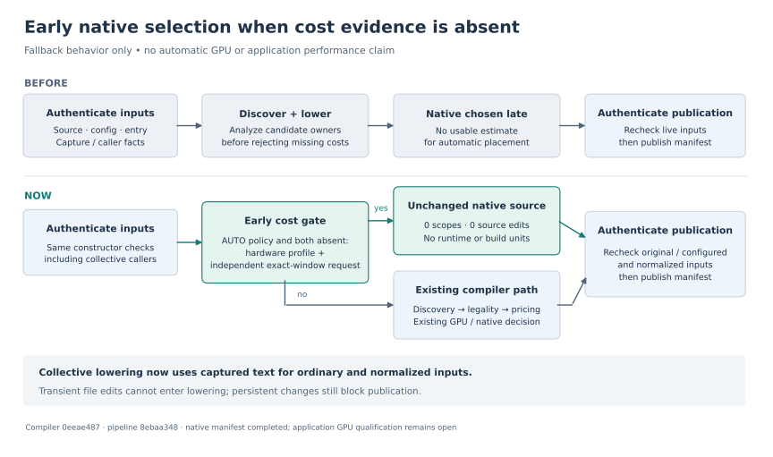

# Automatic native selection before window discovery

**The frozen channel request now completes with an authenticated native manifest. Automatic GPU residency remains unqualified.** This checkpoint closes the missing-cost fallback and collective source-capture gaps recorded in the [previous report](../checked-execution-plan-20261014/README.md).

- **Compiler:** `0eeae487bc68a0a88090a8304e3dceaac1df45a5`.
- **Test-only correction:** `af7584edcec5037b1f3bbc0ab3cc128d3611fd4c`; compiler production code unchanged.
- **Compatible pipeline:** `8ebaa348bbaa8525435a727560d217a4a15a1bc2`.
- **Application generation diagnostic:** completed in **50.606 seconds**; all **178 input files unchanged**.
- **Result:** zero scopes, source edits, runtime objects, or build units. No application was built or run.

Automatic scope formation checks for both a calibration profile and an independent complete-window evidence request before discovering or lowering windows. When both are absent, it publishes unchanged native source with an explicit reason. The constructor still authenticates sources, configured inputs, entry identity, packages and collective participation. Publication rechecks live inputs; diagnostics no longer request an unnecessary transitive effect closure.

Present profiles, explicit complete-window requests and forced diagnostic execution continue through their existing admission paths. Specific missing-cost tests retain valid synthetic profiles so they still exercise immutable-input preparation, native memory ranges, IEEE coordination, collective synchronization and definition checks. This change does not make those costs available or admit new GPU intervals.

Collective numerical lowering now uses the captured ordinary or normalized source text. Regression tests replace the live file during parsing and restore it before publication: that replacement cannot enter lowering. A persistent edit still prevents publication.

The application diagnostic reused the previous request, source/configuration facts and 178 authenticated inputs, with the same four-CPU placement, 300-second cap and 3 GiB memory limit. The earlier `c16d01a` checkpoint reached its cap without a manifest. This checkpoint uses the cumulative corrected compiler and terminates on the explicit missing-cost native decision; these are **generation results, not application runtime samples or an isolated causal speedup measurement**. The common unspecialized request uses source shared by both channel cases; it is not two independently validated configuration paths or application executions.

The input basis remains the pinned ELMM/PoisFFT seed with six audited `INTENT(OUT)` to `INTENT(INOUT)` destination repairs. Numerical statements, case configurations, grids, wall-model behavior and durations are unchanged. `channel` retains fourth-order advection and active filtering. Future controls must use the same repaired seed.

Validation receipts and exact revision bindings are recorded in [report.json](report.json) and `evidence/`. The [independent pipeline build check](evidence/pipeline-native-build/evidence.json) also built and executed its original-source fixture without CUDA; full-field assertions cover both fixture shapes and negative bounds. This fixture is not ELMM application validation. Its receipt records the intermediate working-tree run; all 252 inventoried tracked inputs match the final compiler/pipeline commits.

The complete host suite recorded **5,170 passed and one failed**. That failure was a stale owner-diagnostics fixture: it supplied no cost profile, so the new early native decision correctly skipped owner planning. The test-only correction supplies a valid transfer profile without numerical compute calibration and preserves the deeper assertions. Both affected test files then passed **all 25 tests** against the correction commit; the full host suite was not rerun. The failed baseline and intermediate correction attempt remain in the evidence. The full pipeline suite passed **618 tests and 265 subtests**, with 22 skips; the affected CUDA/native selection passed **19 tests**, with one skip requiring a matching offline calibration profile.

Both primary qualification targets remain open: `channel-simple` below 9 seconds, and `channel` at most 74.4% of fresh native and faster than SGS direct. Useful generic resident discovery, compatible automatic pricing, exact native interruptions, full application fields/halos, observed transfers and the seven-round full-process campaign are still required. The stopped whole-Convection GPU approach is not reopened by this native-only diagnostic.

The artifact inventory binds the report, standalone SVG/PNG/PDF flowmap and compact evidence. Raw test receipts are preserved directly or losslessly reconstructible from the documented compact records. Large temporary builds, compiler archives and repeated manifests are represented by their hashes and reproduction inputs.
