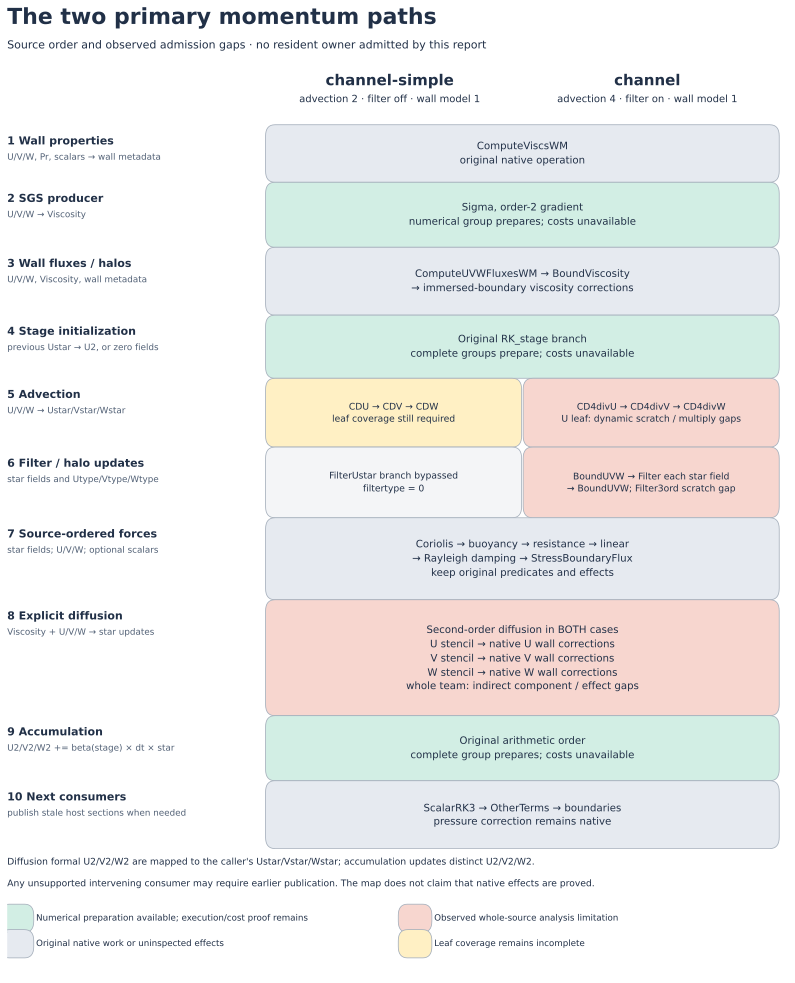
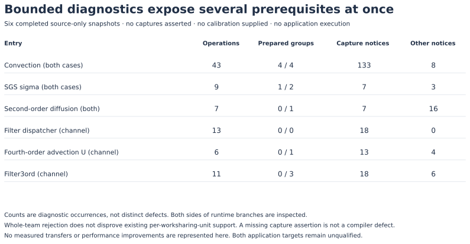

# Automatic residency: bounded source preflight, 2026-10-14

The compiler now reports independently discoverable source, numerical, capture,
completion, and cost prerequisites before attempting an application owner. Six
completed inspections expose several primary-path requirements together.
**This milestone does not establish an executable resident window, lower transfer
traffic, numerical equivalence, or an application speedup. Both targets remain
unqualified.**



The source-derived map preserves the order in ELMM. Colors describe this
diagnostic pass, not CPU/GPU placement. In particular, a prepared numerical group
has neither a checked storage owner nor an available full-window estimate.
Publication may be needed at an earlier unsupported native consumer than the
post-accumulation boundary shown.

## The actual primary configurations

| Setting | `channel-simple` | `channel` |
|---|---|---|
| Configuration origin | `containers/cases/channel-simple` | upstream `examples/channel` |
| Advection method | 2 | 4 |
| General `discretization_order` | 2 | 2 |
| Explicit diffusion branch | second-order, uniform grid | second-order, uniform grid |
| SGS | sigma | sigma |
| Filter | disabled (`filtertype=0`) | enabled (`filtertype=1`) |
| Wall model | 1 | 1 |
| Configured end time | 0.5 | 50 |
| Required wall-time result | median **<9 seconds**, natural 109-step workload | median **≤0.744 × fresh native**, and faster than SGS direct |
| Qualification in this report | not run | not run |

Fourth-order **advection** in `channel` does not select fourth-order diffusion.
`parameters.f90:162` initializes `discretization_order=2`; neither configuration
contains `cmd.conf`, and the pipeline's unchanged runtime argument list contains
only `output_dir='output/'`. `initial.f90:132` lets discretization order 4 force
advection method 4, but the converse is absent. `dynamics.f90:431` chooses diffusion
from `discretization_order`, separately from the advection-method branches.

The upstream `wall_model(type=default)` object is routed through `get_filter` at
`initial.f90:2761`, which enables filtering. The parser subsequently defaults
the wall model to 1 when SGS is active. The maintained simple configuration
explicitly selects `filter(type=none)` and omits the wall-model object, retaining
wall model 1. This report preserves that behavior; it does not repair the input
parser or disable a required operation. Exact configuration files and include
dependencies are hashed in [evidence.json](evidence.json).

## What was inspected



The six snapshots inspect Convection, uniform sigma SGS, second-order diffusion,
the filter dispatcher, the U component of fourth-order advection, and Filter3ord.
They use the same 69 configured original source inputs, `DPREC`, source-order
preservation, automatic policy, and a four-thread policy setting. Each process
has a 120-second wall limit and a 3 GiB address-space limit; at most two run at
once. The compiler's existing 256-operation, 64-procedure, and depth-8 analysis
limits were retained. All six complete snapshots report no traversal truncation.

These are **source-only inspections with an empty capture dictionary, no
calibration profile, and `follow_calls=False`**. Call bodies require separate
inspections; their presence is not a complete effect proof. Both sides of runtime
branches appear in the snapshots, including inactive variants. Repeated
diagnostics count source occurrences, not distinct defects. The 196 capture
notices document deliberately absent assertions and must not be treated as 196
compiler bugs.

The snapshots inspect complete original OpenMP teams. A whole-team decline does
not disprove the compiler's existing per-worksharing-unit or mixed native/GPU
routes. Conversely, numerical preparation alone does not prove that those routes
can admit this complete application interval. Second-order advection leaves,
the V/W fourth-order advection leaves, wall-model routines, viscosity/velocity
boundaries, and the full mapped ownership interval still require coverage.

## Prerequisites discovered together

| Area | Observation at this milestone | Consequence |
|---|---|---|
| Initialization and accumulation | All four numerical Convection groups prepare. Their source cost queries report shared fork/join startup lacking a complete multi-loop cost contract, plus unavailable numerical-environment protocol calibration. | Increasing numerical coverage alone cannot enable automatic placement. A complete owner cost contract is still required. |
| Selected SGS branch | The second-order sigma group prepares; native compute calibration is missing and the numerical-environment protocol is unpriced. | Preserve SGS direct as a separate control. This pass does not measure an improvement over it. |
| Second-order diffusion | Whole-team extraction encounters indexed wall-point components such as `UxmWMpoints(i)%xi`; native effects also report missing viscosity capture authority and an operation-budget exhaustion. | Native wall corrections and their section effects must be admitted in original order. The internal effect proof is incomplete even though the outer diagnostic traversal finishes. |
| Channel fourth-order advection | CD4divU's dynamic private scratch arrays use `tilenx(narr)` extents; the selected team reports an unsupported extent/kind expression. Its trailing generic `multiply` call is unresolved in this route. | Dynamic scratch preparation and call resolution are independent primary-path requirements. V/W sibling eligibility is not inferred. |
| Channel filtering | The dispatcher is inspectable, but each Filter3ord directional team declines its private `tmp(-2:ubound(U,dir))` extent. | Dispatcher coverage does not establish filter offloading. The private snapshot and in-place directional order need independent support. |
| Whole resident interval | No captures, mapped lifetime interval, alias proof, or compatible full-window estimate were supplied or established here. | Transfer totals, device-memory use, placement, and publication points remain unknown. |

The other SGS numerical decline belongs to the inactive
`discretization_order==4` branch. A separate fourth-order diffusion inspection
was interrupted at its 120-second process limit and produced only provisional
events. **Neither is a primary-case blocker.** Fourth-order diffusion remains a
deferred variant; its interrupted events are excluded from the completed-snapshot
counts and cannot be used as an admitted proof.

The report is a checkpoint against serial prerequisite discovery: it does not
authorize a chain of patches for every listed item. The bounded experiment stops
after this preflight and a separately reported pricing experiment. It does not
continue through a chain of private-scratch support, whole-team calibration,
and application build attestation. There is no compiled primary resident
candidate here. Existing numerical foundations remain available; admitting and
pricing the complete primary interval remains distinct unfinished work.

## Ordered resources and native interruptions

| Resource | Required source order / consumers | Ownership question still to prove |
|---|---|---|
| Old `U/V/W` | Wall properties, SGS, wall-flux computation, advection, forces, diffusion | Retain unchanged valid host/device sections across native readers; upload only absent current device sections. |
| `Viscosity` | Wall-property result is intentionally overwritten by SGS; wall fluxes, viscosity boundaries and immersed-boundary corrections follow | Retain supported producer output while admitting every native read/write and required halo update. |
| `Ustar/Vstar/Wstar` | Previous-stage use during initialization precedes overwrite; then advection, filtering, forces and diffusion update the fields; accumulation reads them | Preserve prior-stage values and filtering halos; never infer a safe overwrite from a later use. |
| `U2/V2/W2` | Stage initialization followed by the original `+= beta(RK_stage) * dt * star` accumulation; later native consumers remain in order | Maintain definitions and arithmetic order, then publish stale host sections at the first unsupported consumer. |
| Wall-point metadata and field types | Wall routines supply metadata; filtering reads type arrays; diffusion wall corrections use indexed wall-point fields between component stencils | Complete native effects, descriptor lifetimes and indirect-section handling remain required. |

`SubgridStresses` executes `ComputeViscsWM` **before** SGS, then
`ComputeUVWFluxesWM`, `BoundViscosity`, and immersed-boundary viscosity updates
(`dynamics.f90:879–906`). Within Convection, filtering and both velocity halo
updates precede forces, diffusion, and accumulation (`dynamics.f90:419–498`).
The diffusion team contains U stencil → U wall corrections → V stencil → V wall
corrections → W stencil → W wall corrections (`momentum_diffusion.f90:188–286`
and the three included `wmfluxes-nobranch-*-inc.f90` files).

The diffusion procedure's formal `U2/V2/W2` arguments refer to the caller's
`Ustar/Vstar/Wstar`, not the distinct RK accumulation arrays. The source call
mapping must remain authoritative. `ScalarRK3` still separates Convection from
OtherTerms (`tsteps.f90:125–141`). This milestone changes no numerical order.

## Frozen evidence and reproduction

The compatible baseline pair is parent
`a708841f617ded8d9e78130787faa03a509c69f3` and pipeline
`82c40cc526e1d267f44b10667fe650919d23d207`. ELMM is
`ddb426fca5b020216083f02a218292fea70c1df2`; PoisFFT is
`256a2338254c08f611881b2df5e72bdfa73bc257`. The parent commit supplies the preflight
API and visualization support. Concurrent exact-window cost work is a separate
development slice; its results must be bound to subsequent commit identities.
Pipeline commit `3c799dc` is the later compatible adapter checkpoint, adding
rejection of fixture-only exact-window manifests. Its full identity is recorded
separately in the evidence; it does not replace the provenance of earlier
source inspections.

[evidence.json](evidence.json) preserves original/configured source hashes,
include hashes, all 18 case configuration-file hashes, relevant diagnostic
implementation hashes at curation, preprocessor commands, complete raw snapshot
hashes/identities, and compact ordered operation records. Original raw artifacts
are under `benchmarks/results/automatic-residency-20261014/preflight/`; large
exported source text is intentionally absent from this tracked report.
Implementation hashes record observed bytes in addition to the baseline commit
pair; the report does not claim the entire concurrent working tree was clean.

Completed checks for this milestone include 42 host tests covering preflight,
lexical diagnostics, and numerical closures. The later pipeline checkpoint
passed its complete suite: 549 tests and 265 subtests, with 22 skips. The report
figures were rendered and visually inspected. These checks do not constitute
primary-application execution or numerical qualification; ongoing broader
compiler tests are not counted here.

The figures are deterministic presentations of this frozen evidence. From the
repository root, rerender them with:

```sh
MPLCONFIGDIR=/tmp/residency-report-mpl .venv/bin/python benchmarks/reports/automatic-residency-20261014/render.py
```

SVG files preserve text/vector output; PNG files provide portable previews.
The report contains no measured application times, performance comparison plot,
transfer counts, binary hashes, or numerical-validation result because none was
produced by these source-only inspections. Final qualification still requires
fresh native, SGS-direct, and automatic-resident executions, unchanged outputs
and tolerances, all entry/exit traffic, and the prescribed rotated seven-run
comparison for each complete primary workload.
