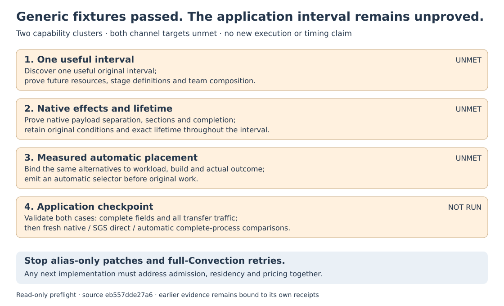

# Channel joint preflight — 15 October 2026

**Two capability clusters produced generic executable fixtures, but no useful automatic application window. Both primary targets remain unmet.** Stop alias-only patch chains and full-Convection retries under the current bounded approach.

This report records **source inspection**, plus explicitly linked earlier evidence. No new proof, generation, build, tests, GPU execution or application run was performed. There is no new performance claim. The current incremental approach is stopped; any next implementation must address admission, residency and pricing together.

## Independent requirements

- **Discovery and definitions:** the smallest credible future hypothesis is the original `SubgridStresses → Convection` interval, ending before `ScalarRK3`. Existing SGS, uniform second-order diffusion and accumulation could remain GPU candidates while original advection, filtering and forces retain their order. Current discovery follows allocation/lifetime candidates; it does not establish this interval's inherited stage definitions, partial intermediates/halos, complete child resource inventory or team composition. This hypothesis is not an admitted application window.
- **Aliases and sections:** runtime registration compares already registered ranges. Canonical identity does not establish storage separation. `StressBoundaryFlux` reads four allocatable `current_profiles` payloads; reserving their parent object does not cover those allocations, and the original owner lacks the required access/import transport. Actual viscosity capture is partially initialized, while current demanded-native hooks require whole definitions. Relaxing alias rejection alone would expose the independent section/halo requirement.
- **Native control and completion:** the new fallback is root-only and rejects guarded single-line CALLs, including the relevant `ComputeTDiff` form. Borrowed owners need complete demand coverage. `ComputeUVWFluxesWM` contains 18 calls to one `fluxes` body with 66 own execution statements: repeated expansion explains budget pressure, but this static count does not reconstruct the historical rejection location. A reusable parameterized effect graph would still need pointer, guided OpenMP, optional-argument, branch and error-stop handling. Listed branches are not asserted to execute in either case.
- **Automatic pricing:** complete-call observations include interruptions and cleanup, but have no runtime workload key or actual resident/fallback outcome. Exact-window calibration supplies authenticated evidence and selectors, but its admission excludes these calls, branches, tiles, module resources and child owners. Current per-operation calibration does not price the required multidimensional stencil/accumulation forms. Sections-only measurement identities cannot simply be relabeled AUTO.
- **Build and runtime matching:** a coherent attachment must cover safely evaluated descriptors, loop/tile/private sizes, relevant branch/control and native metadata work, team state and effective schedule. Equal transfer boxes do not establish equal native work. Executed build receipts are available, but application attestation must cover every relevant original and generated object. The pipeline currently rejects exact-window evidence it cannot enforce.

## Decision boundary

A possible larger redesign would use **one parameterized native-effect graph and one admitted interval with a measured workload/build/outcome attachment**, keeping the checked plan as the shared authority. It would reuse the existing execution/coherence machinery, without a new scheduler or ELMM procedure-name allowlists.

If resumed, require one integrated acceptance gate: useful admitted interval **plus** exact native effects, lifetime and definitions **plus** compatible cost key/build evidence and an emitted preexecution automatic selector **plus** both applications' numerical, complete-transfer and complete-process performance checkpoint. Whole-invocation observations already include guards, planning, transfers, synchronization, native interruptions and cleanup; do not add those costs twice. Evidence mismatches retain original native execution; completed work is never replayed.

The targets remain `channel-simple < 9 s` and `channel ≤ 74.4% of fresh native`, faster than SGS direct, with the previously agreed complete qualification protocol.

[report.json](report.json) binds exact current source references and compatible repository commits, frozen case/input identities and the [earlier native-demand evidence](../native-demand-checkpoint-20261015/README.md). Earlier probe identities are preserved as historical evidence, not relabeled as current proof. [checksums.json](checksums.json) covers this report. Regenerate only the SVG with `python render.py` from this directory.
