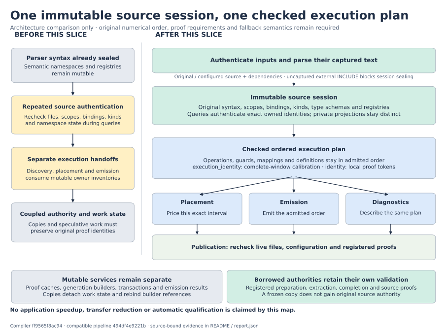
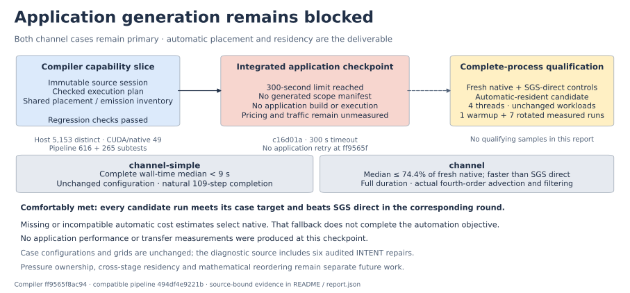

# Checked execution plans: architecture checkpoint and application limit

**The shared source session and checked execution plan are implemented. Automatic application residency is still unqualified.** The one capped Convection-generation checkpoint timed out after **300.004 seconds**, without a scope manifest. No application was built or executed, so this report contains no application speedup or measured transfer saving. Both channel targets remain unmet qualification gates.



The implementation consists of parent commits `c16d01a0e2028c0f610f1291277f37df413344c9` and corrective commit `ff9565f8ac941f9d9fad19e20027840e83f953b5`, paired with pipeline `494df4e9221b61d3c8f28c7f86ab7dd07cd6908f`. **Application generation ran at `c16d01a`, before the corrective commit.** The correction is tested independently; no later application result is implied.

The compiler now shares one authenticated immutable graph of original syntax, scopes, bindings, type schemas and registries. Private projections and mutable generation state remain separate. Discovery, placement, emission and diagnostics consume the same checked operation inventory, preserving original order, guards, canonical resources, definition obligations and completion requirements.

Session parsing and ordinary ScopeBuilder numerical lowering consume captured text. This includes normalized numerical packages: a transient live-file edit, even if restored before publication, cannot enter lowering. Publication rechecks original/prepared sources and supplied dependencies. External Fortran `INCLUDE` readers outside the captured snapshot block session sealing; configured, preexpanded includes retain their source mapping. Preflight diagnostics also perform the final live-file check. A final read-only audit found that the separate legacy `CollectiveScopeBuilder.numerical` override still reads live files; closing that path requires a follow-up correction and is not claimed by this frozen revision.

Only exact objects in the recognized proof registries may be borrowed by the plan. Unknown metadata is frozen as owned data or rejected. Existing proof validation remains necessary; freezing or serializing an object cannot grant original-source authority. An attempted mutation of the sealed graph is a hard numerical-classification error. Transactions preserve rollback and prevent failed candidates from publishing generated artifacts.

The diagnostic plan `identity` includes compilation-local proof tokens. A separate `execution_identity` supports compatible calibration for the existing **complete-original-window** admission class. Independent-process tests with different Python hash seeds cover both serial and original-team fixtures; sorting PRIVATE inventories removes nondeterministic ordering without changing arithmetic or execution order. Reached suffixes and plans with unsupported ownership boundaries gain no calibration admission or portability promise. Their conservative graph fingerprints may differ after speculative work even when emitted artifacts and public operation records are identical.



The [frozen application receipt](evidence/application/outcome.json) binds the committed compiler/pipeline archives, request, **178 unchanged input files**, four-thread policy and fixed 300-second/3 GiB limits. The request used automatic policy, with no calibration profile or runtime configuration specialization. It described the common unspecialized source path for both cases; it was not two application executions. Earlier full-entry attempts used forced policy and pristine declarations, so these timeouts do not establish a comparable planning-speed trend.

The [input bundle](evidence/application/input-bundle.json) records fresh pinned ELMM/PoisFFT sources with six audited destination declarations changed from `INTENT(OUT)` to `INTENT(INOUT)`. Numerical statements are unchanged, but the repaired source has a distinct identity from pristine upstream. Both case configurations, grids, wall-model behavior and durations remain unchanged; `channel` retains fourth-order advection and active filtering. Existing capture assertions were explicitly reissued against the repaired hashes. Any future native, SGS-direct and automatic comparison must use the same repaired seed. The [native rebuild audit](../native-diagnostics-20261014/README.md) is separate evidence, not application validation of this checkpoint.

**Stop the whole-Convection generation approach.** The [blocker map](blocker-map.md) selects diffusion → accumulation only for further investigation, contingent on one joint discovery, native-effect/definition and automatic-pricing preflight. Current discovery never proposes that suffix for these inputs, and current complete-window pricing excludes its structure. Native wall corrections inside diffusion, stage-dependent definitions, runtime alternatives and publication traffic must be checked together before adding kernels. No unchanged retry, larger analysis budget or application-specific schedule follows from this result. A separate read-only interface audit found that the existing pipeline already accepts authenticated zero-scope native manifests. A compiler cost gate could select that result before expensive discovery when both calibration sources are absent. That early exit is not implemented here, and native fallback would still leave the offloading objective unmet.

The map also separates conditional removable transfer edges from net value against SGS direct. A smaller diffusion/accumulation GPU interval introduces transfers that native Convection does not need. Its application benefit is unknown and may be negative. Source-derived byte counts are not a predicted or measured runtime ledger.

| Case | Required complete-process result | Workload |
|---|---|---|
| `channel-simple` | Median **below 9 seconds** | Original configuration, natural **109-step** completion |
| `channel` | Median **at most 74.4% of fresh native**, faster than SGS direct | Original configuration and full duration, including actual fourth-order advection and filtering |

Qualification still requires four threads, identical numerical/runtime settings, one excluded warmup and seven rotated measured runs per mode. Every candidate run must meet its target and beat SGS direct in the corresponding round to count as comfortably met. Full float64 bounds/halos, final and averaged fields, complete transfer accounting and independently measured cost evidence remain required. None is supplied for an automatic application candidate here.

Validation is recorded per source revision in [report.json](report.json) and `evidence/`. The first complete host diagnostic at `c16d01a` recorded **5,110 passed and 36 failed**: 26 interface/timing migrations, nine production regression cases, and one live-affinity mismatch introduced by the runner. The unchanged dependency test file passed 18 tests under fixed affinity. All failures were addressed without relaxing numerical tolerances, removing artifact comparisons or weakening rollback assertions. The corrected full host run passed **5,149 tests with four skips** caused by its eight-CPU affinity. An unchanged whole-file supplement under exactly four CPUs passed **18 tests**, covering all four skips: **5,153 distinct host tests passed** across the two runs, with 14 repeated passes. Both runs kept their affinity fixed and source inventories unchanged; [raw receipts](evidence/host-corrected/evidence.json) bind them to `ff9565f` / `494df4e`.

The corrected full pipeline suite at `ff9565f` also passed **616 tests and 265 subtests**, with 22 skips and unchanged inputs ([receipt](evidence/pipeline-validation/corrected/evidence.json)). The earlier full pipeline run at `c16d01a` passed **616 tests and 265 subtests**, with 22 skips. Its preceding accidental collection of archived work directories is preserved as a collection-only failure, with no tests executed; subsequent runners explicitly select `tests/`. Narrow correction/overlay results retain their own source inventories and do not substitute for the corrected full suites.

The affected CUDA/native regression selection passed **49 tests**, with no skips and unchanged inputs ([receipt](evidence/cuda-native-validation/evidence.json)). This is not the complete CUDA suite or an application campaign.

Work stops at this checkpoint at the user’s request to wrap up. The early missing-cost gate and legacy collective captured-text correction were investigated but not started. Both application targets remain unqualified.

Standalone SVG, PNG and PDF figures present architecture and qualification status. There is no performance chart because no application performance samples were produced. Pressure ownership, cross-stage residency, mathematical reordering and additional campaigns remain deferred. Regenerate the figures with:

```sh
.venv/bin/python benchmarks/reports/checked-execution-plan-20261014/render.py
```

The final artifact inventory binds this report, figures, raw logs and receipts. Large source archives, binaries and field dumps are not copied into the report; recorded identities and reproduction inputs preserve their provenance.
