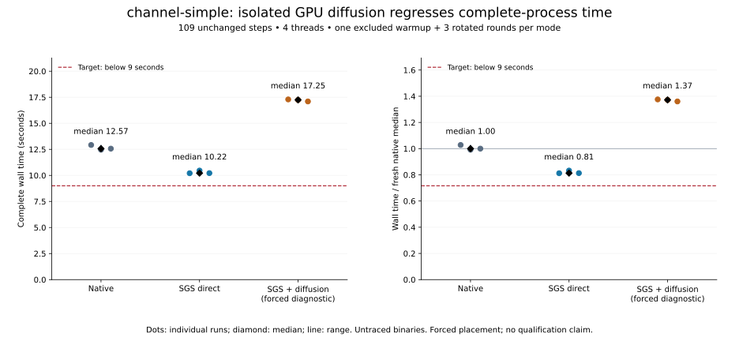
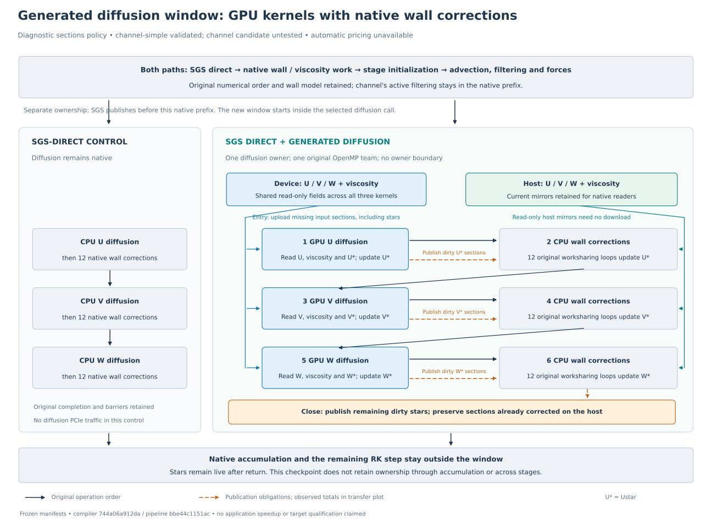
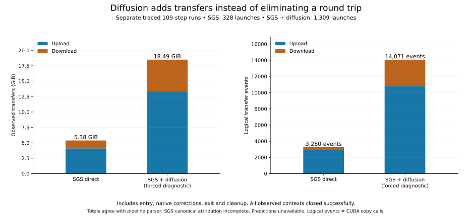

# Diffusion application checkpoint: correct, but slower

**Stop this isolated diffusion placement.** The GPU diffusion owner executes correctly on `channel-simple`, but adds traffic and regresses complete-process time. Automatic application placement and both primary performance targets remain unmet. This bounded diagnostic does not justify another series of admission or pricing patches.

| Unchanged 109-step `channel-simple` | Median | Range | Native-relative median |
|---|---:|---:|---:|
| Native | 12.569 s | 12.467–12.922 s | 1.000 |
| SGS direct | 10.221 s | 10.211–10.465 s | 0.813 |
| SGS + GPU diffusion, forced diagnostic | 17.246 s | 17.100–17.293 s | 1.372 |

One warmup per mode was excluded, followed by three rotated rounds, sequentially, with four threads and CPU affinity `4,5,10,11`. Measurements include startup, output and teardown. Field dumps and tracing were separate. The candidate lost to SGS direct in every round; its median was 68.7% higher. This is a short checkpoint, **not** the required seven-round automatic-resident qualification. Fresh controls use identical numerical settings and runtime environments; historical 9.60-second results are not substituted for these controls.

## Placement and transfers

Both GPU binaries use the same freshly generated SGS implementation. The candidate adds one complete diffusion invocation: three GPU kernels and 36 original native wall-correction loops, inside the original OpenMP team and in numerical order. Read-only velocity and viscosity registrations are shared across kernels, and current host mirrors remain available. Corrections publish required dirty sections; exit publishes the remaining outputs.

**SGS and diffusion remain separate owners.** Advection, filtering, initialization and forces retain their original native positions before diffusion. Accumulation remains native after return. No producer-to-accumulation or cross-stage residency is claimed. Dashed arrows show publication obligations; the transfer plot shows observations.

| Separate traced full run | Upload bytes | Download bytes | Upload / download events | Launches |
|---|---:|---:|---:|---:|
| SGS direct | 4,398,579,712 | 1,375,731,712 | 2,952 / 328 | 328 |
| SGS + diffusion | 14,385,588,736 | 5,468,913,664 | 10,800 / 3,271 | 1,309 |
| Added by diffusion | 9,987,009,024 | 4,093,181,952 | 7,848 / 2,943 | 981 |

Diffusion adds **13.113 GiB** across 327 invocations: 30,541,312 uploaded bytes, 12,517,376 downloaded bytes, 24 upload events, nine download events and three launches per invocation. Native corrections account for 128,581,632 downloaded bytes; remaining diffusion downloads occur at publication/cleanup. No velocity or viscosity downloads appear in the diffusion resource ledger. Each invocation still uploads inputs and stars and publishes results to native accumulation. This placement introduces traffic without removing the proposed larger window's round trip.

All 328 SGS contexts and all 327 additional diffusion contexts closed successfully. Aggregate byte/launch counts agree with the pipeline parser. **SGS canonical resource attribution is incomplete:** its region manifests lack the mapping consumed by this extractor, producing 1,312 attribution issues in each ledger. These failures are preserved. Diffusion resource attribution is available. Counts are logical events, not physical CUDA copy calls; traces have no sequence checksum. No compatible automatic estimate exists, so numerical predicted savings are unavailable.

## Validation and limits

Both `channel-simple` GPU candidates passed **20 float64 field records**, including shapes, bounds and halos, against fresh native output: 15 records contain values and five are valid empty inactive fields. Maximum absolute errors were `3.632e-7` for SGS and `1.620e-8` for combined, within unchanged `atol=1e-6`, `rtol=1e-5` checks. Final and averaged VTK checks passed. All twelve untraced processes completed naturally at 109 steps and passed VTK checks. Dump binaries retain the numerical objects and add only final-lifetime diagnostics; reference VTK comes from the native dump run.

The full native **`channel` completed 2,458 steps** naturally. Neither GPU candidate was run on full `channel` here; its numerical validation and 74.4%-of-native target remain unqualified. The simple-case regression and request to wrap up ended this approach before further long campaigns. No secondary campaigns began. Both configurations retain wall model 1; `channel` retains fourth-order advection and active filtering, while selecting second-order diffusion.

All controls share the previously audited six advection `OUT → INOUT` declaration repairs. Both candidate builds used compiler-issued edits and manifests. All 72 original compilation units matched native compiler identities and normalized flags; source differences were authorized replacements. SGS and diffusion generation took 59.36 and 73.47 seconds, respectively, within separate 300-second caps. No production code changed in this slice; full suites were not rerun. Previous code validation is recorded in the [suffix preflight report](../suffix-pricing-preflight-20261015/README.md).

## Frozen evidence

Tested compatible commits: compiler **`744a06a912da56f116831868c554b5e82f9ae4c1`**, pipeline **`bbe44c1151ac90e0122df91022cceff9d4a48428`**.

| Original application binary | SHA256 |
|---|---|
| Native | `c02226278a595193e31cbc05983b187e4b64c6fbf8ff4649168375bccb03b96c` |
| SGS | `90ead07ea6a395c98e8aadaf2564c48b1bde570530da1e737fc015fe567e2f64` |
| SGS + diffusion | `fc866b9abe2ea0d7b610571511bda4869db59c18bac8fa3accf5c2a8e61b57b6` |

[report.json](report.json) binds manifests, source/configuration inventories, build receipts, driver plans, comparisons, run receipts, compressed traces and ledgers by SHA256. Stage-local receipts preserve their original state: `application_executed: false` in build receipts predates the later run receipts. Binaries, raw field dumps and generated source remain under ignored `benchmarks/results/diffusion-complete-checkpoint-20261015`. Archived scripts retain original paths and are evidence, not a portable new interface.

Regenerate SVG/PNG/PDF figures with `.venv/bin/python benchmarks/reports/diffusion-application-checkpoint-20261015/render.py` and the corresponding `render_metrics.py`. Metrics rendering verifies every archived evidence hash. [artifact-inventory.json](artifact-inventory.json) records report and figure hashes.

The outstanding implementation needs one automatically priced interval sharing producer/diffusion/accumulation ownership, as described in the [joint preflight](../suffix-pricing-preflight-20261015/README.md). This checkpoint closes the smaller diagnostic; the original implementation objective is **not complete**.
