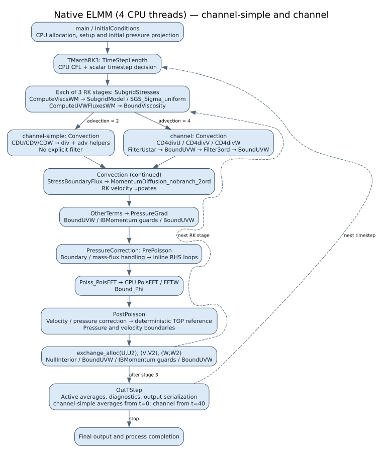
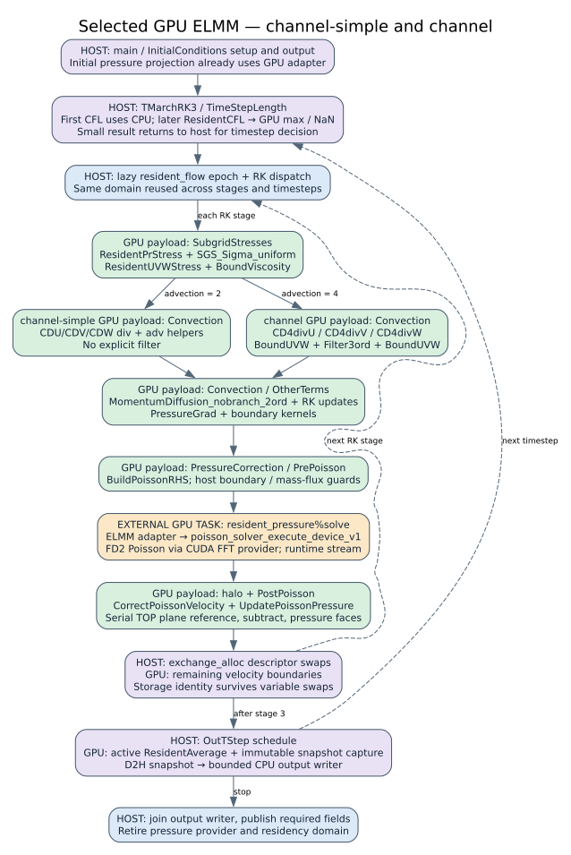
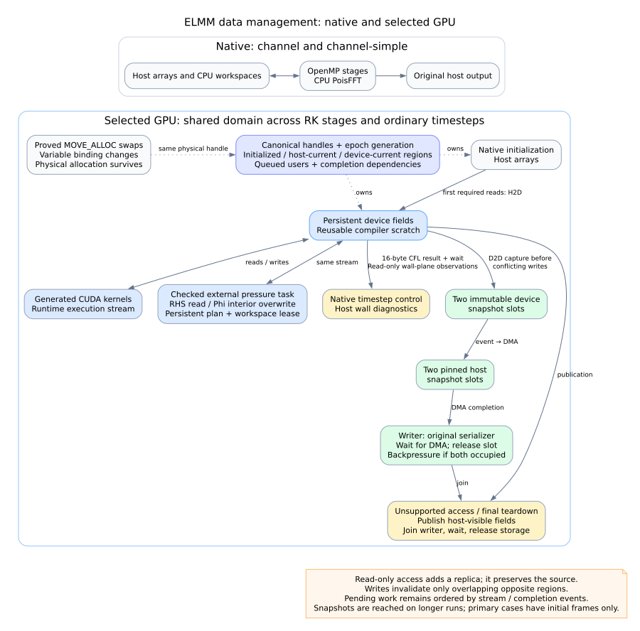

# ELMM hot paths, GPU residency and performance

**Snapshot: 10 November 2026.** The retained resident GPU implementation runs the main field computation and pressure projection on the GPU. Fortran still controls the time loop and RK stages, performs selected diagnostics, and serializes output. The latest seven-round measurements are **3.78× native for channel-simple (109 steps)** and **3.70× native for channel (100 steps)**, using four native threads and complete-process timing.

This report shows the reached hot path, representative original/generated/calling code, data movement, and historical performance. Diagrams deliberately summarize procedures and control regions; they are not exhaustive call graphs or CPU/GPU concurrency timelines. The timing tables separate measurement cohorts and profiler activity from untraced wall time. No new performance campaign was run to produce this report.

Read this file on GitHub, or open the **[standalone HTML report](report.html)** for embedded scalable diagrams, tables and code samples. Editable Mermaid and Graphviz sources are included beside each diagram.

## Reached hot paths and execution placement

These diagrams describe the selected, measured build **A** (`/tmp/fortran-async-output-20261110-01`), preserved in the committed implementation snapshot. They are reduced call/execution maps of the configured hot path, not exhaustive call graphs or time-scaled profiles. A GPU box means the procedure's numerical payload runs on the device; the enclosing Fortran procedure, branches, descriptors and runtime submission still execute on the CPU.





Blue is host execution, green is device numerical work, orange is an explicitly integrated external GPU solver, and purple combines host control with a device operation. The GPU wall, pressure-tail and reduction helpers include explicit adapters as described below; green denotes the execution location, not a claim that every operation is inferred from arbitrary source automatically. Editable versions: [native Mermaid](hot-path/native.mmd), [GPU Mermaid](hot-path/gpu.mmd), [native Graphviz](hot-path/native.dot), [GPU Graphviz](hot-path/gpu.dot).

Both primary configurations use the uniform 128×64×64 grid, lengths 12×4×2, Sigma SGS, periodic horizontal boundaries and no-slip vertical walls. They have no transported scalar fields. Both use second-order explicit momentum diffusion and an **FD2 pressure operator**; `channel`'s fourth-order *advection* does not make its pressure solve FD4. Independent FD4 solver tests qualify a separate supported operator.

| Reached operation | channel-simple | channel | Selected GPU placement |
|---|---|---|---|
| Time advance | Adaptive timestep; three RK stages | Same | Host stage/timestep decisions; resident CFL field and max/NaN reductions after the first step |
| SGS / wall stress | Sigma plus wall model | Same | `SGS_Sigma_uniform`, resident wall helpers and viscosity boundaries |
| Momentum advection | `CDU`, `CDV`, `CDW`, split into div/adv helpers | `CD4divU`, `CD4divV`, `CD4divW` | Generated CUDA in both cases |
| Explicit filter | Disabled | `Filter3ord`, with velocity boundaries | Generated CUDA when reached |
| Diffusion / RK update | `MomentumDiffusion_nobranch_2ord`; RK linear combinations | Same | Generated CUDA |
| Applied pressure gradient | `OtherTerms` → `PressureGrad` | Same | Generated CUDA |
| Pressure projection | PrePoisson → PoisFFT → Bound_Phi → PostPoisson | Same | Generated RHS/correction loops; explicit GPU solver, halo and deterministic pressure-reference helpers |
| Allocation exchange | Three `exchange_alloc` calls per RK stage | Same | Host descriptor operation; residency follows the underlying allocation |
| Time averages | Active from t=0 | Active from t=40; absent from the early two-step trace | Resident generated update when active |
| Output | Same required output contents | Same | Host scheduling, GPU snapshot, DMA, CPU writer; completion is joined |

The reached filter difference is supported by actual generated-backend events, not inferred only from configuration comments. The pinned ELMM wall-model parser also affects the effective filter setting; the simple configuration intentionally leaves the wall-model option at its default. Source and configuration provenance are retained in [provenance.json](hot-path/provenance.json), with the actual configuration files under `samples/`.

The selected build's instrumented **two-step-plus-initialization** runs record 31 generated GPU procedure families for simple and 28 for channel, with no generated CPU-entry events. This does **not** mean there is no CPU work: the ledger excludes enclosing Fortran control, runtime submission, output, external FFT kernels and explicit CUDA helpers. It is also not a per-step kernel-launch count. The focused [backend ledger](hot-path/generated-backend-evidence.json) records the exact source evidence. Representative event counts are six `SGS_Sigma_uniform` entries in each run, six of each simple div/adv helper, six of each channel CD4 helper, 108 channel `Filter3ord` entries, seven RHS builds and seven pressure updates. Initialization accounts for the extra pressure invocation.

The source still contains broader CPU paths and unsupported configurations. Primary-case guards disable scalar transport, sponge and immersed-boundary payloads; their call sites can remain on the CPU without moving full fields. A steady resident run also retains host synchronization for scalar control and output. This is an explicit ELMM pipeline integration built on generic generated entries and coherence, not a demonstration that arbitrary application control graphs are fully scheduled on the GPU.

## Representative transcription and calls

The excerpts below are actual bytes from the selected build. Full original paths, original line ranges, original-file SHA-256 and excerpt SHA-256 appear in [provenance.json](hot-path/provenance.json). Archived excerpts remain readable after `/tmp` is removed. These are representative examples, not manually simplified pseudocode.

### 1. Native pressure-gradient loop → generated CUDA → queued runtime task

Native prepared `dynamics.f90`, original lines 87–93:

```fortran
      do k = 1, Unz
        do j = 1, Uny
          do i = 1, Unx
            U(i,j,k) = U(i,j,k) + A * pr_gradient_x
          end do
        end do
      end do
```

The pipeline extracts this region into [a standalone Fortran compiler input](hot-path/samples/pressure-gradient-extracted.f90). The generated CUDA kernel retains Fortran column-major addressing and explicit original lower bounds. Its grid-stride loop maps adjacent flattened points to adjacent `i` coordinates. The actual arithmetic statement (generated `shared_entry.cu`, original line 61) is:

```cuda
        fort_v0_u[F_IDX(((fort_v9_i - fort_v1_fort_region_lb_u_1) + 1), ((fort_v10_j - fort_v2_fort_region_lb_u_2) + 1), ((fort_v11_k - fort_v3_fort_region_lb_u_3) + 1), fort_v0_u_dim1, fort_v0_u_dim2, fort_v0_u_dim3)] = (fort_v0_u[F_IDX(((fort_v9_i - fort_v1_fort_region_lb_u_1) + 1), ((fort_v10_j - fort_v2_fort_region_lb_u_2) + 1), ((fort_v11_k - fort_v3_fort_region_lb_u_3) + 1), fort_v0_u_dim1, fort_v0_u_dim2, fort_v0_u_dim3)] + (fort_v4_a * fort_v5_pr_gradient_x));
```

The complete [generated kernel](hot-path/samples/pressure-gradient-kernel.cu) includes the coordinate decoding and loop bounds. Numerical compilation requires `--fmad=false --ftz=false --prec-div=true --prec-sqrt=true` and host `-ffp-contract=off`; this expression is not permission to introduce contraction.

The [integrated caller](hot-path/samples/pressure-gradient-caller.f90) binds `u` to the live domain and passes a canonical handle through a generated `bind(C)` interface. The relevant actual call is:

```fortran
        rk_handle_u=resident_flow%bind_real64(u,lbound(u),.true.)
        call pressure_require(rk_device_run( &
          resident_flow%context, &
          FORT_SCOPE_GPU, &
          rk_handle_u, &
          lbound(u,1), &
          lbound(u,2), &
          lbound(u,3), &
          a, &
          pr_gradient_x, &
          unx, &
          uny, &
          unz))
```

The [generated C interface](hot-path/samples/pressure-gradient-interface.f90) binds this to `cpp_fort_shared_80aa32c5945f`; it accepts a handle rather than asking Fortran to copy an array to the GPU. The [generated enqueue excerpt](hot-path/samples/pressure-gradient-enqueue.cpp) attaches exact read/write effects, kernel arguments and a 256-thread launch shape. Its final reservation and submission are:

```cpp
                        FORT_SHARED_CHECK(fort_scope_device_reserve_many_v1(fort_context, fort_graph_handles, fort_graph_reserve_count, fort_graph_pointers));
                        if (fort_graph_0_active) fort_v0_u_device = static_cast<double *>(fort_graph_pointers[fort_graph_slot_0]);
                        if (fort_graph_0_active) fort_graph_0_values.value_0 = fort_v0_u_device;
                        if (!fort_graph_count) return FORT_SCOPE_OK;
                        return fort_scope_graph_enqueue_v1(fort_context, 1757138722106318298ULL, fort_graph_tasks, fort_graph_0_argument_sizes);
```

`fort_scope_device_reserve_many_v1` supplies storage addresses. The effect-aware `fort_scope_graph_enqueue_v1` establishes access/dependency handling; reservation alone does not assert that an input is current. Queued tasks can outlive this call. The generated file also contains a direct launch fallback on `fort_gpu_call.stream`; the queued path is shown here because it illustrates how work-unit calls become tasks in the shared domain.

### 2. CFL: generated element work plus a resident reduction

The ELMM adapter supplies a small Fortran helper that computes each cell's CFL contribution, then uses the generic compiler to translate it. This is an application-supplied decomposition, not automatic transcription of the entire original `TimeStepLength` procedure. Actual helper body:

```fortran
do k=1,nz
 do j=1,ny
  do i=1,nx
   p = max(abs(u(i+3,j+3,k+3)),abs(u(i+2,j+3,k+3))) / dx
   p = p + max(abs(v(i+3,j+3,k+3)),abs(v(i+3,j+2,k+3))) / dy
   p = p + max(abs(w(i+3,j+3,k+3)),abs(w(i+3,j+3,k+2))) / dz
   cfl(i,j,k)=p
  enddo
 enddo
enddo
```

See [complete helper](hot-path/samples/cfl-source.f90) and [generated CUDA](hot-path/samples/cfl-kernel.cu). The [actual caller](hot-path/samples/cfl-caller.f90) binds U/V/W as existing initialized inputs, binds persistent `cfl_values` as an initially uninitialized output, invokes the generated entry, then performs:

```fortran
    call pressure_require(fort_scope_max_real64_v1(resident_flow%context,handle,3_c_int32_t, &
      size(cfl_values,kind=c_size_t),0._c_double,maximum,any_nan,report))
    nan=any_nan/=0
```

The device field remains resident. Only `maximum` and `any_nan` need to reach the CPU for the timestep decision. The first timestep uses the native path before the flow domain is opened.

### 3. Poisson: an explicit device-library task with region contracts

This operation is not a generated FFT loop. The integrated Fortran [pressure dispatch](hot-path/samples/poisson-caller.f90) calls `resident_pressure%solve()` when the qualified resident path is active, followed by `resident_pressure%halo()`; the native fallback remains `Poiss_PoisFFT` / `Bound_Phi`.

The actual C++ adapter declares only the Phi interior as overwritten, and only the RHS interior as read. It enters the same runtime access transaction used to maintain coherent data:

```cpp
        std::array<size_t,3> pl{2,2,2},pu{},rl{1,1,1},ru{};
        for(int i=0;i<3;++i) { pu[i]=size_t(h->config.solver.sizes[i])+2;ru[i]=size_t(h->config.solver.sizes[i])+1; }
        fort_scope_section interior{pl.data(),pu.data()},input{rl.data(),ru.data()};
        fort_scope_access write{0,0,nullptr,1,&interior,1,&interior},read{0,1,&input,0,nullptr,0,nullptr};
        fort_scope_external_binding_v1 bindings[2]={{phi,FORT_SCOPE_REAL64,3,8,write},{rhs,FORT_SCOPE_REAL64,3,8,read}};
        fort_scope_external_call_v1 call{1,0,bindings,2,h->lease,h->workspace};
        return fort_scope_external_execute_v1(context,&call,solve_worker,h,report);
```

The [callback](hot-path/samples/poisson-callback.cpp) checks rank, REAL64 element size, dense Fortran strides, original bounds, total allocation size and the verified two/one Phi/RHS ghost widths. It forwards the transaction's stream and typed device addresses to the checked solver ABI:

```cpp
        view_check(views[0],h,true);view_check(views[1],h,false);
        const int32_t phi_ghosts[3]={2,2,2},rhs_ghosts[3]={1,1,1};
        const int status=poisson_solver_execute_device_v1(h.solver,views[0].device,views[0].bytes,
            views[1].device,views[1].bytes,phi_ghosts,rhs_ghosts,stream,started);
        return provider_status(status);
```

RHS remains read-only, Phi halos are not solver outputs, and the separately declared halo task fills the required faces. Solver plans/workspaces are persistent and charged to the domain. `started` distinguishes rejection before submission from failure after work may have executed; the latter cannot replay source work safely. Complete [transaction](hot-path/samples/poisson-transaction.cpp) and [callback](hot-path/samples/poisson-callback.cpp) excerpts preserve the error-handling context.

The GPU pressure tail also preserves the approved TOP-reference summation order with a single-thread plane reduction, followed by parallel subtraction and pressure-face work. This illustrates the current design's deliberate mixture: generic compiler-generated arithmetic, generic coherent task interfaces, and small explicit ELMM/solver adapters where source-level lowering alone is insufficient.


## Data management and communication

The native configurations keep their arrays in host memory: four OpenMP threads operate on those arrays, CPU PoisFFT uses host workspaces, and the original output routines read host arrays. The selected GPU implementation keeps a shared residency domain alive across RK stages and ordinary timesteps. Native Fortran still controls calls, predicates and timestep selection; returning from a GPU procedure does not publish all its fields to the CPU. Both configurations use resident wall-model work; `channel` additionally exercises frequent host wall diagnostics.



The editable diagram is supplied as [Mermaid](data-management/memory.mmd) and [Graphviz](data-management/memory.dot). Solid arrows represent data or completion flow; dotted arrows represent ownership or identity rules. The selected executable is the retained async-output implementation, not the rejected coordinate-decoder experiment.

### Allocation identity and replica validity

`resident_flow` owns the domain. Its Fortran registry maps physical host allocation addresses to canonical runtime handles and an owner epoch generation. It caches handles, **not coherence state**. The C++ runtime alone tracks layout, initialized regions, current host/device regions, pending uploads, queued users and completion dependencies. Initialized means a value exists; current means a replica represents the latest value; pending work still requires stream/event ordering before another consumer may use it.

| Operation | Actual runtime behavior |
|---|---|
| First GPU read | Upload only the required region missing on the device. Preserve the current host replica. |
| Read-only host observation | Drain conflicting queued work, download missing host regions and wait for the relevant completion. Preserve device validity. A later GPU read does not re-upload unchanged data. |
| GPU or host write | Commit the written region on that side and invalidate overlapping regions in the other replica. Nonoverlapping values remain usable. |
| Proved complete overwrite | Allocate storage without uploading the value that will be replaced. Ordinary reads still require initialized data. |
| Reused compiler temporary | Borrow a persistent slot by site and shape. Discard old values once their queued users are submitted; order reuse on the same stream. No download of dead scratch is required. |
| Allocation exchange | The checked ELMM `exchange_alloc_3D` uses `MOVE_ALLOC`; physical storage survives. The next binding finds the same address/handle under the new variable name. No array payload moves. |
| Unsupported native path / final publication | Publish the host-visible values and end the epoch before unmanaged access. Finalization joins output, waits for users and releases solver/domain storage. |

The generic runtime also provides an explicit descriptor identity-swap API, but the selected ELMM adapter follows physical allocation addresses; it does not call that API for each `MOVE_ALLOC`. This depends on the adapter's checked lifetime assumptions. It is not arbitrary Fortran pointer/allocatable alias inference. Unknown reassociation or unsupported source paths require an epoch boundary. Region fragmentation may conservatively discard a redundant mirror on a write; read-only access must preserve it. Eviction must preserve needed dirty values and cannot free storage still referenced by queued work.

### Solver, control and output

The local `poisson-solver` runs through a checked external-device task, sharing the runtime stream. The transaction validates dense physical layouts, obtains device views of Phi and RHS, and holds a solver-workspace lease. It declares RHS interior read-only and Phi interior overwritten, preserving RHS and untouched halos. Packing, VkFFT execution, unpacking, halo updates and pressure-tail kernels stay on the device. Ghost widths of two for Phi and one for RHS are guarded layout assumptions. The persistent solver is keyed by sizes, lengths, boundary conditions and FD approximation. Successful submission commits the declared writes with their completion ordering; failure after submission poisons execution and cannot replay the source work.

Not every result remains on the GPU. After native first-step setup, `ResidentCFL` performs its field calculation and reduction on the GPU, copies a **16-byte maximum/NaN record** to the host and synchronizes that stream so native timestep control can consume it. `GroundUstar` and `GroundUstarUVW` call `ResidentWallsPublish(.true.)`: channel wall-plane values are observed for original host diagnostics. Those reads preserve the GPU replicas. Primary-case traces therefore do **not** support a claim of scalar-only traffic or zero transfers on ordinary timesteps.

When a postinitial VTK frame is reached, five fields are copied device-to-device into one immutable snapshot slot on the execution stream. An event lets a separate DMA stream download the snapshot into pinned host storage; the writer waits for DMA, calls the original serializer and then frees the slot. There are exactly two slots, backpressure when both are occupied, and a writer join before completion. This keeps snapshot capture ahead of conflicting field writes without making full live fields host-current. Initialization frames remain native; neither short primary timing case reaches a postinitial async frame. The retained channel200 diagnostic reaches two paired frames sharing one snapshot: **25,449,248 bytes per snapshot**, **50,898,496 bytes in the two device slots** and the same amount in the two pinned slots. Its one D2H snapshot took 2.009 ms; measured overlap with kernels was only 0.118 ms. This establishes operation, not an end-to-end speedup claim.

The selected RK domain requests a 2 GiB device budget. Runtime allocations, reusable scratch and external solver/output workspace leases participate in accounting; pinned output storage has a separate 256 MiB cap. These are not a complete cap on process memory: opaque driver allocations and all graph/host bookkeeping have not been comprehensively charged.

### Measured remaining communication

The following totals come from retained **whole-process diagnostic profiles** of the selected executable. They include initialization and final publication, are not steady-state per-step totals, and must not be added to overlapping CPU API times to reconstruct wall time. MB below means decimal megabytes; exact bytes are retained in [provenance.json](data-management/provenance.json).

| Case | H2D calls / MB | H2D device time | D2H calls / MB | D2H device time | All-copy interval union |
|---|---:|---:|---:|---:|---:|
| `channel-simple`, 109 steps | 135 / 60.323 | 7.169 ms | 157 / 115.528 | 17.378 ms | 24.547 ms |
| `channel`, 100 steps | 204 / 48.174 | 6.133 ms | 441 / 115.115 | 19.848 ms | 25.981 ms |

The profiles contain 108 and 99 D2H transfers of 16 bytes respectively, matching postinitial CFL control. They also contain 20 and 317 D2H transfers of 65,536 bytes. Source inspection identifies retained host wall-plane observations; the byte-size histogram alone cannot attribute every individual plane copy. Large field transfers remain at application boundaries. A complete per-transfer semantic ledger is not present, so this report does not assert that every remaining byte is necessary or assigned to a precise source operation.

Implementation references: [domain owner](../../../compiler/runtime/resident_domain.f90), [coherence and external-task runtime](../../../compiler/runtime/scoped_runtime.cu), [scalar reduction](../../../compiler/runtime/reductions.cu), [snapshot queue](../../../compiler/runtime/snapshots.cu), [time-loop adapter](../../../elmm-pipeline/elmm_pipeline/resident_time_loop.py), [wall observations](../../../elmm-pipeline/elmm_pipeline/resident_walls.py), [solver access contract](../../../elmm-pipeline/elmm_pipeline/gpu_pressure_sources/gpu_pressure.cpp). Evidence: [selected profiles](../gpu-kernel-screening-20261110/summary.json), [snapshot diagnostic](../gpu-async-output-20261110/README.md).


## Performance history and measured cost breakdown

The selected GPU implementation runs `channel-simple`'s natural 109 steps in **3.030 s (3.78× native)** and shortened `channel`'s 100 steps in **3.492 s (3.70× native)**. These are complete-process medians, including initialization and output, from the latest retained seven-round comparison. Both cases beat their native control in all seven paired rounds. This is a substantial gain; the 20× research target remains unmet.

The code snapshot is **`620e630e21735b8e90b496ed68621c444e26b9aa`**. Its wrap-up regenerated 130 entries and reproduced all four selected ELMM binary identities. The final packaging adjustment accepts the committed Poisson provider without changing its source hashes. **No new timing campaign was run for the commit**: the numbers belong to the previously measured, retained binary, whose SHA-256 is `2d5df06329cb8447990b0d4b39327ddf803f9d3113036ca2db7d1998cb69300e`. The rejected coordinate-decoder experiment is excluded from the selected result. [Selected measurements](../gpu-kernel-screening-20261110/README.md), [regeneration evidence](../gpu-current-state-wrap-20261110/README.md).

### Comparable native and major-commit controls

The most recent **common four-control cohort** predates the solver-cache and final kernel/host improvements. It directly compares fresh native, `be58ab8`, `7a612e4`, and the resident implementation. Each cell is median seconds followed by speedup over that cohort's four-thread native control.

| Implementation in the November 10 four-control cohort | simple109 | channel100 |
|---|---:|---:|
| Four-thread native, CPU PoisFFT | 11.673 (1.00×) | 13.190 (1.00×) |
| `be58ab8`: historical SGS offload | 9.397 (1.24×) | 11.289 (1.17×) |
| `7a612e4`: graph redesign, refreshed calibration | 16.685 (0.70×) | 11.310 (1.17×) |
| November 10 resident GPU path and GPU Poisson | 4.032 (2.89×) | 4.673 (2.82×) |

The resident implementation wins all seven pairs against all three controls in both cases. The fresh `7a612e4` build chooses additional Convection offloading for simple109 under its refreshed cost profile; the October observation that it offloaded only SGS does not describe this fresh build. Its regression is retained. [Four-control protocol and results](../gpu-resident-four-controls-20261110/README.md).

The latest selected state has its own native control; it was **not** rerun against fresh `be58ab8` and `7a612e4` in that final cohort.

| Latest retained cohort | simple109 | channel100 |
|---|---:|---:|
| Native median | 11.460 s | 12.938 s |
| Selected GPU median | **3.030 s** | **3.492 s** |
| GPU min–max, all seven samples | 2.960–3.077 s | 3.473–3.588 s |
| GPU inclusive Q1–Q3 | 3.004–3.049 s | 3.478–3.544 s |
| Native/GPU median speedup | **3.78×** | **3.70×** |
| Native/GPU paired speedup range | 3.73–3.93× | 3.63–3.78× |
| Paired wins over native | 7/7 | 7/7 |
| Complete-process budget for 20× | 0.573 s | 0.647 s |

All these cohorts use one excluded warmup and seven rotated complete-process measurements per variant and case. November results use four native threads and CPU affinity `0,2,4,6` on the Ryzen 5 5600G / RTX 3060 Ti setup. GPU solver-cache measurements use a warm persistent **compiled-binary disk cache** after the excluded warmup; each timed process still creates its CUDA context and solver plans. Cold-cache first-process time is not represented by those warm-cache medians. The cache milestone's excluded cold warmups were 4.174/4.903 s. [Cache protocol](../gpu-local-solver-cache-20261110/README.md).

### Progression, including regressions

Each speedup below uses the **native measurement from that row's own cohort**. Absolute times across rows are historical observations, not paired comparisons. The October cohort used different CPU affinity (`0..11`) and an earlier CUDA runtime. Dated working-tree milestones were accumulated into the latest snapshot; they were not individual source commits.

| Commit or measured milestone | simple109: seconds (native speedup) | channel100: seconds (native speedup) | Interpretation |
|---|---:|---:|---|
| October 22 `be58ab8` control | 9.651 (1.21×) | 11.454 (1.16×) | Original historical comparison |
| October 22 `7a612e4` | 9.499 (1.23×) | 11.354 (1.17×) | SGS-only profiles; modest parity improvement |
| November 8 `2619b7f` | 11.271 (1.04×) | 16.321 (0.81×) | Empty-native-call retention did not deliver both-case improvement |
| November 8 `03c695d` | 11.186 (1.04×) | 16.236 (0.80×) | Compact-copy calibration; regression remained |
| November 10 resident path | 4.032 (2.89×) | 4.673 (2.82×) | Broad GPU coverage and GPU pressure solve |
| November 10 solver binary cache | 3.190 (3.60×) | 3.778 (3.45×) | 21.36% / 19.62% below same-cohort uncached GPU |
| November 10 exact division and grouping | 3.096 (3.71×) | 3.641 (3.60×) | 2.91% / 4.33% below same-cohort previous GPU |
| November 10 host preparation | 3.034 (3.83×) | 3.524 (3.73×) | 1.51% / 2.66%; wins 5/7 and 6/7, not a robust paired win |
| November 10 asynchronous output | 3.004 (3.83×) | 3.529 (3.73×) | 0.55% / 0.15%; wins 3/7 and 4/7, not a robust gain |
| Latest retained binary, snapshot `620e630` | **3.030 (3.78×)** | **3.492 (3.70×)** | Later remeasurement of selected implementation |

`4d944f1` fixed calibration-cache ownership between the failed compact-copy work and the later resident implementation; there is no separately qualified full timing row for that commit. The primary 109/100-step cases produce **no post-initial asynchronous frames**, so the asynchronous-output implementation cannot explain their small observed incremental difference. The first host-preparation campaign was invalidated by external CPU activity; only its complete valid replacement cohort is included.

Sources: [October baseline](../graph-redesign-parity-20261022/README.md), [2619b7f](../gpu-residency-speedup-20261108/README.md), [03c695d](../gpu-residency-copy-v3-speedup-20261108/README.md), [exact division](../gpu-exact-division-20261110/README.md), [host preparation](../gpu-host-preparation-20261110/README.md), [asynchronous output](../gpu-async-output-20261110/README.md). Every measured sample, native baseline and paired ratio is retained in [data.json](performance/data.json); the flat [timing CSV](performance/timing-samples.csv) contains 420 measurements across nine cohorts, including unselected controls/experiments with explicit mode names.

### Physical transfers and GPU computation

These are **separate traced full-run diagnostics**, not the untraced wall-time samples above. MB means decimal megabytes. Counts and bytes include initialization, scalar results, publication and final output; they are not per-step values. CUDA memory kinds 1/2 are H2D/D2H.

| Traced implementation / case | H2D MB (copies) | D2H MB (copies) | GPU copy interval union | GPU kernel interval union | Kernel launches |
|---|---:|---:|---:|---:|---:|
| `be58ab8`, simple109 | 4,398.580 (2,952) | 1,375.732 (328) | 0.642 s | 0.631 s | 328 |
| Selected GPU, simple109 | 60.323 (135) | 115.528 (157) | 0.025 s | 1.989 s | 58,353 |
| `be58ab8`, channel100 | 4,036.502 (2,709) | 1,262.486 (301) | 0.614 s | 0.579 s | 301 |
| Selected GPU, channel100 | 48.174 (204) | 115.115 (441) | 0.026 s | 2.527 s | 70,238 |

The increase in GPU kernel activity accompanies moving substantially more numerical work off the CPU. The large reduction in transfer bytes does not imply that transfer time previously dominated the whole application. For example, `be58`'s host copy-API spans are 0.888/0.849 s, and its device copy intervals are 0.642/0.614 s; those spans overlap and **must not be added**. [Historical profile](../gpu-residency-recovered-gap-20261109/README.md), [durable historical extract](performance/be58-profile-extract.json), [selected profile](../gpu-kernel-screening-20261110/summary.json).

The selected GPU has 0.641/0.889 s without recorded GPU kernel/copy activity **inside its first-to-last-kernel window** (2.639/3.426 s). This excludes startup before the first kernel and final activity after the last kernel. It identifies remaining gaps, not a directly recoverable speedup or an exclusive host-runtime charge.

The following decomposition sums kernel activity by procedure family from those same selected traces. It measures device work, not end-to-end contribution. Individual kernel durations can overlap; the total activity sum (1.991/2.528 s) is slightly larger than the kernel interval union above.

| GPU procedure family | simple109 activity | channel100 activity |
|---|---:|---:|
| SGS | 0.485 s | 0.446 s |
| Convection and advection | 0.246 s | 0.583 s |
| Diffusion | 0.166 s | 0.152 s |
| Channel filter | 0.000 s | 0.326 s |
| Wall model stresses and corrections | 0.348 s | 0.318 s |
| Velocity / viscosity boundaries | 0.096 s | 0.121 s |
| Poisson FFT kernels | 0.260 s | 0.239 s |
| Poisson packing, denominator, normalization | 0.059 s | 0.054 s |
| Pressure RHS, halos, velocity / pressure correction and pressure gradient | 0.137 s | 0.126 s |
| Pressure reference | 0.088 s | 0.081 s |
| RK array updates | 0.077 s | 0.070 s |
| Time control and reductions | 0.029 s | 0.012 s |
| **Summed kernel activity** | **1.991 s** | **2.528 s** |

Exact procedure names, launch counts, unrounded times and the grouping map are in [gpu-stage-times.csv](performance/gpu-stage-times.csv) and [gpu-stage-groups.json](performance/gpu-stage-groups.json). For example, `BoundUVW` alone launches 29,448/37,818 kernels, while SGS launches 327/300; launch count and kernel duration expose different optimization opportunities.

### Initialization, host phases and output

The dedicated phase experiment adds a complementary view. Values below are **single untraced diagnostic observations**, not seven-run medians. Instrumented host phases are disjoint, but a host call may enqueue device work whose completion is charged to a later phase.

| Main-thread phase | simple native | simple GPU | channel native | channel GPU |
|---|---:|---:|---:|---:|
| Initial conditions, including initial pressure setup | 0.070 s | 0.639 s | 0.063 s | 0.517 s |
| RK calls | 10.971 s | 2.289 s | 12.748 s | 1.726 s |
| `OutTStep` calls | 0.227 s | 0.004 s | 0.030 s | 1.150 s |
| Resident finalization | 0.000 s | 0.032 s | 0.000 s | 0.021 s |
| Final output | 0.066 s | 0.070 s | 0.057 s | 0.052 s |
| Other recorded setup/control/teardown phases | 0.068 s | 0.122 s | 0.066 s | 0.089 s |

The channel GPU's 1.150 s `OutTStep` value is **not serialization time**: it includes waits for queued work. In the separate traced diagnostic, 0.917 s of a 1.187 s output-call span overlaps GPU activity. Narrowed untraced instrumentation puts GPU adapter creation at approximately 0.323/0.298 s, including solver creation at 0.251/0.227 s; these nested intervals must not be added. Profiling itself increases CUDA initialization cost. [Phase analysis](../gpu-phase-attribution-20261110/README.md), [unrounded phase CSV](performance/host-phase-times.csv).

There is no comparable exclusive CPU-per-procedure / initialization / output breakdown for **every historical commit**. An additive table claiming one would mix sampling, nested host spans, overlapping CUDA activity and different cohorts. The retained measurements establish the change from SGS-only offload to a broadly resident GPU path, its traffic reduction, and current launch/computation costs without that inference.

### Evidence and limits

The latest selected binary retains strict primary-case checks and the approved natural channel2458 criterion: independent per-field/output relative L2 limit of 1%, with exact layouts and inventories. Its worst retained natural-run L2 error is 0.155%; the stricter natural-run pointwise criterion still fails. These qualifications and focused milestone suites do not imply full release qualification. No new benchmark or application test was performed to assemble this report.

[sources.json](performance/sources.json) records SHA-256 hashes for each source summary and the archived `be58` extract. [build_tables.py](performance/build_tables.py) reproduces the tables' underlying data, checks each seven-sample median and verifies GPU-stage sums. The 20× goal would require a further **5.29×/5.40×** reduction from the selected complete-process medians. Startup, remaining numerical work and launch gaps all remain relevant; transfer elimination alone does not establish that result.


## Committed snapshot and qualification

| Repository | Implementation commit | Scope |
|---|---|---|
| Compiler/runtime | `620e630e21735b8e90b496ed68621c444e26b9aa` | Shared graph backend, resident memory, reductions, snapshots and current issue fixes |
| ELMM pipeline | `aa40dd281a409e96ae31f6f8905bc7d507f3992b` | Resident RK/pressure/wall/output adapters; explicit local provider |
| Poisson solver | `0b0ec4facc41697d2ad9fe34cb86959e799c5858` | Stream-aware device ABI, persistent kernel cache and FD2/FD4 qualification |

These are independent local Git repositories; commits have **not been pushed**. The overview itself is committed afterward. [Snapshot identities and binary hashes](snapshot/revisions.json) also pin the companion parents. [Pipeline](snapshot/pipeline.patch) and [solver](snapshot/solver.patch) binary-safe patches preserve their changes in this repository; apply them only to the recorded parent revisions. Generated build/install products are excluded from source control.

The last implementation wrap passed **316 CPU/CUDA checks and 126 focused checks**. All 130 ELMM numerical entries regenerated with zero changed CUDA sources; all four executable identities match the selected asynchronous-output build. Existing strict primary and approved natural channel2458 evidence belongs to those exact binaries. The broader audit and its repaired failures are described in the [wrap report](../gpu-current-state-wrap-20261110/README.md); this does not claim a fresh full-suite qualification of the final source snapshot.

One small preparation fix was necessary for committing: the pipeline now accepts local solver commits **descended from** the pinned upstream base, rather than requiring `HEAD` to equal that base. Source snapshot hashes and rejection of unrelated history remain enforced. **34 provider tests pass**, including actual descendant/unrelated Git histories, and a snapshot of the committed solver verifies all 49 selected source files. This changes preparation, not numerical kernels or the measured executable. A trailing blank line and the editor's workspace-relative solver path were also tidied.

Correctness uses the approved deterministic pressure reference and four native threads. Primary/operator checks retain `atol=1e-6`, `rtol=1e-5`. Natural channel2458 uses the approved independent 1% relative L2 limit per field/output component, with exact layout, coordinate, frame-inventory and time checks. The retained long run's worst L2 discrepancy is 0.154896%; its worst local pressure discrepancy is 1.467061% of peak, so the long run is **not** a strict pointwise pass. See [operator qualification](../gpu-operator-parity-20261110/README.md) and [solver residuals](../gpu-solver-residual-20261110/README.md).

The 20× research target is unmet. Complete graph/driver/host-memory accounting, remaining private legacy coupling, final release qualification, changed-identity calibration and a fresh comparison of all historical controls with the latest build remain deferred. No additional research run was started for this snapshot.
