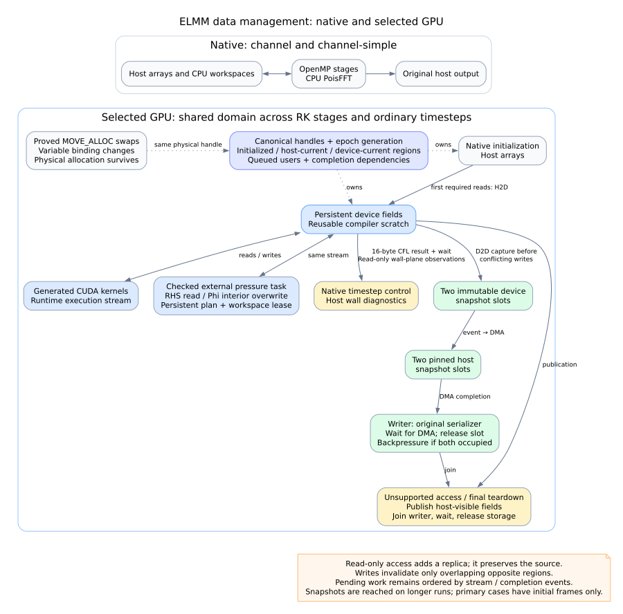

# Data management and communication

The native configurations keep their arrays in host memory: four OpenMP threads operate on those arrays, CPU PoisFFT uses host workspaces, and the original output routines read host arrays. The selected GPU implementation keeps a shared residency domain alive across RK stages and ordinary timesteps. Native Fortran still controls calls, predicates and timestep selection; returning from a GPU procedure does not publish all its fields to the CPU. Both configurations use resident wall-model work; `channel` additionally exercises frequent host wall diagnostics.

The editable diagram is supplied as [Mermaid](memory.mmd) and [Graphviz](memory.dot). Solid arrows represent data or completion flow; dotted arrows represent ownership or identity rules. The selected executable is the retained async-output implementation, not the rejected coordinate-decoder experiment.

## Allocation identity and replica validity

`resident_flow` owns the domain. Its Fortran registry maps physical host allocation addresses to canonical runtime handles and an owner epoch generation. It caches handles, **not coherence state**. The C++ runtime alone tracks layout, initialized regions, current host/device regions, pending uploads, queued users and completion dependencies. Initialized means a value exists; current means a replica represents the latest value; pending work still requires stream/event ordering before another consumer may use it.

| Operation | Actual runtime behavior |
|---|---|
| First GPU read | Upload only the required region missing on the device. Preserve the current host replica. |
| Read-only host observation | Drain conflicting queued work, download missing host regions and wait for the relevant completion. Preserve device validity. A later GPU read does not re-upload unchanged data. |
| GPU or host write | Commit the written region on that side and invalidate overlapping regions in the other replica. Nonoverlapping values remain usable. |
| Proved complete overwrite | Allocate storage without uploading the value that will be replaced. Ordinary reads still require initialized data. |
| Reused compiler temporary | Borrow a persistent slot by site and shape. Discard old values once their queued users are submitted; order reuse on the same stream. No download of dead scratch is required. |
| Allocation exchange | The checked ELMM `exchange_alloc_3D` uses `MOVE_ALLOC`; physical storage survives. The next binding finds the same address/handle under the new variable name. No array payload moves. |
| Unsupported native path / final publication | Publish the host-visible values and end the epoch before unmanaged access. Finalization joins output, waits for users and releases solver/domain storage. |

The generic runtime also provides an explicit descriptor identity-swap API, but the selected ELMM adapter follows physical allocation addresses; it does not call that API for each `MOVE_ALLOC`. This depends on the adapter's checked lifetime assumptions. It is not arbitrary Fortran pointer/allocatable alias inference. Unknown reassociation or unsupported source paths require an epoch boundary. Region fragmentation may conservatively discard a redundant mirror on a write; read-only access must preserve it. Eviction must preserve needed dirty values and cannot free storage still referenced by queued work.

## Solver, control and output

The local `poisson-solver` runs through a checked external-device task, sharing the runtime stream. The transaction validates dense physical layouts, obtains device views of Phi and RHS, and holds a solver-workspace lease. It declares RHS interior read-only and Phi interior overwritten, preserving RHS and untouched halos. Packing, VkFFT execution, unpacking, halo updates and pressure-tail kernels stay on the device. Ghost widths of two for Phi and one for RHS are guarded layout assumptions. The persistent solver is keyed by sizes, lengths, boundary conditions and FD approximation. Successful submission commits the declared writes with their completion ordering; failure after submission poisons execution and cannot replay the source work.

Not every result remains on the GPU. After native first-step setup, `ResidentCFL` performs its field calculation and reduction on the GPU, copies a **16-byte maximum/NaN record** to the host and synchronizes that stream so native timestep control can consume it. `GroundUstar` and `GroundUstarUVW` call `ResidentWallsPublish(.true.)`: channel wall-plane values are observed for original host diagnostics. Those reads preserve the GPU replicas. Primary-case traces therefore do **not** support a claim of scalar-only traffic or zero transfers on ordinary timesteps.

When a postinitial VTK frame is reached, five fields are copied device-to-device into one immutable snapshot slot on the execution stream. An event lets a separate DMA stream download the snapshot into pinned host storage; the writer waits for DMA, calls the original serializer and then frees the slot. There are exactly two slots, backpressure when both are occupied, and a writer join before completion. This keeps snapshot capture ahead of conflicting field writes without making full live fields host-current. Initialization frames remain native; neither short primary timing case reaches a postinitial async frame. The retained channel200 diagnostic reaches two paired frames sharing one snapshot: **25,449,248 bytes per snapshot**, **50,898,496 bytes in the two device slots** and the same amount in the two pinned slots. Its one D2H snapshot took 2.009 ms; measured overlap with kernels was only 0.118 ms. This establishes operation, not an end-to-end speedup claim.

The selected RK domain requests a 2 GiB device budget. Runtime allocations, reusable scratch and external solver/output workspace leases participate in accounting; pinned output storage has a separate 256 MiB cap. These are not a complete cap on process memory: opaque driver allocations and all graph/host bookkeeping have not been comprehensively charged.

## Measured remaining communication

The following totals come from retained **whole-process diagnostic profiles** of the selected executable. They include initialization and final publication, are not steady-state per-step totals, and must not be added to overlapping CPU API times to reconstruct wall time. MB below means decimal megabytes; exact bytes are retained in [provenance.json](provenance.json).

| Case | H2D calls / MB | H2D device time | D2H calls / MB | D2H device time | All-copy interval union |
|---|---:|---:|---:|---:|---:|
| `channel-simple`, 109 steps | 135 / 60.323 | 7.169 ms | 157 / 115.528 | 17.378 ms | 24.547 ms |
| `channel`, 100 steps | 204 / 48.174 | 6.133 ms | 441 / 115.115 | 19.848 ms | 25.981 ms |

The profiles contain 108 and 99 D2H transfers of 16 bytes respectively, matching postinitial CFL control. They also contain 20 and 317 D2H transfers of 65,536 bytes. Source inspection identifies retained host wall-plane observations; the byte-size histogram alone cannot attribute every individual plane copy. Large field transfers remain at application boundaries. A complete per-transfer semantic ledger is not present, so this report does not assert that every remaining byte is necessary or assigned to a precise source operation.

Implementation references: [domain owner](../../../../compiler/runtime/resident_domain.f90), [coherence and external-task runtime](../../../../compiler/runtime/scoped_runtime.cu), [scalar reduction](../../../../compiler/runtime/reductions.cu), [snapshot queue](../../../../compiler/runtime/snapshots.cu), [time-loop adapter](../../../../elmm-pipeline/elmm_pipeline/resident_time_loop.py), [wall observations](../../../../elmm-pipeline/elmm_pipeline/resident_walls.py), [solver access contract](../../../../elmm-pipeline/elmm_pipeline/gpu_pressure_sources/gpu_pressure.cpp). Evidence: [selected profiles](../../gpu-kernel-screening-20261110/summary.json), [snapshot diagnostic](../../gpu-async-output-20261110/README.md).
