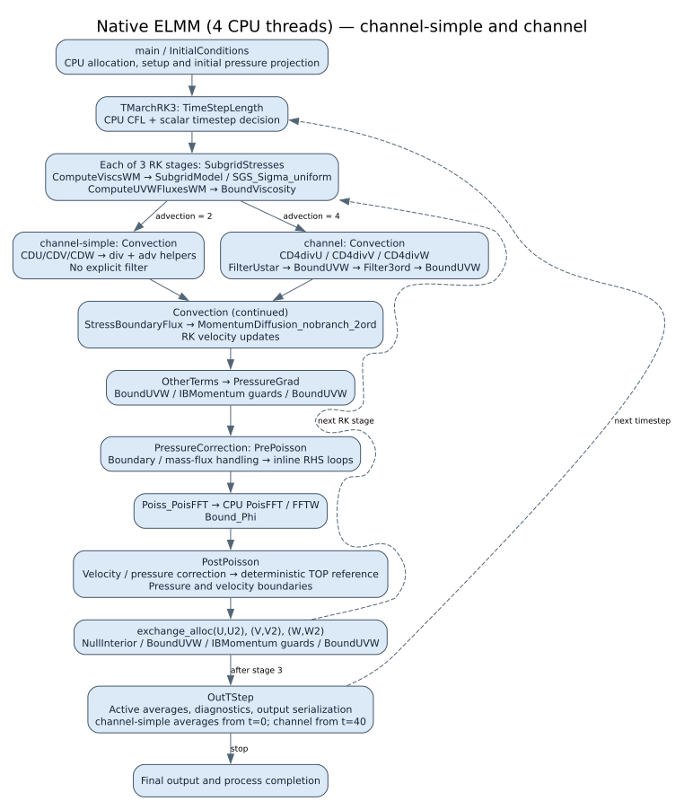
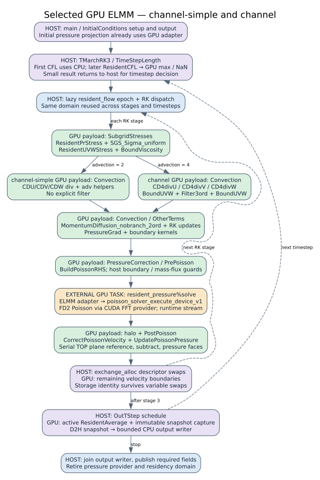

## Reached hot paths and execution placement

These diagrams describe the selected, measured build **A** (`/tmp/fortran-async-output-20261110-01`), preserved in the committed implementation snapshot. They are reduced call/execution maps of the configured hot path, not exhaustive call graphs or time-scaled profiles. A GPU box means the procedure's numerical payload runs on the device; the enclosing Fortran procedure, branches, descriptors and runtime submission still execute on the CPU.





Blue is host execution, green is device numerical work, orange is an explicitly integrated external GPU solver, and purple combines host control with a device operation. The GPU wall, pressure-tail and reduction helpers include explicit adapters as described below; green denotes the execution location, not a claim that every operation is inferred from arbitrary source automatically. Editable versions: [native Mermaid](native.mmd), [GPU Mermaid](gpu.mmd), [native Graphviz](native.dot), [GPU Graphviz](gpu.dot).

Both primary configurations use the uniform 128×64×64 grid, lengths 12×4×2, Sigma SGS, periodic horizontal boundaries and no-slip vertical walls. They have no transported scalar fields. Both use second-order explicit momentum diffusion and an **FD2 pressure operator**; `channel`'s fourth-order *advection* does not make its pressure solve FD4. Independent FD4 solver tests qualify a separate supported operator.

| Reached operation | channel-simple | channel | Selected GPU placement |
|---|---|---|---|
| Time advance | Adaptive timestep; three RK stages | Same | Host stage/timestep decisions; resident CFL field and max/NaN reductions after the first step |
| SGS / wall stress | Sigma plus wall model | Same | `SGS_Sigma_uniform`, resident wall helpers and viscosity boundaries |
| Momentum advection | `CDU`, `CDV`, `CDW`, split into div/adv helpers | `CD4divU`, `CD4divV`, `CD4divW` | Generated CUDA in both cases |
| Explicit filter | Disabled | `Filter3ord`, with velocity boundaries | Generated CUDA when reached |
| Diffusion / RK update | `MomentumDiffusion_nobranch_2ord`; RK linear combinations | Same | Generated CUDA |
| Applied pressure gradient | `OtherTerms` → `PressureGrad` | Same | Generated CUDA |
| Pressure projection | PrePoisson → PoisFFT → Bound_Phi → PostPoisson | Same | Generated RHS/correction loops; explicit GPU solver, halo and deterministic pressure-reference helpers |
| Allocation exchange | Three `exchange_alloc` calls per RK stage | Same | Host descriptor operation; residency follows the underlying allocation |
| Time averages | Active from t=0 | Active from t=40; absent from the early two-step trace | Resident generated update when active |
| Output | Same required output contents | Same | Host scheduling, GPU snapshot, DMA, CPU writer; completion is joined |

The reached filter difference is supported by actual generated-backend events, not inferred only from configuration comments. The pinned ELMM wall-model parser also affects the effective filter setting; the simple configuration intentionally leaves the wall-model option at its default. Source and configuration provenance are retained in [provenance.json](provenance.json), with the actual configuration files under `samples/`.

The selected build's instrumented **two-step-plus-initialization** runs record 31 generated GPU procedure families for simple and 28 for channel, with no generated CPU-entry events. This does **not** mean there is no CPU work: the ledger excludes enclosing Fortran control, runtime submission, output, external FFT kernels and explicit CUDA helpers. It is also not a per-step kernel-launch count. The focused [backend ledger](generated-backend-evidence.json) records the exact source evidence. Representative event counts are six `SGS_Sigma_uniform` entries in each run, six of each simple div/adv helper, six of each channel CD4 helper, 108 channel `Filter3ord` entries, seven RHS builds and seven pressure updates. Initialization accounts for the extra pressure invocation.

The source still contains broader CPU paths and unsupported configurations. Primary-case guards disable scalar transport, sponge and immersed-boundary payloads; their call sites can remain on the CPU without moving full fields. A steady resident run also retains host synchronization for scalar control and output. This is an explicit ELMM pipeline integration built on generic generated entries and coherence, not a demonstration that arbitrary application control graphs are fully scheduled on the GPU.

## Representative transcription and calls

The excerpts below are actual bytes from the selected build. Full original paths, original line ranges, original-file SHA-256 and excerpt SHA-256 appear in [provenance.json](provenance.json). Archived excerpts remain readable after `/tmp` is removed. These are representative examples, not manually simplified pseudocode.

### 1. Native pressure-gradient loop → generated CUDA → queued runtime task

Native prepared `dynamics.f90`, original lines 87–93:

```fortran
      do k = 1, Unz
        do j = 1, Uny
          do i = 1, Unx
            U(i,j,k) = U(i,j,k) + A * pr_gradient_x
          end do
        end do
      end do
```

The pipeline extracts this region into [a standalone Fortran compiler input](samples/pressure-gradient-extracted.f90). The generated CUDA kernel retains Fortran column-major addressing and explicit original lower bounds. Its grid-stride loop maps adjacent flattened points to adjacent `i` coordinates. The actual arithmetic statement (generated `shared_entry.cu`, original line 61) is:

```cuda
        fort_v0_u[F_IDX(((fort_v9_i - fort_v1_fort_region_lb_u_1) + 1), ((fort_v10_j - fort_v2_fort_region_lb_u_2) + 1), ((fort_v11_k - fort_v3_fort_region_lb_u_3) + 1), fort_v0_u_dim1, fort_v0_u_dim2, fort_v0_u_dim3)] = (fort_v0_u[F_IDX(((fort_v9_i - fort_v1_fort_region_lb_u_1) + 1), ((fort_v10_j - fort_v2_fort_region_lb_u_2) + 1), ((fort_v11_k - fort_v3_fort_region_lb_u_3) + 1), fort_v0_u_dim1, fort_v0_u_dim2, fort_v0_u_dim3)] + (fort_v4_a * fort_v5_pr_gradient_x));
```

The complete [generated kernel](samples/pressure-gradient-kernel.cu) includes the coordinate decoding and loop bounds. Numerical compilation requires `--fmad=false --ftz=false --prec-div=true --prec-sqrt=true` and host `-ffp-contract=off`; this expression is not permission to introduce contraction.

The [integrated caller](samples/pressure-gradient-caller.f90) binds `u` to the live domain and passes a canonical handle through a generated `bind(C)` interface. The relevant actual call is:

```fortran
        rk_handle_u=resident_flow%bind_real64(u,lbound(u),.true.)
        call pressure_require(rk_device_run( &
          resident_flow%context, &
          FORT_SCOPE_GPU, &
          rk_handle_u, &
          lbound(u,1), &
          lbound(u,2), &
          lbound(u,3), &
          a, &
          pr_gradient_x, &
          unx, &
          uny, &
          unz))
```

The [generated C interface](samples/pressure-gradient-interface.f90) binds this to `cpp_fort_shared_80aa32c5945f`; it accepts a handle rather than asking Fortran to copy an array to the GPU. The [generated enqueue excerpt](samples/pressure-gradient-enqueue.cpp) attaches exact read/write effects, kernel arguments and a 256-thread launch shape. Its final reservation and submission are:

```cpp
                        FORT_SHARED_CHECK(fort_scope_device_reserve_many_v1(fort_context, fort_graph_handles, fort_graph_reserve_count, fort_graph_pointers));
                        if (fort_graph_0_active) fort_v0_u_device = static_cast<double *>(fort_graph_pointers[fort_graph_slot_0]);
                        if (fort_graph_0_active) fort_graph_0_values.value_0 = fort_v0_u_device;
                        if (!fort_graph_count) return FORT_SCOPE_OK;
                        return fort_scope_graph_enqueue_v1(fort_context, 1757138722106318298ULL, fort_graph_tasks, fort_graph_0_argument_sizes);
```

`fort_scope_device_reserve_many_v1` supplies storage addresses. The effect-aware `fort_scope_graph_enqueue_v1` establishes access/dependency handling; reservation alone does not assert that an input is current. Queued tasks can outlive this call. The generated file also contains a direct launch fallback on `fort_gpu_call.stream`; the queued path is shown here because it illustrates how work-unit calls become tasks in the shared domain.

### 2. CFL: generated element work plus a resident reduction

The ELMM adapter supplies a small Fortran helper that computes each cell's CFL contribution, then uses the generic compiler to translate it. This is an application-supplied decomposition, not automatic transcription of the entire original `TimeStepLength` procedure. Actual helper body:

```fortran
do k=1,nz
 do j=1,ny
  do i=1,nx
   p = max(abs(u(i+3,j+3,k+3)),abs(u(i+2,j+3,k+3))) / dx
   p = p + max(abs(v(i+3,j+3,k+3)),abs(v(i+3,j+2,k+3))) / dy
   p = p + max(abs(w(i+3,j+3,k+3)),abs(w(i+3,j+3,k+2))) / dz
   cfl(i,j,k)=p
  enddo
 enddo
enddo
```

See [complete helper](samples/cfl-source.f90) and [generated CUDA](samples/cfl-kernel.cu). The [actual caller](samples/cfl-caller.f90) binds U/V/W as existing initialized inputs, binds persistent `cfl_values` as an initially uninitialized output, invokes the generated entry, then performs:

```fortran
    call pressure_require(fort_scope_max_real64_v1(resident_flow%context,handle,3_c_int32_t, &
      size(cfl_values,kind=c_size_t),0._c_double,maximum,any_nan,report))
    nan=any_nan/=0
```

The device field remains resident. Only `maximum` and `any_nan` need to reach the CPU for the timestep decision. The first timestep uses the native path before the flow domain is opened.

### 3. Poisson: an explicit device-library task with region contracts

This operation is not a generated FFT loop. The integrated Fortran [pressure dispatch](samples/poisson-caller.f90) calls `resident_pressure%solve()` when the qualified resident path is active, followed by `resident_pressure%halo()`; the native fallback remains `Poiss_PoisFFT` / `Bound_Phi`.

The actual C++ adapter declares only the Phi interior as overwritten, and only the RHS interior as read. It enters the same runtime access transaction used to maintain coherent data:

```cpp
        std::array<size_t,3> pl{2,2,2},pu{},rl{1,1,1},ru{};
        for(int i=0;i<3;++i) { pu[i]=size_t(h->config.solver.sizes[i])+2;ru[i]=size_t(h->config.solver.sizes[i])+1; }
        fort_scope_section interior{pl.data(),pu.data()},input{rl.data(),ru.data()};
        fort_scope_access write{0,0,nullptr,1,&interior,1,&interior},read{0,1,&input,0,nullptr,0,nullptr};
        fort_scope_external_binding_v1 bindings[2]={{phi,FORT_SCOPE_REAL64,3,8,write},{rhs,FORT_SCOPE_REAL64,3,8,read}};
        fort_scope_external_call_v1 call{1,0,bindings,2,h->lease,h->workspace};
        return fort_scope_external_execute_v1(context,&call,solve_worker,h,report);
```

The [callback](samples/poisson-callback.cpp) checks rank, REAL64 element size, dense Fortran strides, original bounds, total allocation size and the verified two/one Phi/RHS ghost widths. It forwards the transaction's stream and typed device addresses to the checked solver ABI:

```cpp
        view_check(views[0],h,true);view_check(views[1],h,false);
        const int32_t phi_ghosts[3]={2,2,2},rhs_ghosts[3]={1,1,1};
        const int status=poisson_solver_execute_device_v1(h.solver,views[0].device,views[0].bytes,
            views[1].device,views[1].bytes,phi_ghosts,rhs_ghosts,stream,started);
        return provider_status(status);
```

RHS remains read-only, Phi halos are not solver outputs, and the separately declared halo task fills the required faces. Solver plans/workspaces are persistent and charged to the domain. `started` distinguishes rejection before submission from failure after work may have executed; the latter cannot replay source work safely. Complete [transaction](samples/poisson-transaction.cpp) and [callback](samples/poisson-callback.cpp) excerpts preserve the error-handling context.

The GPU pressure tail also preserves the approved TOP-reference summation order with a single-thread plane reduction, followed by parallel subtraction and pressure-face work. This illustrates the current design's deliberate mixture: generic compiler-generated arithmetic, generic coherent task interfaces, and small explicit ELMM/solver adapters where source-level lowering alone is insufficient.
