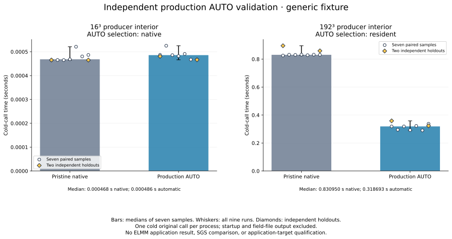
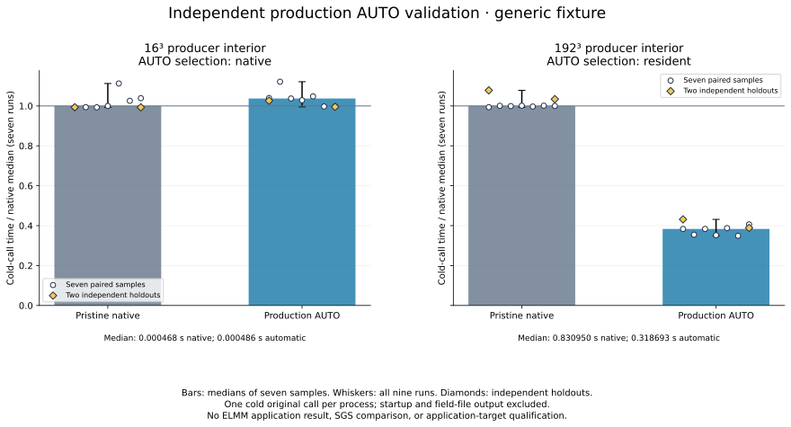
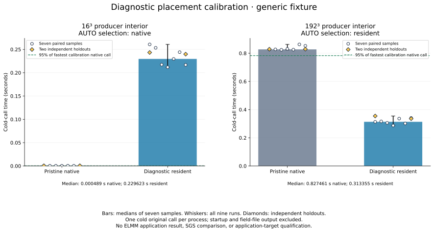
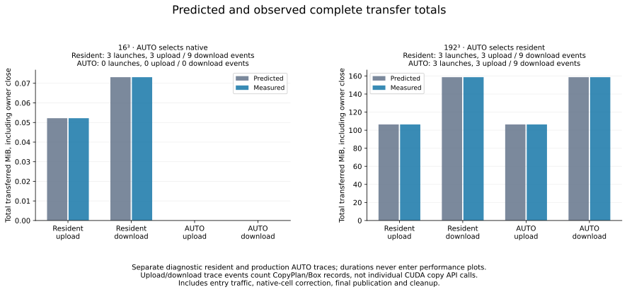
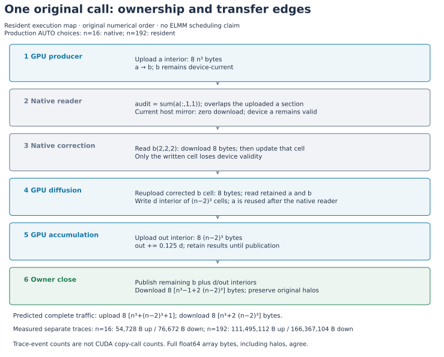

# Generic cold-call residency experiment, 2026-10-14

Automatic placement selects native execution for the tiny fixture and a resident
producer → native reader and correction → diffusion → accumulation window for the
larger fixture. Independent production measurements show a **61.6% lower median
time for the larger original subroutine call**. This is a generic serial-owner
fixture result; neither primary ELMM application is qualified by it.

| Producer interior | AUTO choice | Fresh native median | Production AUTO median | AUTO / native | Production model miss |
|---|---|---:|---:|---:|---|
| 16³ | Native | 0.000468391 s | 0.000485833 s | 1.0372 | No |
| 192³ | Resident | 0.830950444 s | 0.318693081 s | 0.3835 | No |

The small fixture's AUTO median is 3.7% above native; no statistical significance
claim is made for that difference. The separate AUTO trace has no GPU traffic
or launches. For 192³, the slowest production AUTO call (0.358523731 s) remains
below 95% of the fastest native call (0.825706185 s). All float64 field bytes,
including bounds/halos, agree with the native reference. Changing the thread
environment rejects the calibrated resident decision and executes native with
zero GPU traffic; that fallback also agrees numerically.





The performance charts use fresh **production native versus production AUTO**
calls, measured independently after calibration. The diagnostic native/resident
calibration is shown separately. Each comparison contains seven rotated pairs
and two independent holdout pairs. Bars show the first seven samples' medians;
whiskers include all nine samples; holdouts have distinct markers. A model miss
remains visible and never feeds back into calibration authority.

The conservative placement rule requires the slowest resident calibration call
to be faster than 95% of the fastest native calibration call, across all nine
pairs. This is a placement criterion, not an application qualification target.
Every process executes a cold call; this fixture protocol excludes no warmup.



The timer encloses one original subroutine invocation in each fresh process,
including selector checks, CUDA initialization when used, ownership management,
required transfers, native interruptions, final publication and close. It
excludes process startup, input allocation/initialization, field-file output
and process teardown. This deliberately differs from a complete ELMM process
measurement. The native control uses the untouched original source and no CUDA
selector. The resident calibration includes its identity-recording overhead;
production observations and separate trace diagnostics remain distinct.
The original fixture owner is serial. `OMP_NUM_THREADS=4` is a fixed execution
environment setting, not evidence of four native CPU workers. Original-team
admission and pricing for the primary applications remain separate work.

There is **no ELMM application result, SGS direct comparison, or final target
qualification** in this experiment. The application pipeline rejects this
experimental complete-window cost/build contract; its supported consumer is the
independent fixture producer. Neither small fixture speedups nor successful
numerical comparisons establish that either channel case is ready.
The separate [primary-case source preflight](../automatic-residency-20261014/README.md)
records the unresolved application-path requirements.

The ownership map and transfer comparison include the original native reader,
the one-cell correction, and all final owner-close traffic. The current host
mirror of unchanged input `a` serves the reader without invalidating device
data, and diffusion then reuses that device copy of `a`. The reader's
`a(:,1,1)` neighborhood overlaps the uploaded producer input. The correction
downloads and invalidates only its written `b` cell;
diffusion reuploads that cell. Upload/download event counts describe runtime
CopyPlan/Box trace records, **not CUDA copy API calls**. Diagnostic durations
never enter performance plots.

| Interior | Resident predicted = observed upload | Resident predicted = observed download | Upload / download trace events | Kernel launches | AUTO traffic |
|---|---:|---:|---:|---:|---|
| 16³ | 54,728 B | 76,672 B | 3 / 9 | 3 | Zero; native selected |
| 192³ | 111,495,112 B | 166,367,104 B | 3 / 9 | 3 | Same as resident |

The traffic prediction is verified against complete independent traces. No
separate-scope execution baseline was measured, so this report makes no measured
transfer-reduction claim against such a baseline.





The curator checks paired full float64 field hashes, raw sample order, medians,
conservative decisions, separate trace ledgers, unchanged build binaries and
objects, and the compiler source identity against its commit. It retains source,
raw observations, build receipts, complete diagnostic traces and their hashes.
The pipeline commit identifies the application-consumer exclusion boundary; the
pipeline is not used to build this fixture. Large binaries and field dumps stay
outside the curated report and remain identified by their receipt hashes.

The compatible measured compiler commit is
`2aa4990dcd71a2d9e793ada05f7d6b75a9309f19`; the pipeline boundary commit is
`3c799dc0d266abf6aa6eb0d4b3ce39234cd80bcd`. Measurements used an AMD Ryzen 5 5600G,
NVIDIA GeForce RTX 3060 Ti, GCC Fortran 15.3.0, CUDA compiler 13.4.92,
`OMP_NUM_THREADS=4`, `OMP_DYNAMIC=FALSE`, and `OMP_PROC_BIND=FALSE`. Full compiler,
runtime, affinity, GPU, source/configuration, and build identities appear in the
frozen [calibration evidence](evidence/raw/size-192/evidence.json),
[build receipts](evidence/raw/calibration/build-receipt.json), and
[snapshot manifest](evidence/snapshot.json). The plot
[receipt](figures/source.json) binds each figure to the snapshot and renderer.

Validation history is preserved in [validation/record.json](validation/record.json)
with full captured logs and hashes. The broad host run initially reported
5,012 passed, 11 failed, 4 skipped, and 1,467 deselected. The coordinator confirmed
that the 11 failures were stale baseline test expectations, then repaired those
fixtures in commits `fc04620` and `76951bf`; the affected test files subsequently
passed 41 + 29 tests. The real CUDA suite passed 95 tests, the focused exact-window
checks passed 31, and the pipeline suite passed 549 tests plus 265 subtests, with
22 skips. The 70 affected-file and 31 focused results are coordinator/agent
records; individual logs for those reruns were not supplied. **There was no clean
full host-suite rerun after those repairs.** The report renderer's four tests
and lint checks passed separately.

To reproduce curation from the original artifacts into a new directory, then
render the archived evidence into a new output directory:

```sh
python benchmarks/reports/exact-window-20261014/render.py freeze \
  --artifacts /tmp/exact-window-calibration-20261014-v3 \
  --compiler-root . --pipeline-root ./elmm-pipeline \
  --output /tmp/exact-window-frozen
MPLCONFIGDIR=/tmp/exact-window-report-mpl \
  python benchmarks/reports/exact-window-20261014/render.py render \
  --evidence benchmarks/reports/exact-window-20261014/evidence \
  --output /tmp/exact-window-rendered
```

Both output directories are immutable. Rendering only reads frozen evidence;
it does not run the compiler, launch CUDA, or remeasure a workload. SVG output
retains searchable text, removes trailing whitespace, and fixes its ID salt and
timestamp metadata for deterministic regeneration with the same plotting stack.
