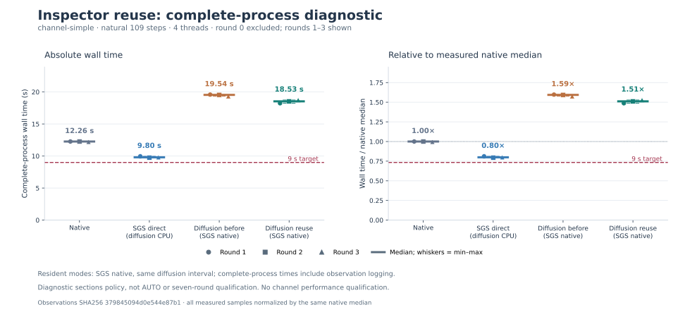
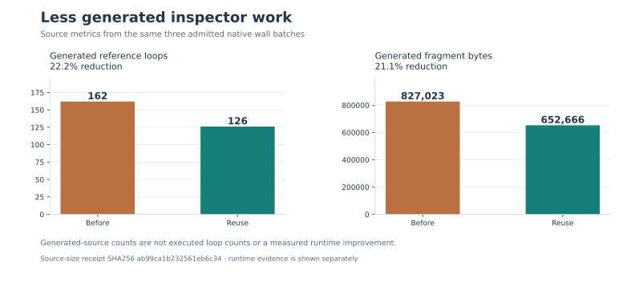

**Identical-footprint reuse improved the resident candidate by 5.166%, but it still loses to SGS direct.** This is a measured improvement from a generic compiler simplification. Automatic placement and both primary performance targets remain unfinished.

The change shares an exact read/write footprint within one reached native operation when its ordered references match. It removes the duplicate metadata scan and rectangle construction. The original logical scan budget still charges both directions; allocation, coordinate and integer-overflow guards, the 32-rectangle limit, partial-write effects and storage lifetime remain intact. There is no cross-invocation cache, ownership expansion or new placement authority.

All samples below are complete, natural **109-step `channel-simple` executions** in seconds. Native and SGS direct are fresh controls. Both resident variants leave SGS native. One warmup round covering all four modes was excluded, followed by three rotated measured rounds with four threads pinned to CPUs `4,5,10,11`.

| Mode | Round 1 | Round 2 | Round 3 | Median |
|---|---:|---:|---:|---:|
| Native | 12.266099 | 12.263790 | 12.212950 | 12.263790 |
| SGS direct | 9.954430 | 9.757613 | 9.804861 | 9.804861 |
| Resident before reuse | 19.585262 | 19.542621 | 19.332520 | 19.542621 |
| Resident with reuse | 18.237172 | 18.533023 | 18.742894 | 18.533023 |

Reuse improves all three paired rounds. The median sum of observed diffusion-owner call times falls from **8.428653 to 7.411625 seconds**. These three-round diagnostics do not satisfy the required seven-round qualification, and the candidate remains well above the below-9-second target.

**Transfers did not improve.** Separate `channel-simple` traces recorded exactly the same totals before and after:

| Observed traffic/activity | Both resident variants |
|---|---:|
| Uploads | 9,987,009,024 bytes / 7,848 events |
| Downloads | 4,093,181,952 bytes / 2,943 events |
| Kernel launches | 981 |
| Waits / contexts | 2,289 / 327 |
| Ledger attribution issues | 0 |

Separate `channel-simple` validation passed all **20 float64 field records**, including bounds and halos, with unchanged `atol=1e-6`, `rtol=1e-5`. Final and averaged VTK checks passed. Focused validation also passed **57 host tests and two CUDA tests**. Build receipts verified matching native compiler flags for all 72 original build units.

**Full `channel` field validation passed.** The candidate completed naturally at 2,458 steps with its original fourth-order advection, filtering and wall model. All 20 float64 field records, including bounds and halos, and final/averaged VTK checks passed the same tolerances. Maximum absolute field errors were `4.533e-7` for `channel-simple` and `6.750e-7` for `channel`. The channel field run was untraced; its per-invocation GPU execution and transfer counts are not established here. No `channel` performance qualification is claimed.

The candidate uses compiler `10ae18b` with pipeline `b9418a9`; the prior resident implementation used compiler `dd8ea33`. See [report metadata and evidence](report.json) for exact identities, and the [preceding runtime-cost investigation](../runtime-cost-breakdown-20261015/README.md) for the profiling evidence that motivated this bounded change.
