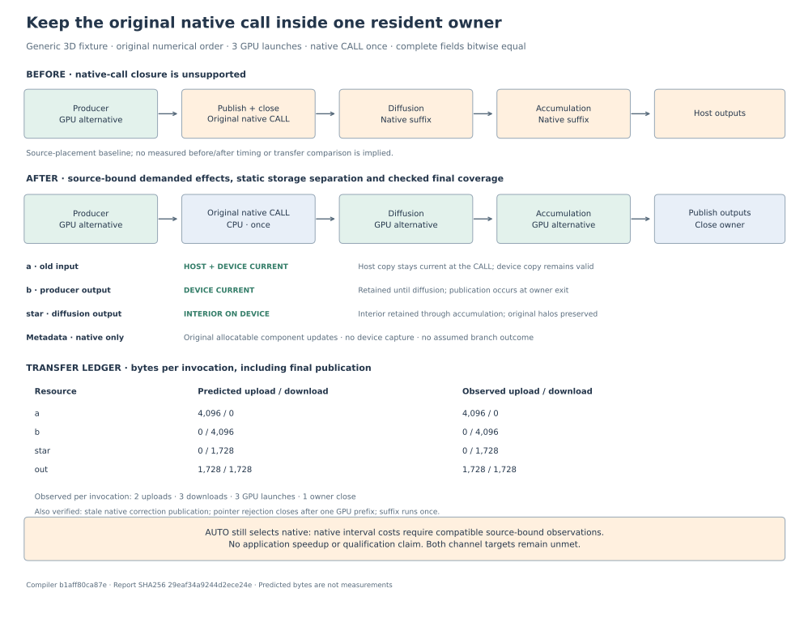

**A generic 3D fixture now executes producer → original native CALL → diffusion → accumulation in one resident owner.** Three GPU launches retain shared fields while the CPU updates its native metadata. Automatic placement still selects native because interval cost observations are unavailable. Both primary application targets remain unmet.



The public compiler path preserves the original call and indexed scalar argument evaluation. An issued native-effect proof discharges storage separation against the prospective resource demand. The final checked plan rejects an uncovered later child resource before publication. Native allocatable metadata gains no GPU layout or capture authority. The figure's earlier ownership boundary is a source-placement explanation; no baseline timing or transfer reduction was measured.

The [CUDA fixture receipt](evidence/cuda/fixture-summary.json) covers both native branch outcomes. Four complete float64 arrays, their bounds and halos, allocatable metadata and the native-call counter match the reference bitwise: **32,840 bytes** across two invocations. Traced, untraced and device-disabled fallback executions pass. Each traced invocation uses one context, three launches and one close. There is **no transfer between producer and diffusion** across the native read of an already-current host copy.

Observed traffic per invocation is **5,824 bytes uploaded in two events** and **7,552 bytes downloaded in three events**, including final publication. The source prediction uses full-array `8³ × 8 = 4,096` bytes and interior `6³ × 8 = 1,728` bytes; these expected accesses were asserted before execution. The [raw ledger](evidence/cuda/fixture/transfer-ledger.json) matches those per-resource predictions. Metadata remains native. This establishes fixture coherence, without an application speedup or transfer-saving claim.

Two [additional CUDA checks](evidence/cuda-extensions/summary.json) passed with unchanged production inventories. A partial native correction publishes all 4,096 bytes of stale `b`, then reuploads the 1,728-byte interior needed by diffusion; whole-owner totals are 7,552 bytes in each direction. An unsupported pointer-metadata operation closes after one non-idempotent GPU producer, publishes 4,096 bytes, and executes the native call and remaining suffix once. Full fields and metadata match in both branch outcomes, including device-disabled fallback. These extensions validate conservative writes and prefix-safe continuation.

A separate [actual-source probe](evidence/application-probe/completion.json) completed four selected calls in **43.296 seconds**, under the unchanged 60-second cap and analysis budgets. It authenticated 178 inputs, including the shared configured source and both case configurations. The existing six audited `INTENT` declaration corrections remain the source baseline. No configuration branch was assumed constant, full effect summary requested, application interval generated, or application executed.

| Original application call | Reachability result | Execution blocker |
|---|---|---|
| `StressBoundaryFlux(Ustar,Vstar,dt)` | Covered; 48 separation obligations | Formal starred fields are not proved separate from old-velocity formals |
| `ComputeUVWFluxesWM(...)` | Existing source-scan budget exhausted | No completed reachability result |
| `BoundViscosity(Viscosity)` | Covered; 19 separation obligations | Viscosity is not proved separate from velocity formals |
| `ComputeTDiff(U,V,W)` | Covered; 36 separation obligations | Distinct velocity formal names do not prove separate storage |

These are individual source queries. A complete useful application interval, its future resource inventory and automatic pricing remain unproved. Whole demanded native accesses require whole entry definitions; unknown aliases, demanded `INTENT(OUT)` changes, writes to demanded planning scalars, allocation changes and unsupported completion remain boundaries. No application-specific procedure allowlist or schedule was introduced.

Validation results overlap and **must not be added**:

| Run | Result | Scope |
|---|---|---|
| Final stable host suite | **364 passed** | Selected compiler host coverage for this slice |
| Broad intermediate host run | 357 passed, 2 failed | Both exact-window evidence failures occurred while implementation fingerprints changed |
| Stable targeted rerun | 20 passed | Repeated the two failures plus 18 proof checks |
| Final native proof and public owner checks | 26 passed | Includes the final future-only declaration rejection guard |
| CUDA integration file | 2 passed | One AUTO host check and one CUDA test with both branch outcomes |
| CUDA write/suffix extensions | 2 passed, 2 deselected | Partial native correction and pointer-boundary continuation |
| Affected pipeline checks | 111 passed, 2 skipped | Existing manifest-consumer compatibility |

[Logs](evidence/validation/) preserve these runs; this is an affected-check claim. The first CUDA attempt failed to compile its driver allocation syntax. After that test correction, a sandbox-only run produced zero GPU launches; its earlier policy-mismatch diagnosis was withdrawn. Those [earlier diagnostics](evidence/cuda/earlier/diagnostic-status.json) remain archived separately.

The successful GPU run overlapped a stricter rejection check for Cray `POINTER` declarations. A final-source regeneration matched **all 33 compiled source/header artifacts byte for byte**, as recorded in the [emission comparison](evidence/cuda/final-emission/comparison.json). This binds the executed fixture artifacts to the later source without claiming a complete test rerun. Two explicit transfer-count assertions added afterward were checked against both archived ledgers. The actual-source probe remains bound to its own before/after inventories; the later guard is not retroactively part of that run.

The compatible production pair is compiler `b1aff80ca87ebc7159abac95883be00653985f0d` and pipeline `b9418a9f1c3c242c4b77e948b29fa391b94aee60`. The [committed-source binding](evidence/committed-source-binding.json) verifies all 172 production Python files against the stable extension inventory and committed source. The archived CUDA test has its own exact source identity and is committed alongside this report. [report.json](report.json) records the current status, case identities and limitations; [evidence-index.json](evidence-index.json) binds archived runners, logs, receipts and source inventories. No binaries or field payloads are committed.

Regenerate the standalone figure without running analysis or workloads:

```sh
.venv/bin/python benchmarks/reports/native-demand-checkpoint-20261015/render.py \
  --report benchmarks/reports/native-demand-checkpoint-20261015/report.json \
  --output /tmp/native-demand-checkpoint-figures
```
