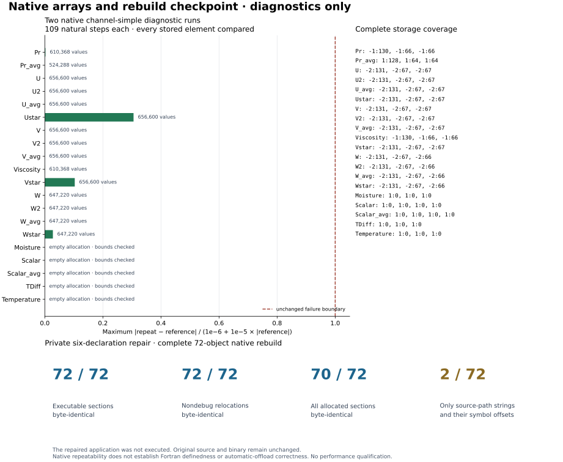

# Native arrays and rebuild checkpoint

**The native `channel-simple` full-field repeat passed.** Both diagnostic runs completed their natural 109 steps with four threads. The comparison covers 20 float64 arrays, 9,586,704 values, original bounds, halos, and available averaged fields. It found zero nonfinite values and zero failures at the maintained `atol=1e-6`, `rtol=1e-5`. The largest absolute difference was `4.5044574398245274e-7`; the largest error divided by its allowed tolerance was `0.305568`. Both final and averaged VTK outputs also agree with the untouched native binary.

**The six-declaration correction was separately rebuilt and inspected.** A fresh private application copy changes only the destination declarations of `CDU/CDV/CDW div/adv` from `intent(out)` to `intent(inout)`. All 72 rebuilt objects, including callers, retain identical executable sections and nondebug relocation sections under the recorded GFortran 14 flags. Seventy objects also retain identical allocated sections. The other two contain different source-root spellings in runtime diagnostic strings; an ELF audit verifies the string differences and all 71 affected symbol offsets.

These are distinct source identities: the executed dump driver uses the **pristine numerical objects**; the corrected application was **built but never executed**. Original sources and binaries remain untouched. Native repeatability does not establish Fortran definedness, automatic offload correctness, or a performance target. Full `channel` array validation is not included. An earlier overlapping run was intentionally aborted and excluded. No timing here is a qualification sample.

The compatible references are parent `62a1d028952561c4c1dd7d0c51d91c9d060f571f` and pipeline `0876bf8c10660f474509d73af8d335d5798709d1`. Relevant parent configuration/output-reader files and every pipeline Python file were checked against those commits. Compiler generation was not invoked. Upstream ELMM remains `ddb426fca5b020216083f02a218292fea70c1df2`; PoisFFT remains `256a2338254c08f611881b2df5e72bdfa73bc257`.

- [Report and source/binary/commit identities](report.json)
- [Complete float64 comparison, field bounds and dump hashes](evidence/channel-simple-full-fields.json)
- [Dump-only main](evidence/dump-main.f90), [exact relink plan](evidence/dump-relink-plan.json), and [executed compile/link receipts](evidence/dump-command-receipts)
- [Six-declaration patch](evidence/repair-source.patch), [all 72 object comparisons and flags](evidence/repair-full-rebuild.json), and [allocated-string/symbol audit](evidence/repair-path-data-audit.json)
- [Frozen plot data](data.json), [PNG](native-checkpoint.png), and [PDF](native-checkpoint.pdf)

Run `python render.py` in this directory to regenerate the visual from frozen aggregates. The original diagnostic recipes are preserved in `evidence/`; their original locations and hashes are recorded in `report.json`. Those recipes expect the checkpoint layout and preserved build inputs at their recorded paths. Large binaries and raw dumps remain in the external checkpoints; their hashes are retained here. `artifact-inventory.json` binds every file in this report.
