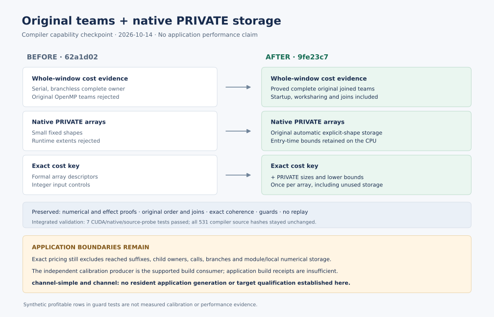

# Original-team pricing and native PRIVATE storage

The compiler now accepts complete-window cost evidence for proved original
OpenMP teams and preserves automatic PRIVATE arrays across native interruptions.
Their original sizes and lower bounds are part of the cost key, so observations
cannot be reused after those descriptors change. This is a **generic capability
and correctness checkpoint**. It establishes no application generation result,
calibration advantage, transfer reduction, or application speedup.

The comparison is between compiler commits `62a1d02` and `9fe23c7`. The latter
includes the descriptor-key repair; the intermediate implementation with missing
PRIVATE descriptor keys is not the delivered milestone. The compatible pipeline
commit is `0876bf8`. Full identities and archived artifact hashes are in
[evidence.json](evidence.json).

The new native storage proof accepts unsaved local explicit-shape arrays with
runtime extents. An outlined owner receives bounds from the already established
original descriptor, without evaluating specification expressions again.
PRIVATE contents remain CPU state, outside GPU registration. This does not grant
dynamic private-array numerical lowering. Saved, pointer, allocatable and target
storage remain unsupported by this proof.

Complete-window protocol 2 binds original team completion proofs, actual runtime
thread and active-level limits, placement, source/build identities and exact
descriptor/control values. PRIVATE descriptors are keyed once per array across
all teams, including unused storage that may incur allocation costs. Ordinary
numerical, effect, definition, alias, coherence and no-replay checks still apply.

| Evidence | Result | What it establishes |
|---|---|---|
| Final integrated source: CUDA/native/probes | **7 passed** | Original-team full fields and transfer ledger; changed or empty PRIVATE descriptors select native with zero launches/transfers; native fallback preserves entry bounds and executes the prefix once; four upstream source-body probes prove native effects. |
| Supplemental integrated host log | **261 passed**, 4 skipped, 2 deselected | Additional regression results. Its exact invocation and separate source inventory were not preserved. The four unavailable-source skips are covered by the final integrated probes above. |
| Earlier repair archive | **37 host + 1 CUDA passed** | Validation of the descriptor-key repair on an archive of `368b8f6`, before integration with source sealing and owner placement. These are separate results, not additional final-revision tests. |

The production-selector guard diagnostic uses **explicitly synthetic profitable
timing rows** with captured runtime identity. Those rows only exercise selection
and rejection. They are not measured calibration, performance evidence, or an
application comparison. Test durations in the archived logs are test-suite
durations.

The authoritative integrated inventory records 531 compiler files before and
after the run, with no changes or additions, plus unchanged `advection.f90` and
`filters.f90` inputs. Every inventoried compiler file matches `9fe23c7`.
The four upstream probes extract `CD4divU`, `CD4divV`, `CD4divW` and `Filter3ord`
into wrapper modules; they do not build or run either application case.

The exact-window route still requires one complete branchless original owner.
Reached suffixes, child owners, calls, branches and module/local numerical
storage remain outside this pricing class. Only the independent calibration
producer enforces its exact build contract; pipeline build receipts alone do
not authorize an application selector. Both `channel-simple` and `channel`
remain unqualified against their requested targets. Pressure ownership,
cross-stage residency and arithmetic reordering remain deferred.

The [earlier source-session report](../source-session-20261014/README.md) retains
the broader application and source-authentication evidence. It is not duplicated
here. This directory archives only compact logs, hash inventories and validation
receipts. [artifacts.json](artifacts.json) freezes every report file except itself.
To regenerate the figure, run `python benchmarks/reports/original-team-pricing-20261014/render.py`.
