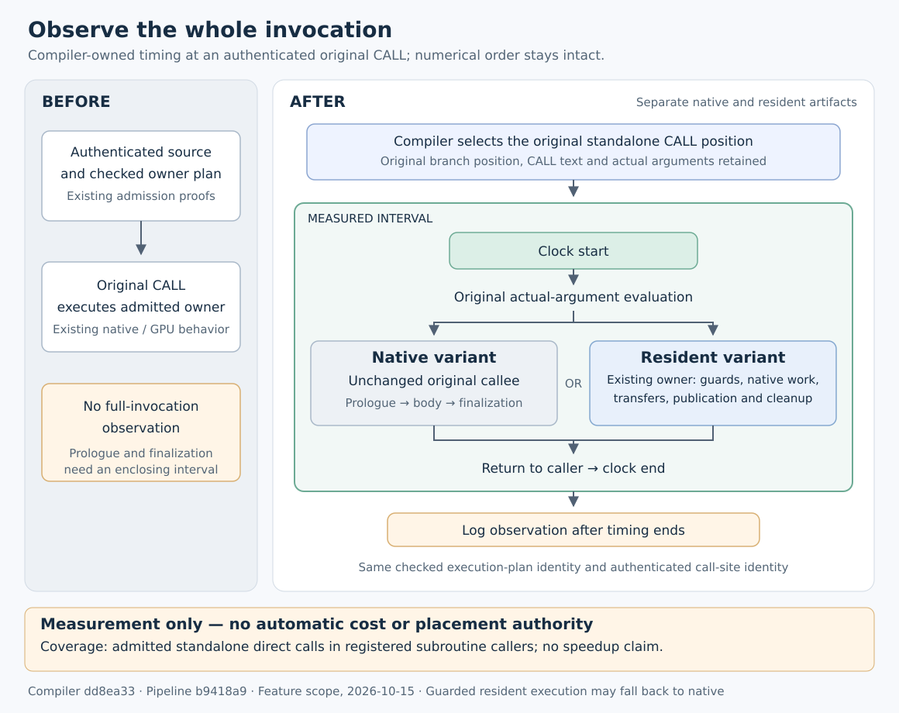
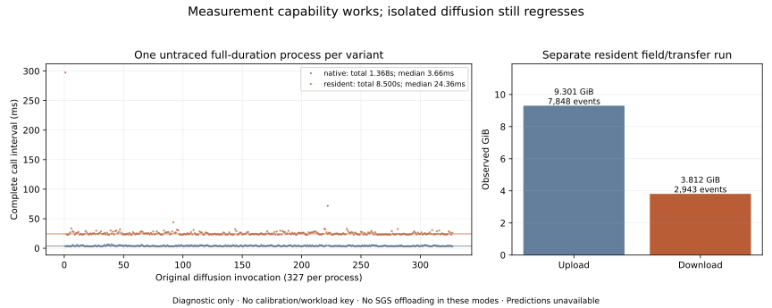

# Whole-invocation measurement: working infrastructure, slower diffusion

**The compiler-issued observer works on `channel-simple`; automatic residency and both performance targets remain unmet.** Native and resident artifacts each recorded all 327 diffusion invocations. Isolated GPU diffusion remains slower, so this checkpoint closes the measurement slice without further capability expansion.

The compiler discovers an authenticated standalone original CALL and places clocks before argument evaluation and after return. The interval includes automatic-array setup, native corrections, transfers, publication and cleanup. Logging follows the end clock. Native and resident variants share the checked execution-plan and call-site identities. Observations are diagnostic: they supply neither compatible runtime cost keys nor automatic placement authority. Coverage is limited to admitted direct calls in registered subroutine callers.

| New `channel-simple` diagnostic | Native diffusion | Resident diffusion |
|---|---:|---:|
| Observed invocations | 327 | 327 |
| Sum of invocation times | 1.367786409 s | 8.500470679 s |
| Complete-process wall time | 12.5153 s | 19.7482 s |

**SGS remains native in both new modes.** These are one untraced complete process per mode, with no excluded warmup, four threads and CPU affinity `4,5,10,11`. Both completed naturally at 109 steps with unchanged configuration. Complete-process times include observation logging, startup, output and teardown. These samples are not medians, a fresh SGS comparison, or seven-round qualification.

Separate field runs also completed 109 steps. All 20 float64 field records passed, including storage shapes, bounds and halos, with unchanged `atol=1e-6`, `rtol=1e-5`; final and averaged VTK checks passed. The separate resident trace recorded 327 contexts, 981 launches, **9,987,009,024 uploaded bytes** and **4,093,181,952 downloaded bytes**, with zero ledger attribution issues. Traced timings are excluded from the table. No predicted transfer saving or compatible automatic estimate is claimed.

The [previous three-round checkpoint](../diffusion-application-checkpoint-20261015/README.md) retains the fresh SGS comparison below. It used different binaries and includes SGS offloading in both GPU modes; its results are not pooled with the new observation runs.

| Earlier complete-process comparison | Median |
|---|---:|
| Native | 12.569 s |
| SGS direct | 10.221 s |
| SGS + forced GPU diffusion | 17.246 s |

That checkpoint excluded one warmup per mode and ran three rotated rounds. The candidate lost to SGS direct in every round. The new measurements confirm that this isolated diffusion placement warrants stopping, rather than extending its scope through successive prerequisite patches.

The initial generation at feature commit `2f36657` failed after 61.85 seconds because the outer measurement option leaked into an internal collective worker. Correction `dd8ea33` confines the option to its original owner. Both subsequent native/resident generations succeeded in approximately 77 seconds each under the unchanged cap. Failed and successful receipts remain separate.

The tested pair is compiler **`dd8ea33d55328d7ea7919ae328440f6a047a2cdf`** and pipeline **`b9418a9f1c3c242c4b77e948b29fa391b94aee60`**. [report.json](report.json) binds source/configuration inputs, binaries, manifests, test receipts and application evidence. Final focused validation passed **36 compiler tests** and **66 pipeline tests**; affected CUDA fallback rechecks also passed. The source seed retains the previously audited six advection declaration repairs; both modes use the same seed. All 72 original compilation units retain their native compiler identities and normalized flags. This report makes no full-suite or full-qualification claim. Protected planning files were unchanged.

The remaining implementation needs one useful, automatically priced interval sharing producer, diffusion and accumulation ownership. Discovery, inherited section definitions, native effects, team completion, cost keys and selector emission must agree on that interval; see the [joint blocker preflight](../suffix-pricing-preflight-20261015/README.md). `channel` was not run in this new checkpoint. Its target and the `channel-simple` target below nine seconds remain open. Whole-Convection retries, isolated diffusion expansion, secondary campaigns, pressure and full-RK ownership stay stopped. No further capability work follows from this bounded checkpoint.
