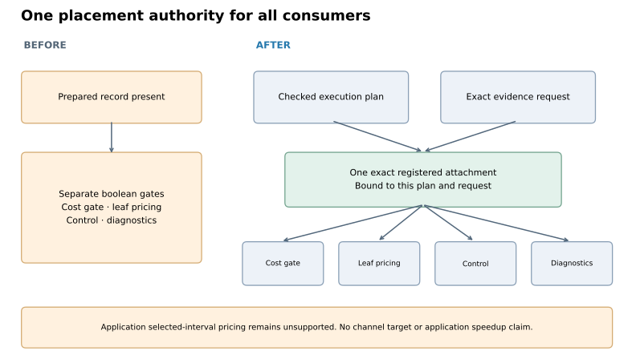
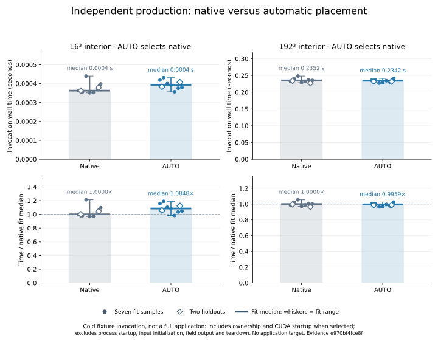

**The bounded experiment ends with the application objective unfinished.** This final slice makes complete-window placement consistent across compiler consumers and verifies that AUTO rejects an unprofitable resident alternative. It does not deliver an automatic resident channel window.

- **Correctness established earlier:** both complete channel cases passed float64 field comparisons, including bounds and halos, and final/averaged VTK checks with unchanged tolerances.
- **Performance target unmet:** the latest `channel-simple` diagnostic median is **18.533 s resident**, versus **9.805 s SGS direct** and **12.264 s native**. Inspector reuse improved the resident result by 5.17%, without reducing transfers.
- **Still missing:** one shared, checked selected-interval plan that can price and emit the application's producers, filtering, native corrections, diffusion and accumulation across repeated RK visits.

Those application results belong to compiler `10ae18b` and pipeline `b9418a9`; they were **not rerun for this placement-only slice**. The full `channel` field run was untraced, so its GPU execution frequency is not established. See the [frozen application report](../indirect-reuse-checkpoint-20261015/README.md). Neither the below-9-second `channel-simple` target nor the `channel` target has seven-round qualification. Secondary campaigns, pressure and full-RK ownership remain deferred. Further isolated-diffusion expansion and whole-Convection generation retries are stopped for this experiment.



Compiler **`13a9188b7d8040d90616134e537173a656b6ff4b`**, compatible with unchanged pipeline **`b9418a9f1c3c242c4b77e948b29fa391b94aee60`**, replaces the internal boolean bypass with one immutable, issuer-registered placement attachment. The cost gate, per-unit pricing, control emission and diagnostics check the same exact plan and request. Copied or foreign attachments, deleted slots and changed evidence fail validation. Existing source/configuration/numerical checks still apply; strict complete-window admission is unchanged.

When complete-window evidence is missing or unprofitable, AUTO retains the original native source and declarations before adding owner instrumentation. Valid native-winning evidence reports an available estimate. The fixture consumer still links its existing runtime envelope; this is not a CUDA-free build. Public schemas are unchanged, and the application pipeline still rejects the unsupported exact-window build contract.

**Validation passed:** 173 distinct compiler host tests, three original-team CUDA tests and 111 pipeline tests. Two opt-in pipeline tests were skipped. Four authority cases were rerun after test-only style changes. The initial run caught a tuple/list conversion regression in the public contract; the final implementation preserves its original types. Passing final logs and the initial diagnostic are archived under [evidence](evidence/).



The fresh generic producer → native reader/correction → diffusion → accumulation campaign completed in **115.425 seconds**, below its 295-second limit plus five-second termination grace. It retained three original four-thread teams, pinned to CPUs `4,5,10,11`. For each size, seven rotated calibration pairs and two input holdouts were followed by seven independent production pairs and two holdouts. These are **cold invocation timings**, excluding process startup, input initialization, field output and teardown. They are not application qualification runs and have no application performance target.

| Interior | Calibration native median | Calibration resident median | AUTO decision | Production native median | Production AUTO median |
|---|---:|---:|---|---:|---:|
| 16³ | 0.000373169 s | 0.238626317 s | Native | 0.000362859 s | 0.000393640 s |
| 192³ | 0.241506979 s | 0.382648022 s | Native | 0.235154051 s | 0.234191264 s |

AUTO selected native at both sizes. No resident performance advantage is claimed. All complete float64 fixture fields agreed, including halos. Separate traces verified zero AUTO transfers/launches, and zero launches under the changed-thread rejection check. The explicit resident diagnostic matched its complete transfer predictions:

| Interior | Predicted = observed uploads | Predicted = observed downloads | Observed upload/download trace events | Predicted = observed launches |
|---|---:|---:|---:|---:|
| 16³ | 54,728 bytes | 76,672 bytes | 3 / 9 | 3 |
| 192³ | 111,495,112 bytes | 166,367,104 bytes | 3 / 9 | 3 |

Trace-event counts are not CUDA API-call counts. This slice makes no transfer-reduction claim. The separate CUDA tests also exercised resident production selection and runtime rejection using explicitly synthetic profitable evidence; those tests do not supply performance evidence.

[Metadata](report.json) binds compatible commits and the compiler source inventory. The [artifact inventory](artifact-inventory.json) binds 185 archived inputs: source/configuration contracts, binary/object build receipts, calibration and production observations, stdout/stderr, trace ledgers and test logs. Large field and object payloads remain outside the report; their checked hashes are retained. [Checksums](checksums.json) cover the published report and figures.

Reproduce the figures entirely from archived evidence:

```sh
.venv/bin/python benchmarks/reports/placement-authority-checkpoint-20261015/render.py \
  --report benchmarks/reports/placement-authority-checkpoint-20261015/evidence/fixture/report.json \
  --output /tmp/placement-authority-figures
```
