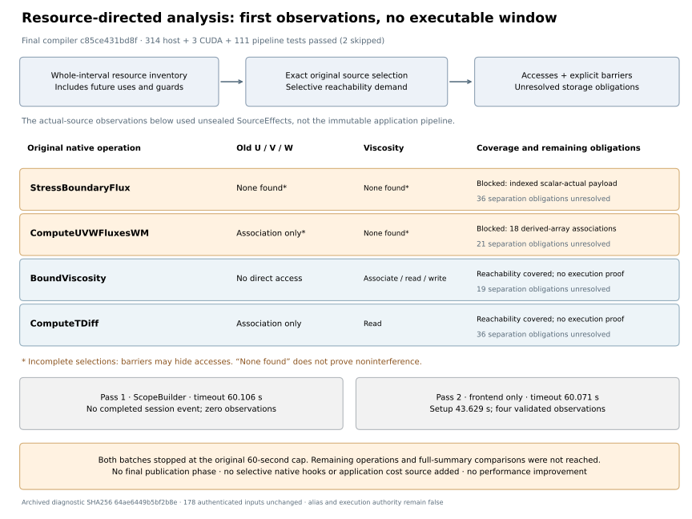

**This is an incomplete diagnostic checkpoint, not an executable residency window.** Four original-source selections produced individually validated reachability records. Both bounded passes timed out; no full-summary comparison, final publication phase, application run, transfer improvement or performance improvement was obtained.



The architecture slice gives a checked plan one resource inventory for its complete interval, including later numerical uses and guard dependencies. A new source-directed reachability query records potential accesses, unresolved storage-separation obligations and explicit barriers before complete effect materialization. This is a first step toward selective native analysis. It adds no selective native coherence hooks, numerical definitions, alias proofs, completion authority or calibrated application cost source; existing native hooks and cost machinery remain available for their previously supported scopes.

**Final implementation:** compiler `c85ce431bd8f435151549dda93a98aacdcb8670f`, compatible with unchanged pipeline `b9418a9f1c3c242c4b77e948b29fa391b94aee60`. Focused final validation passed **314 host tests**, **3 CUDA tests** and **111 pipeline tests**; two pipeline tests were skipped. Fourteen preflight cases were also repeated after an assertion-only style change; they are already included in the 314 distinct host tests. Ruff and the diff check passed. These are affected checks, not a complete-suite claim. [Logs and committed production inventory](evidence/final-validation/) are archived; [report.json](report.json) records the bindings. The committed inventory was captured after testing and independently matched current production files.

Earlier host diagnostics ran while sources changed: three stale-evidence failures and two subsequently fixed implementation failures occurred. The final runs above were reported source-stable. An initial pipeline collection used the wrong working directory; the corrected invocation passed without pipeline changes. The earlier capped application probes remain bound to their own recorded inventories, not retroactively to the final commit.

| Bounded pass | Observed outcome |
|---|---|
| Standard `ScopeBuilder` setup | Timed out after **60.106 s**, before the first completed-session event. No effect query result. |
| Direct, unsealed `SourceEffects` | Construction completed after **43.629 s**. Four query records passed their individual `validate` calls before the **60.071 s** timeout. |

Both used the same 178 authenticated inputs, including 69 configured sources and both case configurations, with unchanged depth/procedure/operation budgets of **8/64/256** and the same 60-second cap. The source seed retains the previously audited six `INTENT` declaration corrections. No runtime configuration value was assumed constant. The second pass authenticated capture-fact inputs but did not apply them as capture authority; it was not an immutable application-pipeline test.

| Original selection | Observed demanded accesses | Remaining barriers / obligations |
|---|---|---|
| `StressBoundaryFlux(Ustar,Vstar,dt)` | No direct access to old velocities or viscosity found in the covered portion | Two calls remain blocked: the scalar actual needs indexed-payload coherence proof; **36** storage-separation obligations. Uncovered calls may hide accesses. |
| `ComputeUVWFluxesWM(...)` | Velocity argument association; no viscosity access found in the covered portion | **18** derived-array call-association barriers; **21** separation obligations. Its velocity-reader closure remains incomplete. |
| `BoundViscosity(Viscosity)` | Viscosity association, reads and writes; no direct old-velocity access | Reachability selection covered; **19** unresolved separation obligations. This does not establish physical sections, definitions or executable coherence. |
| `ComputeTDiff(U,V,W)` | Velocity association without direct payload reads; viscosity read | Reachability selection covered; **36** unresolved separation obligations. This does not authorize native execution within ownership. |

The original diagnostic reports the first barrier as unresolved/ambiguous `add`. A separate [five-variant shape diagnostic](evidence/scalar-actual/resource-add-repro.json) identifies its cause: `-dt*flux/dzPr(n)` contains an indexed array read in a scalar argument. Rank-three to rank-two slicing and scalar arithmetic alone resolve successfully. This explanation does not change the original application source or add acceptance evidence for it. Its standalone script and raw output are archived; no execution-time source inventory was captured for that explanatory run.

All four records retain false execution, capture, definition and alias authority flags. Coverage means that this reachability scan encountered no barrier; it does not mean an operation can execute in a resident window. The fifth demand, `BoundViscosity(TDiff)`, began before timeout but produced no result. The IBM loop, advection/filtering, other forces, diffusion variants, initialization and accumulation were not reached. Full-summary comparisons and final publication verification were also not reached. The launcher separately confirmed unchanged input hashes and compiler inventories after each process stopped. No additional retry followed.

The probes ran on base commit **`43e2c6edd323e826d304b58a0cb9053da78cc32a`**, with pipeline **`b9418a9f1c3c242c4b77e948b29fa391b94aee60`**, plus uncommitted implementation files. Therefore the base commit alone is insufficient to reproduce them. Each pass archives its exact before/after production inventory and runner. The frontend module hashes differ between passes because reviewed fixes landed between them:

- Initial pass: `25c998801c46ab060570acf642a4d19fc44dddf49e34fc3b78c10eb5d77b4536`.
- Frontend-only pass: `8679ae7691194aae85a99e4b456ef1a51d007da2831ba07bf160040ac81962f5`; these exact [module bytes](evidence/frontend-only/resource_reachability.py) are archived.

The recorded command imports the frontend under `PYTHONPATH` set to the repository root; its source bytes match both inventories. No runtime `sys.modules` receipt was captured. A later `execution_plan.py` registry correction occurred after the second completion receipt and is [recorded separately](evidence/frontend-only/post-run-source-change.json); it was not measured by this probe.

[Evidence index](evidence-index.json) binds the archived runners, raw logs, receipts, compact diagnostics, source inventories, input inventory and configuration/capture provenance. Raw query output is losslessly gzipped with deterministic metadata. No large field or binary payloads are included. Existing application performance and numerical evidence remains in the [previous checkpoint](../indirect-reuse-checkpoint-20261015/README.md); neither primary performance target gains new evidence here.

Regenerate the figure without running analysis:

```sh
.venv/bin/python benchmarks/reports/resource-demand-checkpoint-20261015/render.py \
  --report benchmarks/reports/resource-demand-checkpoint-20261015/report.json \
  --output /tmp/resource-demand-figures
```
