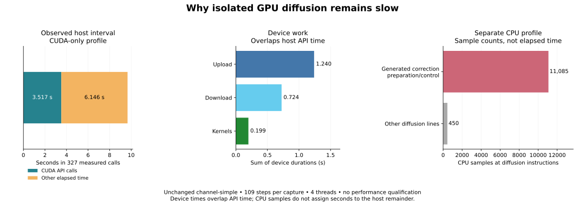

**Stop expanding isolated diffusion.** Profiling found hot host-side inspector loops, but no optimization or application speedup has been demonstrated. Automatic placement and both primary performance targets remain unfinished.

These are separate **full-duration, 109-step `channel-simple` diagnostics** of the existing resident diffusion observer. Both the CUDA profile and CPU sampling run passed the existing VTK comparison. Profiling changes execution cost: these timings are **not performance qualification**, calibration, or evidence that either primary target passed.

The CUDA-only profile recorded 327 complete owner-call intervals. Every CUDA API call was on one host thread, with nonoverlapping API intervals entirely inside those owner intervals.

| Host interval accounting | Count | Seconds |
|---|---:|---:|
| Complete owner calls | 327 | 9.662685664 |
| CUDA API calls within them | 20,611 | 3.517038004 |
| Remaining host, wait and profiler time | — | 6.145647660 |

The remainder is **unattributed elapsed time**, not a measurement of inspector time. It can include native work, inspection, synchronization, waiting and profiler overhead.

| Device activity | Events | Bytes transferred | Summed seconds |
|---|---:|---:|---:|
| Kernels | 981 | — | 0.198658290 |
| Host → device | 7,848 | 9,987,009,024 | 1.239542680 |
| Device → host | 2,943 | 4,093,181,952 | 0.724375602 |

**Device durations overlap host API intervals. Do not add these tables together.** The transfer total remains about 13.113 GiB across the observed calls.

The separate CPU profile contained 11,535 samples at diffusion instructions; 11,085 mapped to generated correction preparation/control. Its twelve largest source hotspots were exact-rectangle insertion loops in the generated native-access inspectors. This confirms a concrete hot path; sampling does not assign the entire host remainder to it or predict the benefit of a rewrite.

The [next-step decision and joint blocker map](next-step.md) records the limits of this experiment and the requirements for a useful automatic producer-to-accumulation interval. The [prior owner-measurement report](../owner-measurement-checkpoint-20261015/README.md) supplies the observer context. Neither report qualifies `channel`, nor replaces the required fresh controls and seven-round campaign.

**Reproduction identities:** the tested binary was built from compiler `dd8ea33` and pipeline `b9418a9`; profiling used compiler tree `91ed590` (a report-only HEAD) with the same pipeline. Binary SHA256: `055edd942a5c798970172e025621aaddfb0c679f7ddaca35ed84ebce8a7d47ef`. See [the machine-readable report and evidence bindings](report.json).

The [analysis script](analyze.py) checks capture/binary hashes, completion, field checks, call containment and sample-to-source mapping. It archives API intervals, source snapshots and sampling extracts. Raw Nsight captures remain at their hash-bound local result paths. Replay reproduced the archived evidence and figures byte for byte. This slice changes reports only; it does not claim another compiler test-suite run.
