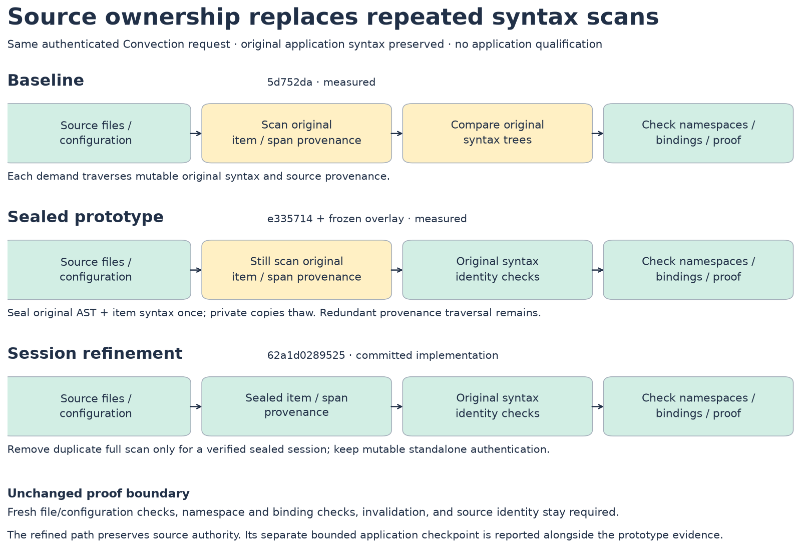
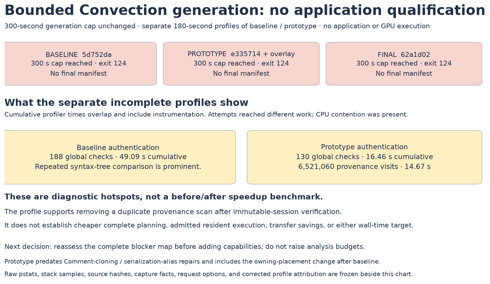

# Source-session authentication checkpoint — 2026-10-14

**All three bounded Convection generation attempts reached the same 300-second cap without a final manifest, including the final committed source-session implementation.** The profiles identify repeated source authentication as a planning cost. The sealed-syntax prototype removes repeated mutable-tree comparisons in its design, but it still traverses original source provenance on each global check. The final session commit removes that duplicate traversal while retaining fresh external authority checks, but it still does not complete this application request within the bound. Adding more kernel capabilities is not justified by these results.

This report contains generation diagnostics. It establishes no application execution, automatic placement, transfer saving, numerical validation, or wall-time improvement. Both primary application targets remain unqualified.

## Frozen attempts

| Attempt | Compiler identity | Pipeline identity | Unprofiled outcome |
|---|---|---|---|
| Baseline | `5d752da1bf88c235b29c1c2cca11c79d8c50ed13` | `3c799dc0d266abf6aa6eb0d4b3ce39234cd80bcd` | 300-second cap, exit 124, no manifest |
| Sealed prototype | `e335714c86e2f36730e91cbe0a416f2d1b22447d` plus four source-hashed overlay files | `3c799dc0d266abf6aa6eb0d4b3ce39234cd80bcd` | 300-second cap, exit 124, no manifest |
| Final committed session | `62a1d028952561c4c1dd7d0c51d91c9d060f571f` | `0876bf8c10660f474509d73af8d335d5798709d1` | 300-second cap, exit 124, no manifest; affinity `4,5,10,11` |

The public pipeline request is `dynamics::convection` with `gpu_policy=sections`, `scope_transfers=direct`, `scope_execution=reached`, and four host threads. It uses the actual 69 pinned application source inputs, original advection declarations, captured-resource facts rebound to those source hashes, and a verified analysis-source export. The captured facts retain their earlier experiment's field/section assertions; an incomplete generation does not prove those assertions sufficient for a complete application path. This is a forced diagnostic request, not an automatic-placement result.

The source inputs, capture facts, entry, options, and analysis-source reference are equal across all three requests. [Baseline request](evidence/baseline/request.json) and [prototype request](evidence/sealed-prototype/request.json) retain the exact data, hashes, and original paths. The prototype request also inventories every frozen compiler file and its four overlay hashes. The prototype includes the owning-placement commit made after the baseline; it predates later Comment-cloning and serialization-alias compatibility repairs.

Separate cProfile invocations used a 180-second internal alarm, with stack traces every 30 seconds and profile flushing on termination. The outer profile cap was 210 seconds; both inner alarms fired. All cumulative times include profiling overhead, overlap with callees, and represent incomplete runs under concurrent CPU activity. They cannot be subtracted into an end-to-end speedup.

| Profile observation | Baseline | Sealed prototype |
|---|---:|---:|
| Global authentication calls | 188 | 130 |
| Global authentication cumulative time | 49.0885 s | 16.4588 s |
| Syntax checkpoint calls, including initial validation | 61,300 | 16,110 |
| Syntax checkpoint cumulative time | 40.7042 s | 3.1496 s |
| Prototype provenance-generator visits | — | 6,521,060 |
| Prototype provenance-generator cumulative time | — | 14.6740 s |

**Profile attribution correction:** the historical comparison JSON contains an `unchanged` entry with 41,640 calls and 0.054332 seconds. That function is `_Sequence.unchanged`, not isolated post-seal identity checking. `_SyntaxCheckpoint.unchanged` is the 16,110-call entry at line 237 and includes initial seal validation. The aggregate profile cannot isolate post-seal timing. The original comparison is retained unchanged for audit; the corrected values above come directly from the frozen pstats files.

## Architecture boundary

The proposed refinement freezes original AST and source-item syntax for a compilation session. Private copies become mutable lowering projections. Fresh source-file/configuration, namespace, binding, proof identity, and invalidation checks remain required. Only the original-item/span scan that duplicates verified immutable syntax may be skipped for a sealed session. Mutable standalone users retain their full authentication path.

The final refinement is committed as `62a1d028952561c4c1dd7d0c51d91c9d060f571f`, paired with pipeline `0876bf8c10660f474509d73af8d335d5798709d1`. [report.json](report.json) binds it separately from the measured prototype. The final bounded generation attempt used these frozen commits with affinity `4,5,10,11`, the unchanged 300-second cap, and the same 3 GiB virtual-memory limit. It timed out with exit 124, emitted only the capture JSON, and produced no final manifest or CUDA artifacts. [Its exact request](evidence/final/request.json), [launch receipt](evidence/final/launch.json), and [terminal result](evidence/final/result.json) are frozen here. No further profiling or increased-budget run was performed.

The bounded application gate remains unmet after the complete immutable-session cluster. Stop this prerequisite chain and reassess the complete blocker map or select a smaller useful interval before adding capabilities. Do not raise the analysis budget. The three terminal outcomes do not provide an end-to-end planning-speed comparison.

## Validation scope

The final implementation's host receipts record **163 passed / 11 deselected** and a focused **80 passed**. These are the supplied affected-host checkpoints, not an assertion that every required application or CUDA qualification suite has completed. [The validation record](validation/record.json) preserves both logs and hashes.

An earlier source revision passed **59 CUDA tests**. Its source inventory and post-run verification are preserved. It includes the serialization-state alias fix, but predates final mutable-copy/restorer and provenance-scan changes; it is distinct from the earlier measured four-file prototype. It is explicitly **not final-revision CUDA validation**. The only file observed changing during that earlier run was pytest's nodeids cache.

## Application-source distinction

The earlier six `INTENT(OUT)` → `INTENT(INOUT)` advection edits do not represent one common blocker for both cases. [The source audit](advection-definition-audit.md) distinguishes the active second-order undefined-entry reads in `channel-simple` from the valid locally initialized fourth-order path in `channel`. The actual application sources and configurations remain unchanged. A separate private object-code comparison for the six proposed declaration corrections is preserved as an **unapplied reviewable option**; it does not establish caller, full-build, or application equivalence.

## Reproduction and evidence

Run `python benchmarks/reports/source-session-20261014/render.py` from a checkout with matplotlib installed to regenerate the figures from frozen evidence. The renderer does not invoke the compiler or either application.

[Profile evidence](evidence/profile-evidence.json) binds selected counts to raw [baseline pstats](evidence/baseline/profile/profile.pstats) and [prototype pstats](evidence/sealed-prototype/profile/profile.pstats). Each attempt also preserves stack samples, termination receipts, request and result files, original helpers, and relevant source snapshots. [The application-source inventory](evidence/application-source-inventory.json) authenticates the original source and configuration excerpts used in the definition audit. No binary or calibration identity exists for these attempts because none emitted a manifest or built an application.
