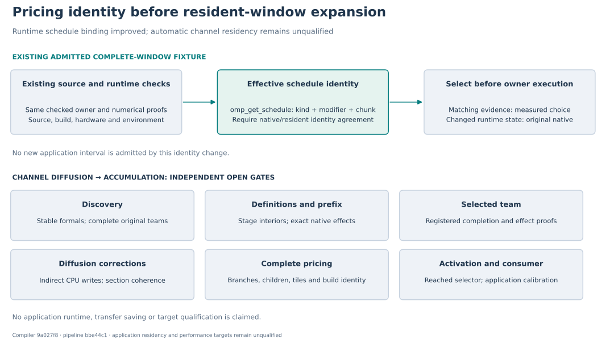

# Diffusion suffix: joint correctness and pricing preflight

**Neither channel case has an executable automatic resident suffix at this checkpoint.** The joint review found independent discovery, source-proof and calibration gaps before any kernel expansion. The unchanged whole-Convection experiment remains stopped.

The candidate retains the original diffusion branch and the complete following accumulation team. Advection, filtering, forces, prefix wall-model calls and stage initialization remain native in their original positions. This report does not admit that interval or claim transfer savings.

| Gate | Current finding |
|---|---|
| Discover a complete interval | Discovery only triggers for unstable allocatable formals or selected-window module facts. Ordinary stable array formals do not trigger it. Its raw statement windows also need to preserve complete OpenMP teams. |
| Prove the prefix and selected team | Planned reached owners support joined teams in the native prefix and mapped children, but explicitly reject a selected top-level team. An unsupported unconditional prefix permanently disables activation. |
| Preserve definitions | `U2/V2/W2` lose prior definition at their `INTENT(OUT)` entry. Stage-dependent initialization must establish their actual interior sections; it cannot establish whole-array halos by assertion. |
| Retain native corrections | The diffusion team interleaves its three tiled component loops with indirect CPU wall corrections. Their effects, completion and section traffic remain required. |
| Price the same interval | Complete-window pricing excludes reached bindings, child owners, branches/calls, tiles/helpers and module storage. Its independent calibration producer is fixture-specific. The application pipeline rejects that experimental contract. |
| Select at activation | The reached owner overrides lexical control emission and does not emit the complete-window selector. Removing the pricing admission checks alone would suppress ordinary estimates without inserting that selector. |

The probe uses the previously frozen, repaired ELMM seed and the common unspecialized source request shared by both channel cases. The six audited `OUT → INOUT` declaration repairs and case configurations are unchanged. This is not two independently executed configuration paths; the [probe receipt](evidence/probe/probe-receipt.json) records the 178-input binding and its post-run verification limits.

The focused source probe completed within its unchanged 60-second cap. It proved the accumulation team's joined completion, but both the accumulation-definition check and the diffusion-branch prefix check rejected the native section analysis. That analyzer requires assumed-shape array dummies; `beta` and `rho` are explicit-shape `dimension(1:3)` formals. No selected owner or generated manifest resulted.

These findings rule out a discovery-only patch or deletion of the pricing restrictions. Suffix-admission patches stop at this joint preflight; the known gaps must be addressed as one interval design before another application checkpoint. The next resident implementation needs one coherent interval contract across selection, native-prefix definitions, original-team completion, measured costs and selector emission at the original activation point.

This slice addresses one concrete pricing prerequisite: **effective OpenMP scheduling state**. `OMP_SCHEDULE` environment text does not identify a schedule changed through `omp_set_schedule`. The updated measurement and selector contract records the effective kind, modifier bits and chunk returned by `omp_get_schedule`, and compares that state before choosing the resident alternative. The native observations use the same identity. A standalone ABI probe found that the tested GNU Fortran 15 wrapper returns kind `1` when the C API reports monotonic-static `0x80000001`; native calibration therefore calls the C API through an explicit binding before the timed interval. The [probe receipt](evidence/abi-probe/receipt.json) preserves the source, output and toolchain identities. Older evidence must be recalibrated; the interval restrictions above remain intact. The current complete-owner admission excludes calls that could change scheduling state inside the interval. Future native interruptions need their own lifetime proof or a check at a safe activation point.

The runtime tests use synthetic profitable observations only to exercise selection guards. They are not measured performance evidence. Matching runtime state may select the existing admitted fixture; a changed schedule or chunk with identical environment text must select native before GPU work. Complete float64 fixture fields and zero GPU traffic on rejection are checked separately from placement.

Both application targets remain open: `channel-simple` below 9 seconds and `channel` at most 74.4% of fresh native while beating SGS direct. No application binary, application field validation, complete transfer ledger or qualification campaign was produced by this preflight. The original wall-model and filtering configurations remain required.

The compiler change is committed as `9a027f87ac58a5a8132eaa57ac6db93722deb038`, paired with pipeline consumer tests at `bbe44c1151ac90e0122df91022cceff9d4a48428`. Final focused validation passed **99 host/native tests**, **one CUDA test covering matching and three rejected schedule states**, and **53 pipeline consumer tests**. Full compiler/CUDA suites and application qualification were not run for this slice. The earlier CUDA file recorded two passes and one fixture compile failure; its corrected diagnostic exposed the Fortran wrapper issue. Both failures and the final passing runs are preserved separately.

Exact probe outcomes, tested revisions, validation counts and artifact hashes are recorded in [report.json](report.json). Earlier application inputs and the stopped approach are documented in the [previous blocker map](../checked-execution-plan-20261014/blocker-map.md).
