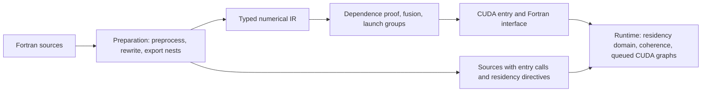

# Fortran-to-CUDA compiler

The compiler turns the loop nests of selected Fortran procedures into CUDA
kernels and keeps the arrays they use on the device for as long as the
application says. It lowers a procedure into an immutable computation IR,
checks types and definite definitions, proves with `islpy` that the iterations
of a nest are independent, fuses and groups nests where that stays provable,
and emits a CUDA entry with a Fortran interface. Nothing runs on the device
that the analysis did not prove; a nest it cannot prove stays the original
Fortran.

There are two ways in:

- **A resident build of an application** (`compiler.resident`). A project
  description names the application's sources and the procedures whose nests
  become entries. The preparation rewrites those sources so that each compiled
  nest is called while a residency domain is active and the original statements
  run otherwise, and builds a native and a resident executable. This is the
  production path; see "Resident build of an application".
- **One kernel entry** (`python -m compiler --input file.f90 --kernel name`).
  It compiles one procedure into `shared_entry.cu` and `shared_interface.f90`
  for a caller that owns the residency domain itself.

Generated numerical code publishes a versioned `numerical_contract` in the
public JSON `build_sources` and the runtime descriptors. The
`separate-arithmetic-v1` contract requires CUDA `--fmad=false --ftz=false
--prec-div=true --prec-sqrt=true` and host C++ `-ffp-contract=off`; NVCC receives
the host requirement through `-Xcompiler`. Consumers must apply these options
and record the actual command. Original native Fortran flags remain unchanged.
The contract does not promise bitwise agreement for all arithmetic, authorize
IEEE flag observers, or change numerical tolerances.

Dynamic floating division uses a device fast path when the divisor is a normal
power of two with a normal, exactly representable reciprocal and the numerator
is finite. One multiplication then produces the same rounded result as the
original division. Other values keep ordinary division; no reciprocal
approximation or arithmetic reassociation is introduced.



Proved scalar motion and loop fusion are enabled by default. Equal rectangular
loop domains fuse only when fresh dependence analysis proves the combined region
independent; inconclusive candidates keep their original passes. A rectangular
perfect prefix maps to parallel iterations; its remaining ordered body can contain
assignments, conditionals, and sequential inner loops. `--opt-level 0` retains the
source regions, source indexing, and source axis order unless overridden by
`--indexing` or `--schedule`. Automatic axis ordering favors Fortran locality.
Parallelization is strict: a region whose independence is unproved is an
error.

## Implementation layout

```text
compiler/
├── driver/                  Command line, one-entry compilation, options
├── frontend/                Fortran parsing, lowering, and the source analysis the export uses
├── ir/                      Immutable computation nodes and execution plans
├── analysis/                Semantics, effects, dependence proofs, array sections
├── transforms/              Checked scalar motion and loop fusion
├── scheduling/              Axis ordering
├── addressing/              Static integer ranges and proved subscript widths
├── offload/                 Footprints of a region and what a launch needs prepared
├── scopes/                  Extraction of loop nests into entries and their calls
├── resident/                Resident build of an application: preparation, rewrites, directives, CMake
├── runtime/                 Residency domain, coherence, budgeted device memory, CUDA graphs
├── emission/                CUDA entries, kernels and launches; the Fortran interface
└── tests/                   Python, native and CUDA tests
```

The frontend and analyzer depend on the IR. Emitters consume the IR and checked
plans without importing fparser or ISL. Package entry points are
`compiler.frontend.lower_file`, `compiler.analysis.build_execution_plan`,
`compiler.emission.generate_sources` and
`compiler.driver.pipeline.prepare_function(function, *, options=CompilerOptions())`,
which returns the optimized function and its checked plan with schedules and
addressing decisions.

## Command line

```bash
python -m compiler --input input.f90 --kernel advance --json --output-dir out/advance
```

writes `shared_entry.cu`, `shared_interface.f90`, the common header and the
runtime sources; compile the sources listed in `build_sources` with each one's
numerical contract and link the runtime once. The entry takes buffer handles
from its caller and always runs its regions on the device, falling back to its
generated host loops only when the device budget cannot hold a region's arrays.
`--list-candidates` reports which procedures of a file compile, and
`--emit-scoped-runtime` writes the runtime alone. `--opt-level`, `--schedule`,
`--indexing`, `--host-threads`, `--verbose` and the
header options shape the entry. Output is published only after every stage
succeeded.

## Shared residency runtime

### Shared memory runtime foundation

Export the independently compiled runtime and its versioned manifest:

```bash
python -m compiler --emit-scoped-runtime --json --output-dir out/scoped
```

The output contains `scoped_runtime.h`, `scoped_entry.hpp`, `section_copy.hpp`,
`scoped_regions.hpp`, `scoped_cuda_resources.hpp`,
`scoped_runtime.cu`, `fort_scoped_memory.f90`, and `scoped-runtime.json`. Compile and link the CUDA
runtime once per executable with host OpenMP support (`-Xcompiler=-fopenmp`) and compile the common Fortran interface before its
users. The manifest identifies the ABI, source hashes, source languages, and
build ordering. No input procedure is required for this operation.

Completed GPU scopes can reuse one idle stream and CUDA memory pool per device.
Idle pools retain at most 64 MiB; the runtime explicitly trims and checks the
reserved capacity, discarding resources if the driver cannot meet that limit.
Only physical execution resources survive: buffer registrations, definitions
and freshness are rebuilt for every invocation. Poisoned or incomplete scopes
never enter this cache. `FORT_RUNTIME_TRACE=1` reports `initialize_reuse` with the
retained byte capacity; the allocation counters count logical field
allocations. The cache is lazy, so native-only execution does not query CUDA.
At scope close, stream-ordered pools queue final field downloads and field/scratch
retirement before one completion wait. Native access hooks and unregister still
publish synchronously; devices without memory-pool support retain the original
synchronous allocator path.

The public C/Fortran API provides explicit contexts, canonical buffer handles,
host/device access begin/end, completion, and close. Buffers borrow stable
contiguous host allocations; host storage must remain valid until unregister or
close. Registrations use explicit identities and allocation generations, validate
layouts, and reject independently registered overlapping storage. Sections use
zero-based physical coordinates with exclusive upper bounds. Access descriptors
separate reads, possible writes, and proven overwrites.
After bounded union and subtraction, adjacent rectangles merge only when their
union is itself a rectangle. This reduces copy submissions without adding cells
or filling holes. The 32-rectangle and 1,024-intersection limits remain in force.

`fort_scope_register_sections` accepts partially initialized host coverage.
`fort_scope_forget_definition` clears semantic definition coverage while
retaining physical versions and device storage. Publishing already executed
writes remains possible after a semantic definition change. Exact body writes
define new values; an ordinary intrinsic numeric OUT declaration does not by
itself erase incoming physical or already established definition coverage in a
graph owner.
Neither re-registering a pointer nor keeping its allocation defines its contents.
`fort_scope_set_device_budget` limits live full-layout fields and cached scratch
payload bytes; set
it before CUDA initialization. A grouped reservation pins every buffer required
by the task, evicts older unrequested allocations as necessary, and publishes
only dirty device sections before eviction. Requested buffers must fit together;
resource exhaustion before an operation starts permits native continuation,
including after earlier completed operations.

CPU reads retain device validity. CPU writes invalidate only affected sections;
GPU writes similarly invalidate host sections. On excess fragmentation, the
runtime reconciles current pieces before coarsening. Excess fragmented partial
initialization requests a boundary before execution. Contexts initialize CUDA
lazily and use one non-default stream and private pool where supported. Host
access waits for conflicting device work and pending DMA that reads a region
before a host write. Independent CPU work does not force a device wait. All-native and empty accesses initialize no CUDA resources.
Execution failures poison the context, preventing unsafe replay; abandoning a
failed context releases resources without claiming valid host results.

The command queue holds launches back so that several go to the device as one
CUDA graph, which costs the host less per launch. What is held back is work the
device is not doing, and after a host read of device values the device has
nothing else to do. The queue therefore submits itself as soon as its launches
start 2^18 device threads or more: small launches are still batched, and a
launch over a whole field goes out at once. `FORT_SCOPE_GRAPH_QUEUE_WORK` sets
another thread count (0: no limit); the fields do not depend on it.

Sections travel directly between a host array and its device copy, as the
exact rectangles an access names. Generated interfaces publish a
`configure(context)` helper that states this one transfer mode through
`fort_scope_set_transfers`.

Emit a numerical entry that borrows common buffer handles:

```bash
python -m compiler --input input.f90 --kernel advance --json --output-dir out/scoped-entry
```

Scoped numerical generation publishes artifact schema 2: `shared_entry.cu`,
`shared_interface.f90`, the common header, and runtime artifacts. Its JSON lists
only the shared-entry and common-runtime build sources, including argument order,
array types and execution modes. It does not generate an additional ordinary
CUDA/C++ backend, owned-session interface, or ordinary fallback query.
Consumers take the files from `build_sources` rather than by globbing the
directory.

Shared numerical entry ABI version 2 accepts scalar pointers through its C
interface, with matching Fortran reference arguments. Binding those references
does not read their values. A scalar used only behind a conditional or possibly
empty retained loop keeps that worker native, preserving the original protection
before CUDA would capture its value. Other safe workers in the same entry can
still execute on the GPU. Public `region_execution` metadata explains each such
choice; the common memory runtime remains ABI version 1.
Protected CPU reads retain their original guards under host optimization. If a
physical section offset also uses a protected scalar, its native access uses
conservative whole-resource effects without evaluating that offset early.

Independently generated entries link one common runtime and borrow handles
registered by their caller. They take read-only scalar parameters and are called
from one serial caller. The additive [scratch ABI](runtime/SCOPED_SCRATCH_ABI.md)
supplies one reusable, context-owned device arena for a library that works on
the domain's stream, as a device solver does.

### Resident build of an application

`compiler.resident` builds a whole Fortran application so that the loop nests
of selected procedures run on the device and their arrays stay there between
calls. The application is described, not adapted by hand:

```python
from compiler.resident.project import ResidentProject, Selection, prepare
from compiler.resident.build import build

project = ResidentProject(
    sources=(src / "params.f90", src / "fields.f90", src / "boundaries.f90",
             src / "stepper.f90", src / "diagnostics.f90", src / "main.f90"),
    selections=(Selection("step", ("stepper::diffuse", "stepper::store"), minimum_nests=2),
                Selection("halo", ("boundaries::*",))),
    defines=("DOUBLE",))
prepared = prepare(project, out / "prepared", fortran="gfortran")
build(prepared, out / "built", name="box", programs={"box": src / "main.f90"},
      fortran="gfortran", cxx="g++-14", nvcc="nvcc", architecture="86")
```

A selection names procedures as `module::name` or by a glob over such names.
An internal procedure is `module::host::name`, an external procedure (one
that stands in no module) is `$external::name`, and a main program is
`$program::name`, given exactly. The arrays of a main program live as long as
the run, like a module's. The array dummies of an external procedure are bound
as they are passed: they get no `TARGET` attribute, which its callers could
not learn without an interface.

`prepare` preprocesses the sources, removes OpenMP directives inside the
selected procedures (one serial caller dispatches their nests), exports and
compiles the entries, replaces each compiled nest by a call that runs while
the domain is active and keeps the original loops for when it is not, and
writes the changed sources. An entry is not called where none of its nests
has an iteration: there is then nothing to bind and nothing to launch. A nest
the compiler rejects stays host code and gets the access to its arrays that
any host statement gets (see below). `minimum_nests` makes lost coverage an
error.
`build` generates a CMake project that compiles the application twice, from
the original sources (`box-native`) and from the prepared ones with the entries
and the runtime (`box`), both with the compiler's numerical options.

What the loop nests cannot tell the compiler is said with residency
directives. They are comments, so the same source still builds natively:

| Directive | Effect |
|---|---|
| `!$fort enter [budget(<bytes>)] [if(<condition>)] [device(<n>)]` | Start keeping values on the device, unless that is already the case |
| `!$fort leave` | Bring every value back to the host and stop |
| `!$fort close` | Also free the device state; run it before the arrays are deallocated |
| `!$fort publish [if(<condition>)]` | Bring every value back and forget the device copies, before host code whose accesses are not known |
| `!$fort observe(<arrays>) [if(<condition>)]` | Bring the named arrays back and keep their device copies, for host code that reads them |
| `!$fort release(<arrays>)` | Retire a temporary's device copy before the temporary is deallocated |
| `!$fort active(<logical>)` | Set the variable to whether values are on the device now |
| `!$fort host` | Inside a loop nest: the nest is host code that takes care of its own access; it is neither compiled nor reported |
| `!$fort reduction(<op>: <scalars>) [private(<scalars>)]` | Before a loop nest: the scalars only accumulate there, in any order (see below) |

Without `budget` the domain may use what the device has free when the first
epoch starts, less a reserve of one sixteenth of the device (at least 512 MiB)
for what the driver and libraries allocate themselves. Arrays take device
memory when an entry first uses them; when the budget is reached the least
recently used ones move back to the host. `FORT_RESIDENT_DEVICE_BUDGET` (bytes,
or a count with `K`, `M` or `G`) replaces the derived value, for a device shared
with other work. A `budget` clause is for an application that knows its limit;
it takes precedence over both. `domain%unclaimed()` is the part of the budget
nothing claims at that moment: the cap to hand a library that sizes its own
device workspace.

A directive between two nests ends their shared entry, and a nest with a
directive inside it is left to the host. An application that cannot carry
directives in its own source passes `edit(texts)` to the project: it gets
every source after the entry calls are in place, returns the ones it changed
and may add new ones. An application with residency state of its own (a
device solver, persistent work arrays) names its domain object with
`ResidentDomain`, and lists in `held` the arrays its domain binds itself, which
entries then take by handle; the default domain is the runtime's
`fort_resident_application` module. `rewrites` applies the compiler's loop
rewrites, or the application's own functions, to a source before export.

Forms beyond plain array loops that are supported in selected procedures:

- **Loops that only accumulate scalars.** A nest such as

  ```fortran
  do k = 1, nz
    do j = 1, ny
      do i = 1, nx
        p = abs(u(i,j,k)) / dx
        fastest = max(fastest, p)
        if (v(i,j,k) > 0) cells = cells + 1
      end do
    end do
  end do
  ```

  leaves nothing in any array, so it cannot be an entry as it stands. The
  preparation rewrites it (`compiler.resident.reductions`): up to 65536 device
  threads each take every 65536th iteration, in source order, and store what
  they accumulate; a second nest folds those partial results into 256 values;
  the host brings the 256 values back and folds them into the variables. Only
  those values cross to the host, the arrays stay where they are, and the
  original nest remains for the time values are not on the device. Recognized
  are `s = s + x`, `s = s - x`, `s = max(s, x)`, `s = min(s, x)`, `s = s .or. x`,
  `s = s .and. x` and the assignment of a logical constant, on scalar REAL,
  default INTEGER and default LOGICAL variables that the nest uses in no other
  way, under any conditions and inner loops; the procedure may be a function
  whose result is accumulated. Maximum, minimum, integer sums and logical
  accumulation do not depend on the order, so such nests are rewritten wherever
  they are found. A sum of reals does: it is rewritten only where the source
  says the order is free, with an OpenMP `reduction` clause on the loop or with
  `!$fort reduction(+: s)` before it. The device order is fixed, so a run
  repeats its sums exactly; they differ in rounding from a serial host sum.
  A scalar the nest assigns without accumulating it is computed in a copy. It
  must therefore be local to the procedure and not be named after the nest,
  or be listed in a `private` clause of the OpenMP directive or of the
  `reduction` directive. `prepared.json` lists every such nest under
  `reductions`, with `compiled` or the `reason` it stays on the host. A nest
  that also writes array elements, calls a subroutine, has more iterations
  than a default integer counts, or whose rewritten form the compiler rejects,
  stays on the host; in the last two cases the device values are published
  first, which costs a full download each time the nest is reached.

- **Array assignments.** An assignment to an array section inside a loop is
  part of the loop's nest: each section is a further loop dimension, and a
  section of a known small extent is assigned from a snapshot of the right-hand
  side, as the statement requires. An array assignment outside every loop,
  such as `total = total + field(1:nx,1:ny,1:nz) * weight`, is written as its
  loop nest by the preparation (`compiler.resident.array_statements`) when the
  nest repeats it exactly: every name is declared in the same file, no array
  is a pointer, the assigned array appears on the right only as the same
  elements, the right-hand side uses operators and elemental intrinsics, and
  an allocatable array assigned as a whole keeps its shape. Working arrays of
  a procedure (its own arrays without `ALLOCATABLE`, `SAVE` or `TARGET`) are
  left alone. `prepared.json` lists the statements
  under `array_statements`, `lowered` or with the `reason` they stay. A nest
  that does not compile runs on the host like the statement it came from,
  with the access to its arrays that any host statement gets.

- **Arrays of any declared shape but one.** The arrays of a nest may be
  assumed-shape or explicit-shape dummies (with constant or run-time lower
  bounds), allocatable dummies, and module arrays; the entry gets their
  bounds at each call. An assumed-size array (`a(*)`) has no extent the
  device copy could take, and a pointer array may share storage with another:
  nests that use either stay on the host, with that reason. An array is bound
  by its first element and its extents, and what a dummy is associated with
  is known only when the entry is called. It may be something that cannot be
  kept that way: a strided section of the caller's array, an empty array, or
  a part of an array that is kept as a whole (a plane of a field, say). The
  domain then gives no handle, and the original statements run after the
  device values are published; the first time a part of a kept array is met
  at a place, the standard error names the place and the array it is part of,
  since the statements there run on the host from then on.

- **Loops around nests.** A loop is either the outer loop of a nest or a
  loop that runs around nests: an iteration, a time loop, a sweep. It may be
  the second kind when its body holds a loop nest beside other statements, or
  one nest while its iterations may depend on each other through an array
  they assign: every iteration assigns the same elements, or the body also
  names the array at another position along the loop, as a plane that uses
  the plane before. Such a loop
  is first taken as a nest. When it cannot be
  one (it calls a procedure, carries a directive, or its iterations depend on
  each other), the nests in its body are tried in its place. Where one of
  them compiles, the host runs the loop and they are entries, called once
  per iteration, and `prepared.json` lists the loop under the selection's
  `descended`; a loop with many short iterations then costs a launch for
  each. Where none compiles, the loop is rejected as a whole, with the
  reasons of what it holds under `inside`, and its arrays go to the host
  once. Nests that share an entry are tried one by one in the same way when
  the entry does not compile: one of them may be all that stands in the way
  of the others. An array
  assignment in such a body is written as its nest like one outside every
  loop. A nest in such a body that only accumulates scalars is rewritten only
  where an OpenMP `reduction` clause or `!$fort reduction` marks it, whatever
  it accumulates: unmarked, it may be the private accumulation of each
  iteration of a nest.

- **Nests that are independent for some values of their scalars.** Whether two
  iterations of a nest touch the same element can depend on integer values
  the nest starts with: a halo copy whose two sides meet in a grid of one
  cell, a nest that reads one level of an array and writes another where the
  two levels are scalars. The dependence analysis says for which values
  iterations conflict; where that leaves values for which they do not, the
  nest is compiled for those, and its entry checks the condition before it
  does anything. Called with other values it declines, and the caller runs
  the original statements after the device values are published. A subscript
  that is not affine but does not change while the nest runs, such as
  `mod(step, 2) + 1`, counts as one such value. A condition that would only
  say that one of the nest's loops has a single iteration is not used: such
  a nest is rejected, or its outer loop is left to the host. The report of an
  entry lists its `conditions`.

- **Scalars that only a branch reads.** A scalar that only a branch of a nest
  reads may be undefined where no iteration takes the branch. An INTEGER or
  REAL variable that is always there (a local, a dummy argument, a module
  variable) is passed by value all the same: reading it at the call loads a
  value that nothing uses. An allocatable scalar may not be there, so an
  entry gets it by reference and reads it only where the original statements
  would; a nest in which only a branch reads one stays on the host.

- **Loop variables that are read after their loop.** The host variable of a
  compiled nest keeps its old value, so the entry call is followed by the
  nest's loops without their statements when a later statement reads one of
  its DO variables. A nest whose other scalars are read later stays on the
  host.

- **Fields of an array of derived type.** A nest may read and write
  `points(i)%field` for a rank-one array of derived type and a scalar REAL or
  default INTEGER field. Each field used is one array resource. Its values are
  strided through the structures, so the domain keeps a contiguous copy
  (`bind_field`), gathered when the field is first bound and written back to
  the structures at the next publication or `!$fort observe(points(:)%field)`.
  Nests over different lists get entries of their own.
- **Elements that are one value for a nest.** A table of coefficients read as
  `rho(stage)`, where the nests do not change `stage`, is one number for the
  whole entry. The call reads it on the host and passes it; the array gets no
  place on the device and is not bound, so a named constant or an expression
  may be the actual argument behind it. This is done for an array of which
  the nests of an entry use nothing but such elements, each reached in every
  iteration, and which is not allocatable, a pointer or optional.
- **Writes through index values.** A nest such as
  `a(idx(i)) = a(idx(i)) + v(i)`, or the same with index fields of a list, is
  independent across iterations exactly when its subscripts name a different
  element each time. The compiler cannot know that, so the call block checks
  it on the host, once per publication: it walks the nest's loops and marks
  each addressed element. If an element is named twice, the device values are
  published and the original loop runs. All subscript tuples an array is
  written through, in all nests of the entry, are marked in one mask, so the
  nests are also independent of each other and nests over the same iterations
  become one launch. A tuple that is only read, or a subscript the nest
  computes itself, is rejected as before.

Branches on run-time configuration keep nests apart: each branch is an entry
of its own. When the application knows which values the configuration has
while its fields are on the device, a selection lists them in `assume`, as
comparisons `<expression> == <integer constant>`:

```python
Selection("faces", ("boundaries::apply",), assume=("kind(west) == PERIODIC", "kind(east) == PERIODIC"))
```

Each procedure of the selection then gets a second version of its body with
the branches these conditions decide folded away. The procedure tests the
conditions once at entry and runs that version while they hold and its
original body otherwise, so nothing is assumed that is not checked. The nests
that end up next to each other share an entry, and those that write different
sections of one array, such as the ghost layers of opposite faces, share a
launch. A procedure that assigns to a variable the conditions name, or passes
one to a call, is refused.

Calls keep nests apart as well: a small procedure that is called once per
field, such as a halo update, gives each call its own entries. A selection
names such procedures in `inline`:

```python
Selection("faces", ("boundaries::apply",), inline=("boundaries::corners",))
```

Each call to them from the selection's procedures is replaced by the callee's
statements (`compiler.resident.inlining`), before the assumed conditions are
folded, so the nests of the calls stand in the caller and are grouped like its
own. The replacement is text substitution and is made only where that is
exact: caller and callee are in one module; the callee has nothing but
declarations of its dummies and plain scalar locals, and statements without
RETURN; each array dummy gets a whole array declared with the same bounds;
each scalar dummy is INTENT(IN) and gets something the statements do not
change. A constant argument decides the callee's branches on it, a local that
is assigned once from unchanged values is replaced by its value, and the
callee's OpenMP directives go the way of the caller's. A call that does not
fit stays a call; `prepared.json` lists each one under `inlined`.

While an epoch lasts the host mostly runs serial code between kernels, and a
parallel region it still enters wakes the whole OpenMP team. With
`FORT_RESIDENT_HOST_THREADS=<n>` in the environment the domain narrows the
team to `n` threads when an epoch begins and restores the application's count
when it ends. The count the application starts with is left alone, because it
can decide results (a parallel random initialization does). An epoch during
which the host still does its parallel work is begun with `keep_team=.true.`.

`prepare` also gives the host statements of the selected procedures their
access to arrays on the device. A statement there that stays host code and
names an array some entry binds would read values that are newer on the
device, or change values the device then no longer has. The preparation puts
the hand-over around it:

- arrays the statement only reads are brought up to date and stay on the
  device;
- arrays it may change (an assignment target, input, an actual argument the
  called procedure does not take `INTENT(IN)`) belong to the host until the
  statement is through, and the device copy is outdated after;
- an array it deallocates is released first.

The generated block asks the domain which of the arrays it holds when the
statement runs. An array that is empty, not allocated, or that no entry has
used yet costs nothing, and a dummy that is part of a bound array stands for
that array. The access of a one-line IF is taken inside its condition, and
that of a host loop, or of several loops next to each other, only when one
of them runs at all. Where arrays cannot be
handed over one by one (a field of an array of derived type, or statements
that control can leave before the arrays are handed back) all device values
are published first. A call into host code that itself reaches selected
procedures, and a loop statement that reads an array while entries run in the
loop, end the stay on the device instead: the entries in there need the arrays
where the host statement needs them too.

Nothing is generated for a statement that a residency directive directly
precedes, or that only passes such arrays whole to procedures that are
selected themselves. A wrapper that is not selected and only passes its arrays
on counts as what it calls; a section or an expression of an array is a use,
not a hand-over; asking for an array's bounds or allocation is not a read. A
call through a type-bound procedure counts as a call of every procedure
bound under that name in the declared type of the object, in the types it
extends and in the types that extend it (in every type of the sources where
the object is a component), and an array it passes is changed only if one of
them may change it. An array that no entry keeps does not count, however the
statement uses it. A dummy array counts whatever it
is called, since the array it is associated with may be kept on the device
under another name; the generated block asks the domain when it runs.
An array of derived type counts when entries keep
one of its fields; its values come back to its elements with everything else.

A host procedure called from a selected one may use arrays it is not handed:
module arrays, or variables of the calling procedure where it is internal to
it. The call gets access to those as well, followed through the host
procedures that the called one calls in turn; an array a procedure only
passes whole to selected procedures is theirs. A module array that is not
visible at the call under its own name is brought in by a `USE` in the
generated block. Every value is published first where an array cannot be
named there (it is private to its module, or a local name hides it), and
where a call may reach a procedure of the sources that is not known: one
through a dummy procedure, or a type-bound call whose bindings are not all
found. A procedure that is not of the sources, an intrinsic or a library's,
sees only what it is handed. Where a called host procedure may deallocate a
kept array, the stay on the device ends.

`prepared["audit"]` lists the statements that got
access, each with its procedure, lines, text, arrays and `access` (`arrays`,
`publish` where every value comes back, or `leave` where the stay on the
device ends): every one is a place where
arrays may travel, so a statement that shows up in a hot path is worth
selecting or rewriting. The audit looks inside the selected procedures and
follows their calls; host code that runs while values are kept on the device
without a selected procedure calling it needs a residency directive.

A selected procedure's temporary arrays get storage that the domain lends. An
array that the procedure allocates and deallocates in each call would cost a
device allocation per call and, at its `DEALLOCATE`, a wait for everything
queued that still uses it. Where the array is a local REAL array of rank three
that entries keep on the device, with one `ALLOCATE` and one `DEALLOCATE` among
the procedure's own statements, it becomes a contiguous pointer and the two
statements ask the domain: while values are kept on the device it hands out
host and device storage that stays from call to call, one piece per place in
the source and shape; otherwise the array is allocated as before. The exchange
is made only where a pointer behaves like the allocatable did: the array is
used by its elements, sections and bounds, or passed whole to a procedure that
takes an ordinary array, and the procedure has no RETURN and no internal
procedures. `prepared["temporaries"]` lists the arrays.

`compiler/tests/apps/box` is a complete small application built this way. Its
resident run writes the same bytes as its native run
(`test_resident_application_cuda.py`).

The lower-level pieces are usable on their own:

### Resident entries for a caller-owned domain

An application that keeps its fields on the device across many calls owns a
residency domain: a Fortran object of the runtime's `resident_domain` type, or
an extension of it, that binds arrays to handles and says whether it is active.
The compiler supplies the numerical entries and the calls to them in these
steps, all in `compiler.scopes`:

- `resident_entries.export_resident_entries` extracts the loop nests of the
  named procedures into small entry modules. It decides the entry boundaries
  and records, for each entry, its source span, its parameters and the
  original variables they stand for. Spans it cannot extract are listed as
  rejections.
- `resident_entries.pass_scalars_by_value` rewrites exported entries so that
  lower-bound parameters, and scalars the caller names as defined before any
  entry runs, are `VALUE` arguments.
- `resident_entries.compile_resident_entries` compiles every exported entry
  for forced device placement, in process, and writes its sources next to a
  `compiler-report.json`. An entry the compiler rejects, or one that would
  leave a region on the host, joins the rejections with its span.
  `compile_resident_entry` does the same for one entry and is what the command
  line runs for `--kernel`.
- `resident_splice.splice_resident_entries` writes each source with its
  compiled spans replaced by a block that binds the arrays through the domain
  object and calls the entry while the domain is active, and runs the original
  statements otherwise. A rejected span stays native with the access of a
  host statement around it; the caller can supply its own text for such a
  span instead. `resident_splice.addressable_arrays` adds `TARGET` to the
  arrays a domain can bind.

The caller names its domain with `ResidentDomain(module, object, check)`. It
keeps everything the compiler cannot know: which procedures to export, when
the domain is active, and the effects of native code. `compiler.runtime.
RESIDENT_SOURCES` lists the runtime translation units such an application
links, and `compiler.numerical_contract` the compile options they require.

## Supported Fortran subset

Module subroutines are selectable without annotations. A `! kernel` comment
inside a subroutine marks it for `--list-candidates`:

```fortran
! kernels
module example
  implicit none
  integer, parameter :: knd = kind(1.0d0)
contains
  ! kernel
  subroutine scale(a, factor, n)
    real(knd), intent(inout) :: a(:)
    real(knd), intent(in) :: factor
    integer, intent(in) :: n
    integer :: i
    real(knd) :: tmp
    do i = 1, n
      tmp = a(i) * factor
      a(i) = tmp
    end do
  end subroutine scale
end module example
```

- Default `integer` (signed 32-bit), default `real` (binary32), and resolved REAL kinds 4 and 8
  scalars and assumed-shape dummy arrays. Array rank and loop nesting depth
  follow native Fortran language/compiler limits.
  Integer literal tokens must fit before applying unary signs: `-2147483648`
  rejects, while `(-2147483647-1)` is valid. Constant integer operations check
  every intermediate result, including division by zero and `ABS(INT_MIN)`.
  Unknown runtime values retain the existing arithmetic and ABI.
- Explicit `intent(in/out/inout)` arrays. Omitted array intent is conservatively
  treated as `inout`; omitted scalar intent is treated as read-only input. Scalar
  entry argument writes remain unsupported. Pure numerical helpers can write
  private scalar actuals with explicit `INTENT(OUT/INOUT)`. `contiguous` and `target` are accepted;
  pointers remain unsupported.
- Counted `do` loops with positive or negative integer strides, including
  invariant runtime stride expressions. Constant zero strides reject; a runtime
  zero stride diagnoses at loop entry. Empty domains do not launch.
- Perfect and imperfect nests. The analyzer maps a rectangular perfect prefix;
  assignments and remaining inner loops execute in their original order within
  each parallel iteration. Bounds may depend on outer indices in retained loops.
  Fusion retains the ordered body of each original mapped iteration.
- Host scalar and array element assignments before, between, or after nests.
  Private temporaries must be defined before each read in the mapped iteration
  and unused after the region. Retained sequential loops may carry a scalar
  initialized within that iteration; their final induction values are available
  within the iteration too.
- Grouped arithmetic `+`, `-`, `*`, `/`, unary signs, integer/real literals,
  `SIZE(array, dimension)`, and `SIZE(array)` total element counts.
  Default real literals retain single precision; `D` exponent literals use
  binary64. Explicit kind suffixes use their declared numeric precision.
  Integer constant powers from zero through sixteen lower to ordered products.
- Affine access relations and constant-stride congruences are modeled exactly.
  Invariant non-affine bounds are captured as symbolic parameters. Unknown
  subscript coordinates are conservatively unconstrained, allowing read-only
  indirect gathers and writes whose other coordinates already distinguish
  parallel iterations. Identical squared affine subscripts, such as `a(i*i)`,
  receive a simple injectivity proof when every access shares that expression
  and its operand is proven nonnegative or nonpositive throughout the region.
- Positional whole-variable calls to same-module helpers. Inlining creates fresh
  locals per call and preserves actual storage identities and case-insensitive
  Fortran name resolution.
- Source-backed pure module/internal functions and subroutines, including lexical
  captures and scalar function results. Pure scalar input actuals may be
  expressions; pure function arguments require `INTENT(IN)`. Helper work remains
  at its original expression evaluation point, including guarded `ELSEIF` paths.
  Recursion rejects; numerical inlining is bounded to depth eight and 128 calls.
  In exported resident entries a helper's array arguments may declare constant
  lower bounds (`a(-2:,-2:,-2:)`) when the helper uses them by element; the
  copied helper addresses them from one, which is the same element of the
  actual argument.
- Fixed-size private numerical arrays with constant explicit bounds, including
  negative bounds, scalarize to independently defined scalar storage. Each array
  has at most 256 elements. Constant indexing loops are unrolled with a shared
  256-iteration budget; unknown private subscripts remain boundaries. Array
  arguments retain Fortran element-order association and dummy-bound rebasing.
  Explicit-shape helper arrays require private fixed array actuals or read-only
  fixed `PARAMETER` vectors.
- Fixed-cardinality sections with one varying axis support elementwise
  expressions, private array assignments, short serial `SUM` and `DOT_PRODUCT`.
  Captured-array section origins can depend on the mapped coordinates when the
  endpoint difference is provably constant. Each vector has at most 256 elements,
  with at most 4096 expanded elements per numerical closure. Nonzero constant
  strides and empty vectors retain Fortran order; omitted endpoints use declared
  lower/upper bounds regardless of stride. Right-hand-side values are captured
  before overlapping private-array writes, and scalar broadcasts evaluate once.
  Sums/products accumulate in logical element order from a typed zero under the
  supported native numerical contract; this grants no parallel reduction contract.
  Private `SIZE`, `LBOUND` and `UBOUND` inquiries
  preserve original bounds and empty-array semantics. Scalar real `PARAMETER`
  declarations and rank-one numeric `PARAMETER` vectors preserve typed initializer
  expressions. Outlined source regions retain a bounded closure of imported and
  lexical constants, original bounds and dependencies, without registering them
  as mutable captures or private arrays. Private `INTENT(OUT)`
  outputs require complete ordered definitions on every reached helper path.

An original rank-one numeric `PARAMETER` can also be forwarded unchanged to a
required fixed-shape `INTENT(IN)` module companion. This association keeps the
original argument and native ABI; it adds no `TARGET`, temporary, address or
device registration for the coefficient array. A serial reached perfect loop
nest may capture an invariant element as a separate typed scalar operand.
Ordered nonempty checks precede queries and operand preparation, and the value
is read from the original formal only after its original guards and a valid
index check. Empty nests execute their original source without querying or
reading dormant inner controls. Joined worksharing, uncertain indices or
activation, and unsupported associations stay native. Original array read
effects remain public, with an explicit projection for managed coherence.
When managed and immutable entities share a declaration, only the managed
entities receive `TARGET`; the original entity order and attributes are retained.

An immutable scalar `PARAMETER` whose initializer is outside the outlined
constant language can supply its original Fortran value as a read-only scalar
argument. Its canonical binding must be visible from the original numerical
owner, including through imports and renames. The compiler does not recompute
that initializer on the GPU or fold it with Python. Inaccessible helper-local
constants remain native, and array `PARAMETER` initializers still require their
complete compile-time dependency proof. Source and initializer changes invalidate
the outlined artifact identity.

Real fixed-vector work, including short `SUM` and `DOT_PRODUCT`, carries a
numerical-environment requirement: an entry diagnoses a host rounding mode
other than nearest, or enabled floating-point traps, before it does numerical
work. Source that observes IEEE exception flags stays native.

Logical arrays, writable scalar entry arguments, recursion, runtime-cardinality
slices and snapshots,
non-pure expression call arguments, other intrinsics/operators, explicit lower
dummy array bounds, and
unsupported specification statements reject with a source location.
An entry itself has no parallel reductions; a resident build rewrites loops that
only accumulate scalars before they reach this frontend (see "Resident build of
an application"). `IEEE_IS_NAN` of `IEEE_ARITHMETIC`, the intrinsic module or a
source module that stands in for it, is read as the comparison `x /= x`.
Scoped source generation has the additional proven array-operation normalization
described above; it does not make arbitrary numerical slices legal. Initialized scalar recurrences, scalar
live-outs, final induction values, and otherwise unproved regions are
rejected with the reason. General nonlinear or indirect writes
are parallelized only when conservative relations prove independence; no runtime
alias or index-uniqueness checks are introduced.

Transcendental helper tests cover both precisions, zero gradients, repeated
singular values and signed zero against native Fortran. Ill-conditioned spectral
intermediates can amplify small scalar/vector math-library rounding differences:
an independent rank-deficient diagnostic observed approximately `7.5e-9` in a
nominally zero binary64 singular value with gfortran 16.2 at `-O3` and contraction
disabled. This does not establish strict agreement for those intermediates.
Complete application field tolerances remain the acceptance criterion and are
not relaxed to admit a helper closure.

### Conditions and scalar intrinsics

Scalar `LOGICAL` values, logical literals/operators, numeric comparisons, block
and single-line `IF`, `ELSEIF`, and `ELSE` are supported. Definitions after a branch
must be valid on every path. Host branches use recursive execution plans, and
device predicates participate in conservative dependence analysis. CUDA preserves
host/device coherence when entering and leaving host branches. Logical scalar
arguments are explicitly converted to `logical(c_bool)` by the Fortran bridge.

The following intrinsics support scalar expressions in both C++ and CUDA:

- Numeric functions: `ABS`, `MIN`, `MAX`, `SQRT`, `EXP`, `LOG`, `LOG10`, `SIN`,
  `COS`, `TAN`, `ASIN`, `ACOS`, `ATAN`, `ATAN2`, `SINH`, `COSH`, `TANH`, `MOD`,
  `MODULO`, `SIGN`, and `DIM`.
- Conversions and rounding: `REAL`, `INT`, `NINT`, `FLOOR`, `CEILING`, and `DBLE`.
  `REAL` defaults to binary32 and accepts constant `KIND=4` or `KIND=8`; `DBLE`
  returns binary64. Integer results use the default signed 32-bit kind, including
  explicit `KIND=4`. `INT` truncates toward zero; `NINT` rounds ties away from zero.
- Type/model inquiries: `KIND`, `EPSILON`, `TINY`, and `HUGE`. These use the
  declared type of a scalar or whole array without reading its value. `HUGE`
  supports INTEGER and REAL; `EPSILON` and `TINY` require REAL.
- Array inquiries: `SIZE`, `LBOUND`, and `UBOUND` on whole assumed-shape dummy
  arrays, with constant or runtime INTEGER `DIM` and optional `KIND=4`. `SIZE`
  without `DIM` returns the total element count. `LBOUND` and `UBOUND` require
  `DIM` because array-valued results are unsupported. Dummy lower bounds are 1,
  and upper bounds are their extents, including 0 for an empty dimension. Runtime
  dimensions must lie within the array rank.
- Selection: `MERGE` with matching numeric or logical scalar sources and a
  logical mask.

Positional and standard keyword arguments are accepted. Numeric functions preserve
supported argument kinds and arithmetic grouping; `MIN`/`MAX` require at least
two arguments, and multi-argument numeric functions require matching types and
kinds. Transcendental functions require REAL arguments. `MOD` follows the dividend's
sign and `MODULO` follows the divisor's sign. Numeric runtime helpers evaluate each
argument once. Logical arrays, array-valued elemental calls, other result kinds,
and unlisted intrinsics remain unsupported.

Semantic validation and definite definitions live in `analysis/semantics.py`;
structural effects live in `analysis/effects.py`; `analysis/planning.py` builds
execution plans. Intrinsic signatures
live in `ir/intrinsics.py`; `runtime/numeric.hpp` is assembled into the existing
shared support header.

The optimized GNU Fortran numerical contract is checked against `gfortran-15
-O3` for both REAL kinds. Two-argument runtime `MIN`/`MAX` preserve ordered
operand selection, including signed zero. A finite leading literal uses the
separately checked constant-first form, including degenerate numerical clamps.
Unordered multi-argument forms are not covered by this contract and new helper
closures retain native execution for them. IEEE exception guards remain at
their original source locations. Scoped runtime calls save and restore the
caller thread's rounding mode, exception flags and trap mask; numerical
computation is not moved into them.

## Legality and caller contract

For each region the analyzer constructs statement iteration domains,
multidimensional read/write access maps, and the original lexical schedule. It
composes access maps to find ordered read-after-write (RAW), write-after-read
(WAR), and write-after-write (WAW) conflicts. Every conflicting pair must have
identical **mapped iteration coordinates**, including every dimension assigned
to CUDA threads. Ordered same-cell updates and recurrences inside retained
sequential loops are accepted within one mapped iteration. Conflicts between
mapped iterations are rejected. A perfect rectangular nest maps all its
dimensions; an inner recurrence in such a mapped nest is rejected.

A dependence error includes source/call provenance, affected accesses, the
symbolic conflict relation, and a conflicting-iteration witness. Embedded
single-line actions inherit their enclosing source span while retaining inline
call stacks. If unknown indices, variable-stride congruences, or branch effects
without predicate constraints widen the model, successful reports and conflict
diagnostics label the dependence model conservative. A conservative conflict
witness shows why independence could not be proved, rather than promising a
collision for every caller's runtime data.
Branch-free affine models remain exact; proofs do not split paths by predicates.
`--verbose` also displays exact/conservative modeling and retained loop counts.
Unfused regions execute in original order, honoring cross-region dependencies.

Distinct array arguments must not overlap whenever either is written. The
compiler does not perform runtime overlap checks. Repeated actual arguments in
an inlined helper retain shared identity and are analyzed as aliases. Callers
must provide valid extents and sufficient storage for every accessed index;
general bounds checking and broader Fortran semantics are outside this subset.

### Checked fusion

The pipeline first proves source regions independently. Greedy fusion then matches
equal rectangular domains with constant nonzero strides and scalar/extent-only
bounds, substituting iterator identities without regrouping expressions. Same-point
operations retain their order. Fresh analysis must prove that combining the bodies
introduces no conflicts between parallel iterations; shifted RAW, WAR, or WAW
conflicts keep the passes separate. Conservative non-affine models may prevent
fusion even when each original region is independently legal.

A temporary reused by successive passes does not prevent fusion when the
second pass's existing private-scalar proof establishes a definition before
every per-iteration read and no escaping value. The merged body is still checked
again. Carried values, live-out scalars and array dependences remain barriers.

Intervening scalar setup can move before the first pass only when its inputs are
available and unchanged and its destinations are unused by the crossed loop. Array
accesses never move. Scalar lifetimes, bound snapshots, symbol identities, and
source provenance are preserved. Fusion stays inside each host branch. Invalid
source remains a compilation error; an inconclusive optimization keeps its original
form. Verbose reports explain each applied or skipped candidate.

### Scheduling

Scheduling follows legality analysis and fusion. `RegionSchedule` records axis
order and CUDA thread count; emitters render those choices.
Automatic ordering scores unit-stride accesses in Fortran storage order, weighting
writes twice as heavily as reads. Unknown accesses receive no locality credit,
and ties keep original innermost-first order. `--schedule source` preserves that
order; either explicit schedule choice overrides the optimization-level default.

Bounds are captured in source order, with inner bounds suppressed when an outer
loop is empty. The schedule reorders ordinal coordinates and reconstructs signed
Fortran indices. Host workers and CUDA threads each take every n-th point of
the flattened domain, for any rank. Iteration products are
checked for overflow before launch, and zero factors suppress spurious overflow
errors for empty domains.

### Checked wide addressing

After scheduling, the addressing planner selects subscript arithmetic that can
use signed 64-bit loop coordinates directly. Static interval proofs must show
that every original intermediate result fits default INTEGER, including division
and integer `ABS`, `MIN`, and `MAX`. Unknown or unsafe arithmetic keeps its
existing lowering; expressions are never reassociated. This is separate from
dependence analysis and does not add runtime guards or additional kernels.

Only mapped iterator ranges are refined, using bounds and signed strides;
constant loops use their exact last executed index. Other integer values retain
the full signed 32-bit range. There is no branch-sensitive or assignment-based
refinement. Bound arithmetic without a safe range proof contributes an unknown
INTEGER snapshot. Neither array extents nor valid accesses imply tighter scalar
bounds. For example, a loop beginning at 2 with an unknown upper INTEGER bound
can use wide `i` and `i-1` subscripts, while `i+1` retains source arithmetic.

Each complete subscript is selected independently, including nested array
accesses. Shared C++/CUDA rendering consumes the plan and preserves scalar
INTEGER arithmetic, the ABI, `SIZE` conversions, and integer array-load values.
Loop-bound snapshots, retained-loop headers, and host statements remain
unchanged. Source-order bound evaluation and empty-loop
suppression are preserved. No array bounds checks are introduced.

Use `--indexing source` and `--indexing auto` with the same optimization level
and schedule to measure addressing independently. Both choices override
the optimization-level default. Plans constructed without addressing metadata
use source indexing. Verbose reports count promoted and retained subscript
occurrences and explain decisions; accesses in unchanged loop headers are excluded.

## Development and validation

```bash
python -m venv .venv
source .venv/bin/activate
python -m pip install --upgrade "pip>=25.1"
python -m pip install -r requirements.txt --group ./compiler/pyproject.toml:dev

python -m pytest compiler/tests -n auto
python -m ruff check compiler
```

`compiler/tests/conftest.py` puts the repository on the import path, so the
suite runs from any directory without `PYTHONPATH`. It needs no submodule.
`compiler/tests/support/consumer` is a second, independent reader of what the
compiler issues (the scope manifest, its build roles and the runtime's trace
lines); the tests use it as an oracle for their own output. The complete suite
builds and runs CUDA programs; with
`-n auto` (pytest-xdist) it takes several minutes on a workstation, and the
parser/analysis subset below a few minutes. The pipeline, container and
benchmark suites run the same way:

```bash
python -m pytest elmm-pipeline/tests -n auto
python -m pytest containers/tests benchmarks/tests
```

Tests cover lowering, source ordering, inline aliases, scalar lifetimes, ISL
relations against brute-force ordered accesses, rejection without publication,
and deterministic generation. Fusion tests cover scalar motion, shifted conflicts,
unequal domains, conservative accesses, branch boundaries, and signed-stride small
domains compared with source execution. Scheduling tests execute serial/OpenMP
and simulated CUDA coordinate maps for signed strides
and arbitrary rank; CUDA launches are also compiled with nvcc when available.
Native tests exercise both optimization
levels and compile and compare original Fortran
and generated CUDA using deterministic nonuniform inputs and
absolute tolerance `1e-10` for real values and exact comparison for integers.
Coverage includes fill/scale, non-cubic/singleton/empty domains, sentinel halos,
CDU/CDV/CDW, signed/runtime strides, rank-5 integer arrays, rank-15 bridge
compilation, imperfect nests, fresh host/device values, indirect gathers,
squared indices, and default-real arithmetic. Rejection tests cover recurrences,
scalar live-outs and conflicts between iterations, apart from invalid source.
Runtime tests also check CPU ownership, selective host/device coherence, pinned
registration lifetimes, stale tokens, shape/size errors, and profiling events with
instrumented CUDA calls.
Native compiler absence skips the corresponding capability;
CUDA compilation requires `nvcc`, and execution also requires a usable device. Once
those capabilities are available, build or runtime failures fail the tests. All builds and outputs use temporary directories.

```bash
# Parser/analysis checks without native builds:
python -m pytest compiler/tests -m "not native and not cuda"

# The resident build of the small test application, without a GPU:
python -m pytest compiler/tests/test_resident_application.py
```

Shared numerical fixtures live in `tests/support/`. Read-only generated-source
checks may reuse immutable source text and serialized manifests. CUDA fixtures
reuse the original driver and strict arithmetic checks through
`tests/support/numerical_cuda.py`.
